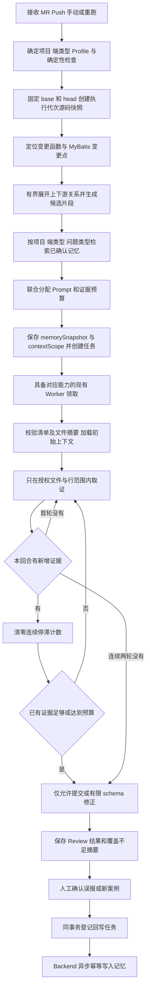
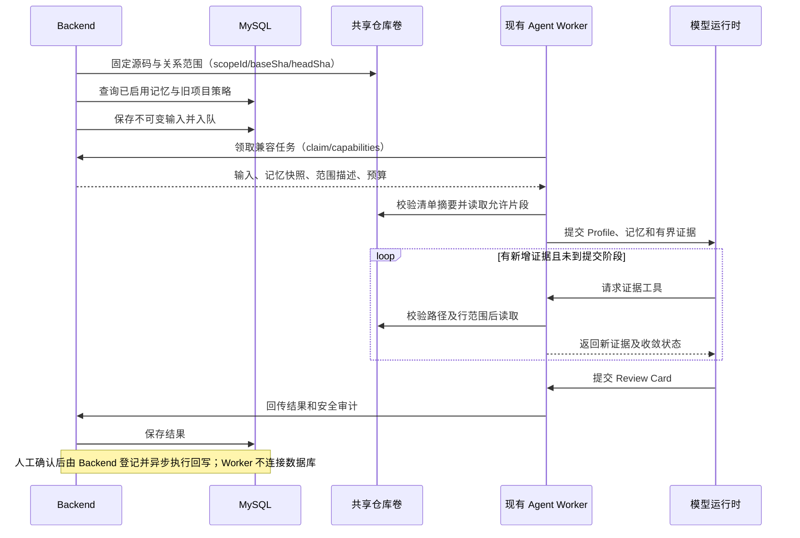
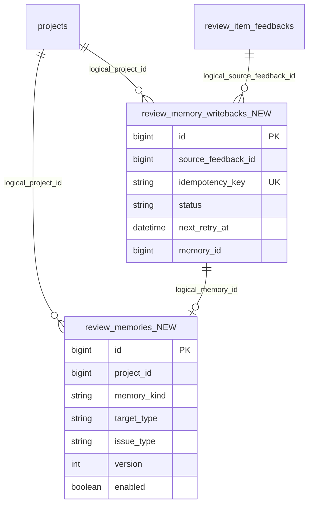

# 单 Agent Review 记忆、调用图裁剪与证据早停后端概要设计

## 0. 状态、结论与成本

- 日期：2026-11-11。
- 状态：评估与设计稿；未实现、未迁移、未部署。
- 依据：当前工作树（HEAD `129b9ef`）及现有模型、迁移、调用点、容器配置；未查询运行环境数据库与真实任务指标。
- 已确认：首批调用图覆盖 **Java / MyBatis**；其它端使用下文明确的有界降级，不宣称已支持精确调用图。
- 当前授权：完成三项能力成本评估、流程设计、容器接入与阶段划分；本轮到文档校验结束即停止。
- 基准工作量 **13.70 人天**，建议按 **14～17 个工作日**安排单人实施与联调；排期余量来自 Java 解析歧义和固定 Claude CLI 的回合事件适配，并非已经证明的精度收益。等待确认、部署窗口与生产观察时间另计。
- 估时明细见 [61-agent-review-memory-context-and-convergence-estimate.md](61-agent-review-memory-context-and-convergence-estimate.md)。

| 能力 | 实现工作量（人天） | 判断与交付边界 |
| --- | ---: | --- |
| 普通数据库记忆 | 2.90 | 复用反馈与项目策略；新增记忆及确认回写表，检索后注入，提供最小维护/确认入口 |
| 快照与调用图裁剪 | 5.75 | 成本最高；Java 语法解析、base/head 定位、有限关系展开、片段预算、工具强制范围及混合版本保护 |
| 连续两轮无新证据早停 | 3.00 | 三种 HTTP Runner 易于接入；Claude CLI 需要真实回合桥接，不能按两次工具调用冒充两轮 |
| 共用自测与容器联调 | 2.05 | 四种运行时、输入范围、重启恢复、旧任务兼容和页面状态核验 |
| 合计 | **13.70** | 不含向量库、跨仓图、多语言解析、完整反馈运营平台 |

## 1. 需求背景与现有边界

### 1.1 当前实际链路

1. `code_quality/service.py` 按项目、端类型/Profile、触发方式及运行时选择 Agent；先完成确定性检查。
2. `agent_review/service.py::enqueue_agent_review` 过滤敏感路径、检查 1 MiB diff 上限、准备 worktree，调用 `build_project_review_policy_prompt_context`，保存 case、budget、runtime 快照及 Scheduler Job。
3. `agent_review/worker.py` 领取任务，在 Claude Code、Responses、Chat Completions、Anthropic Messages 四种 Runner 中执行一个。
4. 每次 Review 创建新会话；任务内部多轮保留历史。Claude 使用临时 HOME 和 `--no-session-persistence`；不续接上次审查对话。
5. 当前 Agent 只暴露 `list_files/search_code/read_file_range/read_diff_range/submit_review`。底层 `ReviewWorkspace` 在安全目录内搜索，未用调用关系限制相关范围。
6. 标准 Review 的 `review_context/local_retriever.py` 已有 Java/XML 正则关系索引及分层证据裁剪；Agent 未接入。该索引只能作为低置信兜底，不能直接成为硬拦截依据。

### 1.2 已存在的资产

| 资产 | 事实来源 | 本方案复用方式 |
| --- | --- | --- |
| 项目规范 | `project_review_policies`，`project_review_policy/service.py` | 保持原数据权威性，作为只读旧策略来源，不全量复制到新表 |
| 人工反馈 | `review_item_feedbacks`，`review_feedback/service.py` | 误报类型、原因、finding 快照和来源关联继续由原表负责 |
| 本地仓库 | `review_context/local_repo.py` | 复用 mirror、Git 凭据与锁；为新任务增加不可变的执行代次快照 |
| 证据关系 | `review_context/local_retriever.py` | 复用候选字段、安全摘要与 MyBatis 线索，新增 Java 语法解析和作用域构建 |
| 收敛/输出修复 | `ToolBudget`、`ReviewToolExecutor`、四个 Runner | 叠加新证据计数；保留取证次数、提交期限、三次 schema 提交上限与取消机制 |
| 容器 | `deploy/agent-review-worker.Dockerfile`、三个 Compose 文件 | 保留单 Worker 进程、只读源码挂载和受控模型出口 |

项目组已从当前业务模型退出，见 `docs/59`。首期“团队规范”作为记忆内容类型，按项目明确登记；不重新引入 `project_groups`、隐式团队继承或跨项目共享权限。

### 1.3 目标和边界

- 先通过 MySQL 标签与有界文本检索获得已确认经验，再拼入初始 Prompt；人工确认后异步沉淀案例。
- 以当前 diff 对应的 Java 变更函数为根，获取调用方、被调方及必要类型/Mapper 片段；未进入范围的源码先在工具层阻断。
- 连续两个模型决策回合没有新增有效证据时停止取证，保留提交机会；缺失证据不能转成猜测风险或“全量通过”。
- 不新增向量服务、图数据库、MQ、独立检索容器、并行子审查器或跨仓分析。保持新会话，通过显式记忆补充经验，而非恢复无限增长的历史对话。
- 超大 diff 不可能仅靠裁剪保证在固定轮次中完整审完。首期必须展示未覆盖数量和 `PARTIAL`；自动拆批及跨批综合判断另行设计、估时。

## 2. 新 Review 流程



### 2.1 容器与数据库时序



## 3. 数据库与记忆设计

### 3.1 对象清单与来源

| 对象 | 当前状态 | 本次设计 |
| --- | --- | --- |
| `projects` | 已有 | 项目 ID、项目名、当前端类型的权威来源；不在记忆表重复保存项目名 |
| `project_review_policies` | 已有 | 原策略继续生效，不迁移、不双写正文 |
| `review_item_feedbacks` | 已有 | 人工误报/确认及 finding 快照的权威来源 |
| `review_memories` | **新增** | 五类已确认、可启停的文本记忆及检索标签 |
| `review_memory_writebacks` | **新增** | 人工确认后的持久化待办、重试和幂等边界 |
| `agent_review_runs` | 已有，局部加列 | input_json 保存记忆/范围快照；增加一个 required_feature_mask 派生列用于 SQL 能力筛选，不新增记忆专用 Run 列 |

表之间使用应用层逻辑关联，不新增物理外键。下列结构是拟新增结构，不表示运行库中已存在；迁移编号在实施时按最新台账分配。

### 3.2 ER 图



### 3.3 新增表：`review_memories`

```sql
CREATE TABLE review_memories (
  id BIGINT PRIMARY KEY AUTO_INCREMENT,
  project_id BIGINT NOT NULL,
  memory_kind VARCHAR(32) NOT NULL,
  target_type VARCHAR(32) NULL,
  issue_type VARCHAR(64) NULL,
  title VARCHAR(255) NOT NULL,
  content TEXT NOT NULL,
  source_feedback_id BIGINT NULL,
  source_key VARCHAR(128) NOT NULL,
  version INT NOT NULL DEFAULT 1,
  enabled BOOLEAN NOT NULL DEFAULT TRUE,
  deleted_at DATETIME(3) NULL,
  confirmed_by VARCHAR(128) NOT NULL,
  created_at DATETIME(3) NOT NULL DEFAULT CURRENT_TIMESTAMP(3),
  updated_at DATETIME(3) NOT NULL DEFAULT CURRENT_TIMESTAMP(3)
    ON UPDATE CURRENT_TIMESTAMP(3),
  UNIQUE KEY uk_review_memory_source (project_id, source_key),
  KEY idx_review_memory_lookup (project_id, enabled, target_type, issue_type),
  KEY idx_review_memory_feedback (source_feedback_id)
) ENGINE=InnoDB DEFAULT CHARSET=utf8mb4 COLLATE=utf8mb4_unicode_ci;
```

- `memory_kind`：`PROJECT_RULE / TEAM_STANDARD / FALSE_POSITIVE / ARCHITECTURE_CONVENTION / INCIDENT_PATTERN`。
- `target_type`：沿用六种端类型；NULL 表示该项目所有端，不能把已有 `GENERAL` 偷换成“全部”。
- `issue_type`：沿用 CORRECTNESS、SECURITY、TRANSACTION、SQL_PERFORMANCE 等平台 finding category；NULL 表示通用。首期一条记录一个主问题类型，不增加任意标签关系表。
- `source_key`：人工录入使用 `manual:{uuid}`；反馈案例使用 `feedback:{feedbackId}`。重复确认更新同一来源记忆并递增 version，不重复新增。
- `content`：可直接引用的规范、适用条件、反例及例外；入库上限 8000 字符，正文不保存完整源码或模型推理。
- `enabled=false` 或 `deleted_at` 非空立即排除新任务检索；已入队任务保留旧快照，需要立即撤回时取消该任务后重跑。

### 3.4 新增表：`review_memory_writebacks`

```sql
CREATE TABLE review_memory_writebacks (
  id BIGINT PRIMARY KEY AUTO_INCREMENT,
  project_id BIGINT NOT NULL,
  source_feedback_id BIGINT NOT NULL,
  source_digest CHAR(64) NOT NULL,
  confirmed_payload_json JSON NOT NULL,
  confirmed_by VARCHAR(128) NOT NULL,
  idempotency_key CHAR(64) NOT NULL,
  status VARCHAR(24) NOT NULL DEFAULT 'PENDING',
  attempts INT NOT NULL DEFAULT 0,
  next_retry_at DATETIME(3) NOT NULL DEFAULT CURRENT_TIMESTAMP(3),
  lease_expires_at DATETIME(3) NULL,
  memory_id BIGINT NULL,
  last_error_code VARCHAR(64) NULL,
  created_at DATETIME(3) NOT NULL DEFAULT CURRENT_TIMESTAMP(3),
  updated_at DATETIME(3) NOT NULL DEFAULT CURRENT_TIMESTAMP(3)
    ON UPDATE CURRENT_TIMESTAMP(3),
  UNIQUE KEY uk_review_memory_writeback (idempotency_key),
  KEY idx_review_memory_writeback_due (status, next_retry_at),
  KEY idx_review_memory_writeback_project (project_id, created_at)
) ENGINE=InnoDB DEFAULT CHARSET=utf8mb4 COLLATE=utf8mb4_unicode_ci;
```

`source_digest` 对反馈相关字段及人工确认内容做规范化摘要，既是确认版本边界，也是去重依据；只存必要确认快照，不复制完整 finding。`idempotency_key=SHA256(projectId+feedbackId+sourceDigest)`。

### 3.5 检索与初始 Prompt 注入

1. 按项目名筛选时复用现有项目选择/查询，解析唯一 ID；同名歧义要求明确项目，绝不跨项目模糊召回。新记忆 API 与任务内部统一使用 projectId，项目名作为关联展示/筛选标签而非重复正文列。
2. SQL 先筛 `project_id + enabled + deleted_at IS NULL`，再取端精确/通用、问题类型匹配/通用记录。
3. 问题类型线索来自确定性检查、变更信号和 Java/Mapper 证据；无法判定时，允许候选类型扩大到该项目当前端，记录 `issueHintsUnknown=true`，不把启发式漏识别当成规则不存在。
4. 项目通用规则优先保留；其它候选按端/问题类型匹配度、与变更符号/文件线索的文本重合、更新时间、ID 稳定排序。首期候选查询最多 200 条，按通用规则、精确标签、其余匹配三组分配 40/120/40 配额，组内按更新时间与 ID 稳定读取后去重、内存文本评分；空余配额可给下一组，不做 embedding，显式记录候选截断。
5. 与旧策略统一渲染但不复制正文；相同 sourceFeedbackId 已有旧策略时不重复注入案例。旧策略的既有优先级与错误行为保持兼容，新记忆使用剩余预算。
6. 新记忆最多 8 条，整体最多 6000 UTF-8 字节；一条正文不能完整放入时跳过并保留计数，避免截断“除非/仅适用”语义。不是把所有历史反馈拼进 Prompt。
7. `memorySnapshot` 保存 `{source,id,version,kind,targetType,issueType,title,content}`；后续重跑重新检索，当前排队任务不受库中内容漂移影响。
8. 渲染到独立“项目已确认参考资料”块，说明适用条件和来源；内容不是工具指令，不能覆盖硬风险、访问范围及输出协议。记忆不能自动忽略 finding。
9. 新记忆查询超时/失败时记录 `MEMORY_LOOKUP_UNAVAILABLE` 并沿原链路继续；旧 `build_project_review_policy_prompt_context` 的失败保护不因本方案放宽。

后期向量检索只替换 `review_memory/service.py::select_review_memories` 的候选召回，继续由 MySQL 保存权威文本、状态、项目隔离、版本及确认来源。返回契约与快照不变，不在本期预建向量表或接口。

### 3.6 人工确认与异步回写

- 审查完成只产生候选 finding；模型不能自行把输出提升为长期经验。
- 人工可把已保存误报、有效事故案例整理成确认文本，再提交确认请求。`CONTEXT_MISSING` 仍进入上下文治理，不自动变成“以后忽略”的规则；沿用原禁止转策略保护。
- 同一数据库事务锁定反馈、核验项目/状态、写入确认后的回写任务并提交；接口返回 202，不等待记忆入库。人工确认可将 PENDING 标记为 VALID；INSUFFICIENT/IGNORED/CONVERTED 需先在原治理流程处理，不通过确认接口绕过。更新后的状态参与 sourceDigest；未确认反馈不入队。
- Backend 新增一个小型定时扫描器，沿用 `main.py` lifespan 的线程/异步调用方式；每 10 秒扫描最多 20 条到期任务。现有 Provider 调度器持有进程内函数参数，不能当成已有可靠回写队列。
- MySQL 8.4 使用 `FOR UPDATE SKIP LOCKED` 领取，状态 `PENDING/RETRY_WAIT -> RUNNING`，租约 60 秒；短事务完成记忆 upsert 与 `SUCCEEDED` 标记，单记录失败不影响其它任务。测试替身使用顺序领取语义。
- 最多 3 次执行，失败分别等待 30 秒、120 秒；超过次数为 `FAILED`。过期租约在下一次扫描恢复；重启不会丢确认请求。扫描周期与重试等待独立。
- 消费前复核反馈状态及 sourceDigest；内容已更改、反馈撤销或新版本替代时记 `CANCELLED_STALE_SOURCE`，不将过期确认重新写入。消费事务按反馈 -> 回写记录 -> 记忆的固定锁顺序操作。
- 旧确认版本延迟完成不得覆盖新版本；重复请求返回同一任务，状态查询可看到 `memoryId` 和安全错误码。
- 已经人工停用/逻辑删除的同来源记忆不得被回写自动复活，任务记为 `CANCELLED_MEMORY_DISABLED`；恢复需先经过记忆维护接口。
- 确认者沿用平台可用操作者上下文；如当前部署没有可信登录身份，不把前端传入的姓名宣称为管理员鉴权。首期不另建账号体系，Worker 无权调用确认接口。

## 4. 上下文裁剪与调用图

### 4.1 固定快照与变更根

- 现有 `worktrees/{task}/head` 可被标准链/补证据重建，新范围任务不得绑定这个可变目录。
- Backend 复用项目 mirror，为新任务创建 `worktrees/{task}/agent/{scopeId}/head`，固定解析后的 headSha；baseSha 从该任务真实比较范围解析，不能用任意最新目标分支代替。
- base 源码通过 mirror 的只读 `git show baseSha:path` 解析，支持删除/重命名/签名变化；不要求 Worker 安装 Git，也不把完整 base 仓库再挂一份。
- 工作区锁覆盖 ref 解析、快照创建及清单封存；正在排队/运行/有效租约中的目录不参与过期清理，终态才进入原清理策略。生成失败清理只针对当前代次。
- 对新增、修改、删除函数分别保留 old/new 符号与行范围；非函数变更（类签名、注解、字段、Mapper XML/DDL/配置）作为单独变更根，不能只提取函数而漏掉它们。

### 4.2 Java / MyBatis 首期解析范围

- 在 Backend 增加固定版本 Java Tree-sitter 语法解析依赖，提取 package/import、类型、继承/实现、函数范围与调用表达式；XML 使用禁用外部实体的解析方式。
- 符号键使用相对文件、声明类型、方法名及参数线索。优先解析同类型、显式 import、接收者已知类型、项目内接口实现关系。
- 直接调用展开：每个变更根默认 caller/callee 各 1 跳；接口实现、Controller-Service、Service-Mapper、MyBatis namespace/id、resultMap/type/字段是同等的一跳关系。高风险根仅在预算剩余时再展开 1 跳。
- 同名重载、接口动态分派、反射、动态 SQL、跨仓 RPC 无法确定时保留有限候选并标记 `POSSIBLE/UNRESOLVED`；不把字符串同名当成已解析边，不因未找到边断言没有调用。
- 现有正则 source index 与 `rg` 作为兜底召回，关系带低置信来源标记。使用兜底扩大候选范围，不用它删除原本应可读的直接变更。
- 不做运行期全链路、跨仓图或持久化全局图；本次执行内解析项目源码并复用结果，不对每个函数重复扫描整仓。

### 4.3 证据范围与强制拦截

新增 `contextScope` 清单，包含 changed roots、允许相对路径/行区间、关系、文件内容 SHA256、base/head 身份、构建版本与缺失原因。

| 内容 | 进入初始 Prompt | 工具可访问范围 |
| --- | --- | --- |
| 全部安全变更文件清单及覆盖状态 | 有界摘要；完整清单留任务输入 | changed files 保留 diff 访问，不静默丢弃 |
| 直接变更函数/字段/配置证据 | 优先片段，保留相邻必要类型信息 | 对应函数、imports、类签名、必要字段的合并范围 |
| 上下游调用/接口/Mapper | 按关系与风险排序后的片段 | 清单中的文件及行区间 |
| 未选中的关联候选 | 路径/关系/数量等安全摘要 | 只有已授权范围可读；未授权候选不能用大范围搜索绕过 |
| 无关文件、敏感路径、构建依赖目录 | 不进入 | 在遍历、匹配、读取前过滤 |

- `list_files` 只枚举允许路径；`search_code` 先约束路径及行区间，再匹配和截取结果；`read_file_range` 对越界请求拒绝并返回允许区间摘要，不能先读整文件再过滤输出。
- `read_diff_range` 只允许原安全 changedFiles，保持真实 diff 行语义；没有注入初始 Prompt 的 diff 可分页取，不把分页当删除。
- 所有工具先走既有安全路径和符号链接保护，再校验新范围；模型不能修改清单。首期无随意扩大范围工具，漏边通过 missingContext/覆盖不足暴露，不能后台悄悄改为全仓可读。
- 删除函数的 base 片段明确标记 base 行号，只用于证据，不冒充 head 新行；finding 仍受既有 changedFiles 和 diff 行定位约束。
- 文件/清单缺失、摘要不匹配、非法路径时，新范围任务以 `AGENT_CONTEXT_SCOPE_INVALID` 终止，不降级为无限制读取；旧任务无新字段时沿原行为执行。

### 4.4 预算与信息完整性

- 新能力使用独立版本的 `contextPolicy`，不要把语义不同的字段混入现有严格 `budgets` 校验。首期固定默认值，不扩建配置中心。
- 起始基准：初始输入整体 64000 UTF-8 字节（含 system/Profile、工具 schema、记忆、清单、diff、片段），关联源码片段最多 24000 字节，记忆最多 6000 字节。原项目策略仍受既有上限并计入总量。
- 优先级：协议与 Profile、全部变更覆盖摘要、直接变更 diff/片段、必要上下游证据、匹配记忆、辅助关系。为 diff/直接证据保留至少一半可分配证据预算，不让历史文本挤掉当前改动。
- diff 不够放时保留原始完整输入，转分页并记录 `deferredDiffFileCount`；片段压缩采用函数/语句边界及匹配行窗口，不做任意字符串腰斩；未进入内容记录 `notInjectedEvidence`。
- 关系图初始最大 120 个节点、30 个关联文件；超限不随机保留，按直接关系、风险、置信度稳定选择并记录丢弃数量。具体值在首批真实样本中校准。
- Backend 单次解析默认最多 2000 个 Java/XML 文件、单文件 1 MiB、总计 64 MiB、30 秒；达到任一界限保留已获证据并标记 PARTIAL。若首批仓库超过此规模，不宣称有全仓调用方覆盖，需要单独校准资源与索引策略。
- HTTP Runner 每次请求前统计完整序列化 history（含工具定义和所有输出），建议 160000 UTF-8 字节软上限；接近时立即转提交，输出预留独立预算。工具返回预算不能只算源码而漏掉 search/metadata/schema。
- 已知模型 token 上限时叠加 tokenizer/保守估算与输出预留，取更严值；未知模型不声称字节数等于 token 数。初始必要协议本身超预算则明确失败，不静默删规范。
- Claude CLI 不暴露完全相同的服务端请求体，初期使用模型可见输入及工具输出的保守累计字节上界，同时保留 CLI 模型上下文保护；不宣称精确 token 控制。
- 任何未读 diff、未解析符号、未覆盖变更均进入 coverage：`COMPLETE/PARTIAL/UNAVAILABLE`。这里 COMPLETE 只表示定义范围已覆盖，不表示证明无漏洞。有限轮次不足时不能伪造全量审核通过。
- 非 Java/MyBatis 任务不启用图裁剪；采用变更文件与同文件窗口的有界模式，标记 `graphStatus=UNSUPPORTED_LANGUAGE`。混合仓库内未解析变更文件保留 diff/同文件证据，明确未提供跨语言关系。

## 5. 连续两轮无新证据早停

### 5.1 精确定义

一个“回合”是一次模型决策响应及该响应发起的全部证据工具结果处理完成，不是一次工具调用；一次响应并行/串行请求多个工具仍只算一轮。网络重试、流式分片、心跳及 schema 修复不算取证回合。

`newEvidenceCount` 由执行器根据实际返回内容计算，不能由模型声称“发现了新信息”决定：

- 文件/diff：以快照、base/head、相对路径、行号、行内容摘要去重；重叠窗口只算此前未见的有效行。
- 搜索：首次可见匹配行可计数；后续读到该行不重复计数，新增周边有效行仍算新证据。
- 初始已注入的 diff 和片段预先计入已见集合。目录列表、重复查询、空结果、权限拒绝、工具错误及纯元数据不算新代码证据。
- 已见集合只在当前 Run 临时内存/文件中存在；落库仅保存计数/安全原因，不存源码哈希列表、查询原文或推理。

### 5.2 状态与终态

```text
DISCOVERY
  本回合 newEvidenceCount > 0 -> stagnantTurns = 0
  本回合 newEvidenceCount = 0 -> stagnantTurns += 1
  stagnantTurns >= 2 -> SUBMIT_ONLY(reason=NO_NEW_EVIDENCE)
  已有取证次数/字节/提交期限先达到 -> SUBMIT_ONLY(reason=对应预算)

SUBMIT_ONLY
  禁止所有后续证据读取；只允许 submit_review
  下一模型决策必须提交；有效卡立即结束
  schema 失败沿用最多三次提交总上限，不重置为三次额外机会
  拒不提交 -> AGENT_EARLY_STOP_WITHOUT_REVIEW
```

已有证据足够时模型仍应主动立即提交，无须等待两轮空转。空搜索只能说明本范围未获得证据，不能证明不存在调用，也不代表触发了新的危险。

收口输出只保留有证据支撑的问题；仅因背景缺失不能新增 MAJOR/CRITICAL 猜测。证据不足写 `PARTIAL/INSUFFICIENT` 与缺失项；无可信 finding 可以提交空数组，但 summary 与运行覆盖状态必须说明“本次证据不足/部分覆盖”，不能写成全仓安全结论。

### 5.3 四种 Runner 接入

| Runner | 接入方式 | 实现注意点 |
| --- | --- | --- |
| Responses | 每次 response 的所有 function calls 执行完后结算一轮 | 下一请求在平台侧限定 submit_review；传输重试不重复结算 |
| Chat Completions | 按 assistant message 的完整 tool_calls 结算 | tools/tool_choice 进入提交阶段后仅允许提交，原 history 不任意删除 |
| Anthropic Messages | 按一次完整 assistant tool_use block 集合结算 | tool_result 全部处理后结算，采用对应协议限定提交 |
| Claude Code | 增量消费现有 stream-json，按 message/tool_use ID 关联 MCP 审计结果 | 当前 communicate 轮询没有真实回合控制，必须增加桥接，不能只改 Prompt |

Claude 适配要求：

1. 固定当前镜像 CLI 版本，先用本地 synthetic 任务确认 assistant/tool_use/tool_result 的事件形态及 ID；只解析结构 ID、工具名和完成边界，不持久化模型原文。
2. Runner 使用有界 stdout 消费线程，stderr 同时排空，保留取消、超时、子进程组清理；替换 communicate 的位置必须验证无死锁和大输出内存增长。
3. 在任务临时目录中用原子控制文件记录回合及提交状态，MCP 执行器在每次访问 worktree 前检查。按上一回合所有工具结果完成边界结算；结果尚未完成不能提前累计。
4. 从取证工具结果中回传 `turnId/newEvidenceCount/stagnantTurns/mustSubmit/stopReason`。CLI tool_use ID 与 MCP JSON-RPC request ID 不视为相同 ID；通过工具名、规范参数摘要及同批出现次序在内存中关联，重复/并发调用发生关联歧义时不得猜测回合。控制文件更新与下一工具请求之间需使用有界确认握手；下一工具访问先结清上一轮，超时或边界无法证明则终止并记录协议不支持，不继续读源码。
5. 触发后 MCP 硬拒绝再读并提示 submit_review；Claude 不能像 HTTP Runner 一样直接改下一次厂商请求的 tool_choice，最终拒不提交由 Runner 有界终止，绝不造一张成功卡。
6. CLI 事件不支持可靠关联时，该 Worker 不上报对应能力，新任务不得投递到它。原有次数/超时保护继续有效；这是发布门槛，不用两次工具调用替代回合语义。

### 5.4 提交与 fallback

- `stopReason=NO_NEW_EVIDENCE` 且已有合法卡是正常完成，覆盖不足单独展示，不记轮次超限。
- 新快照任务的 `AGENT_EARLY_STOP_WITHOUT_REVIEW / AGENT_CONTEXT_SCOPE_INVALID / AGENT_CONTEXT_BUDGET_EXCEEDED` 不自动送入无范围约束的 Standard fallback，以免绕过本次裁剪或再次拼大上下文；终态保留明确失败、缺失摘要并允许人工重跑。
- 原任务以及网络/Provider 不可用等既有 fallback 不在本期整体改写；新错误排除必须同时进入 fail handler、恢复扫描及待 fallback 查询，不能只挡实时失败入口。
- schema、取消、租约丢失保持各自终态，不被“早停”遮盖；所有输入版本的结果仍使用当前 Review Card schema。

## 6. 契约、接入文件与容器

### 6.1 拟新增公开接口

| 接口 | 用途与契约 |
| --- | --- |
| `GET /api/projects/{project_id}/review-memories` | 按 kind、targetType、issueType、enabled 分页查询；projectId 作用域强制 |
| `POST /api/projects/{project_id}/review-memories` | 人工创建已确认规范/架构/事故文本；不接收模型侧自动提交 |
| `PUT /api/review-memories/{id}` | 修改文本/标签，使用 expectedVersion，冲突返回 409 |
| `PUT /api/review-memories/{id}/enabled` | 启停；带 expectedVersion |
| `DELETE /api/review-memories/{id}?expectedVersion=...` | 逻辑删除，保留来源；版本冲突 409；不能被旧回写任务重新启用 |
| `POST /api/risk-feedback/{id}/confirm-memory` | 人工确认内容并异步回写；重复内容返回原 writebackId，冲突版本要求重新确认 |
| `GET /api/review-memory-writebacks/{id}` | 返回 status、attempts、memoryId、lastErrorCode，不暴露源码 |

新增 Pydantic request/response schema；不要照旧接口使用任意字典绕过边界校验。错误状态：参数 400/422、资源 404、版本/不允许确认状态 409。

确认请求示例（人工操作，不是模型工具）：

```json
{
  "memoryKind": "FALSE_POSITIVE",
  "targetType": "BACKEND",
  "issueType": "CACHE_CONSISTENCY",
  "title": "特定更新入口的缓存删除由事务提交事件执行",
  "content": "仅适用于采用指定事务事件的更新入口；仍需核对本次入口确实发布事件，不能推广到所有缓存写入。",
  "expectedFeedbackDigest": "由查询接口返回的确认版本摘要"
}
```

响应：HTTP 202，业务 data 为 `{ "writebackId": 31, "status": "PENDING" }`。sourceFeedbackId、projectId 从 URL 和数据库记录获取，不信任前端覆盖。

### 6.2 内部任务版本

在 case 中新增以下描述，并在 claim 响应透传；以下字段是新契约草案：

```json
{
  "reviewInputVersion": 2,
  "requiredCapabilities": ["CONTEXT_SCOPE_V1", "EVIDENCE_TURN_HTTP_V1"],
  "memorySnapshot": {
    "version": 1,
    "items": [],
    "selectedCount": 0,
    "truncatedCount": 0
  },
  "contextScope": {
    "version": 1,
    "scopeId": "generated-id",
    "manifestPath": "agent-context/task-123/generated-id/manifest.json",
    "manifestSha256": "sha256",
    "baseSha": "resolved-base-sha",
    "headSha": "resolved-head-sha",
    "coverageStatus": "PARTIAL"
  },
  "convergencePolicy": {
    "version": 1,
    "maxStagnantTurns": 2
  }
}
```

- 新任务按所需阶段及实际 Runner 声明能力：三种 HTTP Runner 用 EVIDENCE_TURN_HTTP_V1，Claude 用 EVIDENCE_TURN_CLAUDE_V1，二者不能互相替代。只有记忆的任务不要求证据范围/回合能力。旧任务无 version 时继续按 v1 执行。
- `normalize_worker_capabilities` 当前会丢弃非 Runner 能力，必须同步扩展；claim 在取行锁前按 requiredCapabilities 筛任务，不能先取首条再拒绝造成队头阻塞。
- 能力投影增加一个 Run 的整数 `required_feature_mask`（默认 0、索引按实际 claim 查询确定），作为可被 SQL 过滤的持久化派生字段；权威定义仍是版本化输入，创建时一致写入，领取时校验，不扫描/丢弃首条。与能力过滤一起在 P5-A 增量交付，不提前混入记忆表迁移；旧任务为 0。
- 新任务字段非法，或新 Worker 发现 scope 契约不完整时硬失败；新 Producer 不能把 v2 投给旧 Consumer。无兼容 Worker 时不创建假装可执行的 scoped 任务，返回能力不可用摘要。
- 原始 diff、记忆正文和上下文清单只保留在必要输入/共享只读文件中；completion_context 不复制这些正文，沿用现有通知上下文 16 KiB 白名单。

### 6.3 文件与职责

| 位置 | 拟改动 |
| --- | --- |
| `app/review_memory/{models,repository,schemas,service,api}.py`（新增） | 记忆标签、选择/渲染、维护、确认与回写扫描；初期放在单一业务包 |
| `app/review_feedback/service.py` | 返回确认摘要、核验反馈来源；现有反馈写入行为保持 |
| `app/main.py` | 挂新路由与回写扫描生命周期，独立 Session，退出时有界停止 |
| `app/review_context/local_repo.py` | 执行代次不可变 head worktree、base 读取、活动快照清理保护 |
| `app/review_context/java_context.py`（新增） | Java/MyBatis 解析、变更根、上下游边及未解析原因 |
| `app/review_context/agent_scope.py`（新增） | 候选选择、行范围/摘要、manifest 封存及预算；不改旧标准 Context Pack 入口 |
| `app/agent_review/service.py` | 入队前记忆与范围准备，冻结输入；新错误的终态/fallback 分类 |
| `app/agent_review/{repository,runtime,worker}.py` | 能力声明/过滤、case 透传、输入校验与安全审计白名单 |
| `app/agent_review_spike/{workspace,tool_executor,prompting,mcp_server}.py` | 工具层范围约束、共享证据账本、控制文件及提交信号 |
| `app/agent_review_spike/*runner.py` | 三种 HTTP 回合钩子、Claude 增量事件桥、历史预算与提交阶段 |
| `backend-python/pyproject.toml`、Backend 镜像构建 | 仅 Backend 安装固定 Java parser 依赖；验证 Windows/Python 3.12/Linux 构建可用 |
| `frontend/src/App.jsx` 相关详情/配置组件 | 独立启用最小误报确认与项目记忆维护，不整体开启旧学习治理页面；展示计数/停止原因 |

### 6.4 接现有单 Agent 容器

1. **Backend 做准备**：连接现有 MySQL，查记忆、维护 mirror、解析调用图并生成 manifest。新增依赖安装在 Backend，Worker 不导入 SQLAlchemy/GitLab/解析器模块。
2. **共享卷不变**：Backend 继续写仓库卷；Worker 继续以 `/workspaces:ro` 挂同一个卷。新 manifest 放该卷 `agent-context/{task}/{scopeId}/`，描述使用相对路径与摘要，Windows/Linux 都由各自根路径解析。
3. **Worker 使用已有镜像构建**：Dockerfile 已复制整个 `agent_review_spike` 包，新增纯执行模块随包进入；保留 `python -m app.agent_review.worker`、UID 10001、只读根目录、临时目录和出口代理，不添加数据库凭据/端口。
4. **Claude 输入不是命令行长参数**：P3-A 即限制 system/Profile/旧策略的最终字节数。新记忆以独立参考资料块进入现有 stdin user input，相关源码也走 user input/工具，不把它们追加到 `--append-system-prompt`。必要 system 文本超过安全上限时明确失败；不依赖未经验证的 CLI 文件参数。
5. **保留现有租约与完成接口**：Worker 仍通过 claim/heartbeat/complete/fail 回传；审计新增字段必须同时通过 Runner、Worker、repository 的白名单，否则早停计数会被丢弃。
6. **发布顺序**：先加法迁移及兼容 Backend（新功能关闭）→新 Worker 注册能力→灰度开启记忆→生成并投递范围任务→开启各 Runner 已验证的早停能力。Linux Compose、runtime Compose 和 Windows Agent Compose 均验证同卷映射，无需新增服务。
7. **回滚顺序**：先关闭新任务开关，等待/取消并明确终结新版本排队与运行任务，再回滚 Worker/Backend；不把旧 Worker 放回仍有 v2 任务的队列。数据库保留新增表/列，不在回滚时删数据；历史 v1 任务继续可执行。

## 7. 可观测性、验收与风险

### 7.1 最小指标

- 记忆：候选/入选/未放入数、版本、查询耗时、失败码、回写任务成功/重试/失败数。
- 上下文：变更根数、解析失败数、caller/callee 边数、未解析边数、允许文件/范围数、片段/请求字节数、未注入数、未读 diff 数与覆盖状态。
- 收敛：真实取证回合数、每轮新证据数、连续停滞轮数、stopReason、提交尝试数与最终失败原因。
- progress/页面只显示安全计数与枚举；源码、记忆正文、绝对路径、完整查询和模型思维链不进入事件日志。完整资料按已有项目可见性在维护或输入位置访问。

### 7.2 必须完成的验收场景

1. 同名项目、不同项目/端、禁用记忆和旧策略同时存在，注入内容不会串项目/重复；修改后旧 Run 快照不漂移。
2. 人工确认后重启 Backend、重复确认、回写失败重试、确认撤回均有稳定结果；模型未确认输出不会自动生效。
3. Java 方法签名/方法体、删除方法、接口实现、字段、Mapper XML、Entity/DDL 等变更都能形成根；无关文件在工具层不可读。
4. 同名方法、动态调用、缺 base、解析失败、图/字节超限不会输出“没有引用”；遗漏进入 PARTIAL/UNAVAILABLE。
5. 初始注入与工具重复窗口不会被重复算证据；同轮多个工具有任一有效新片段就重置停滞，不能中途提前关闭。
6. 连续两轮无新证据后，第三轮不能再读；可以提交有效卡，schema 修复仍最多三次，拒不提交有明确失败，不能生成假成功。
7. 新能力任务不会被旧 Worker 领取，也不会因 SQL 首条不兼容阻塞其它兼容任务；取消、租约过期、重跑、清理不修改活动快照。
8. 四种 Runner、Linux 容器和 Windows 本地 Backend + Linux Worker 的路径/权限/健康检查闭环完成；Worker 没有数据库访问依赖。
9. 固定一组真实大 MR 回放比较输入体积、P50/P95 耗时、轮次超限率、重复取证率、人工误报率与漏报。验收不能只看 finding 数变少；已确认严重问题样本不得因为裁剪消失。未有样本前不承诺误报下降百分比。

本轮仅静态核验文档与源码，不新增/修改/运行单元测试。实施时按阶段明确授权的验证范围执行；优先 parser 样本、synthetic 运行时协议与容器人工验收，不默认运行单元测试。

### 7.3 限制与后续扩展

- 首期多态/反射/动态 SQL 只能有界候选召回；“关系未解析”不是硬拦截正确性的证明，需要明确覆盖不足。
- 两轮停滞可能提前终止本来可以找到证据的其它检索路径；这是主动限制成本的取舍，必须保存缺失并人工抽查，不能靠放宽风险结论弥补。
- 新体系仍是每次新会话，记忆检索不等于模型训练。误报只有人工确认且适用条件清晰才沉淀。
- Python、JS/TS、iOS/Android、跨仓关系、自动拆批、向量相似检索都单独评估，不能套用 Java 基准估时。

## 8. 分阶段交付与停止点

总体为“大”改造，已经按可独立交付、授权与安全停留的边界拆分；下列阶段均为“小/中”，不保留一个整体实现阶段。任何阶段完成即汇报并停止，等待用户确认下一阶段；本轮不启动 P1。

| 阶段 | 改动量等级与依据 | 目标/范围 | 非目标 | 验收方式 | 授权边界与停止点 |
| --- | --- | --- | --- | --- | --- |
| P1 记忆存储与内部查询 | **中**：单库隔离的加法数据层，可关闭并独立回退 | 新两表、schema/内部选择服务；功能关闭 | 不改 Worker、不让新 Prompt 生效 | 静态 DDL/契约检查，授权环境迁移往返核验 | 本地实现不包含运行库迁移；完成后停 |
| P2-A 记忆维护 API | **中**：单一后端记忆维护契约，不改变审查 | 项目隔离、版本、维护/启停/逻辑删除 API | 不接确认回写、不改审查行为 | 手动 API 验证项目隔离、冲突与停用 | 以 API 独立可使用为交付，完成后停 |
| P2-B 确认回写闭环 | **中**：反馈确认与可靠消费作为一个完整交付 | 确认/查询 API、持久化扫描、幂等重试 | 不自动确认模型输出、不改审查行为 | 手动 API/synthetic，重复、重启、撤回 | 确认入口与必要保护同阶段交付；完成后停 |
| P3-A 记忆注入 | **中**：已有任务输入与四种渲染点的兼容接入 | 入队记忆快照、联合预算、Claude stdin 参考块 | 不改页面、不改工具范围 | 项目隔离、版本冻结、四运行时输入 | 默认关闭，灰度需独立部署授权；完成后停 |
| P3-B 最小维护页面 | **中**：页面复用已交付 API，不新增后端协议 | 项目记忆维护、finding 人工确认与异步状态 | 不改旧学习平台、不改审查行为 | 页面人工验收与对应 API 核验 | 依赖 P2 的完整保护，完成后停 |
| P4 Java/MyBatis 范围构建 | **中**：仅 Backend 内部源码分析，暂不改变执行权限 | 固定代次快照、base/head 解析、关系/manifest、清理保护 | 不硬切 Agent 工具、不新增服务 | 固定 Java/XML 样本和覆盖报告 | 仅影子生成，旧 Review 可用；完成后停 |
| P5-A 范围投递兼容保护 | **中**：单后端任务领取协议的兼容调整 | Run 能力投影、claim 筛选、版本/失败及恢复处理 | 不开启范围任务、不改 Worker 读取 | 首条不兼容、旧任务、恢复与无兼容节点验收 | 新协议 Producer 保持关闭，完成后停 |
| P5-B Worker 范围强制执行 | **中**：已有执行器跨四协议复用同一读取边界 | manifest 加载、路径/行范围、预算、注册能力 | 不开启两轮早停、不无条件全仓回退 | 越界/篡改/超大输入及容器闭环 | 仅新能力完整后允许开启范围任务，完成后停 |
| P6 HTTP 回合早停 | **中**：共享执行器和三种协议消费点调整 | 证据去重、真实回合计数、三种 HTTP 提交门与审计 | 不给 Claude 假报支持 | 多工具同轮、重复/空证据、schema/取消验收 | 只声明已验收协议能力；完成后停 |
| P7-A Claude 回合桥 | **中**：单一 CLI 进程控制和 MCP 回合协议适配 | 增量事件/控制握手、临时资源、提交门 | 不换运行时、不扩大语言覆盖 | 固定 CLI synthetic、并发工具/大输出/进程终止 | 事件边界不能证明则不启用该能力；完成后停 |
| P7-B 首批对比验收 | **小**：验证已实现能力，不新增功能 | 容器联调与真实 Java 大 MR 对比 | 不自动部署、不临时扩大范围修复 | 既定样本、覆盖/误漏报、耗时/轮次指标 | 发布/生产任务单独授权；汇报后停 |

上述“中”按拆分后单一交付边界评估：加法迁移、内部协议和页面接入不再混为一个跨全链路阶段；没有依赖未部署安全保护的前端入口或可绕过的新协议。

## 9. 存量实现盘点与接入证据

以下是当前 Python 活动后端的源码事实；与前文“拟新增”能力分开列示。行号以本次工作树为准。历史文档仅用来定位演进意图，不据此认定功能已经上线；未查询运行库和生产开关。

### 9.1 非 Agent 链路做过哪些上下文选择与裁剪

| 实现痕迹 | 源码位置（`backend-python/` 下） | 实际行为与限制 |
| --- | --- | --- |
| Context Pack 主入口 | `app/review_context/service.py:174`，调用方 `app/code_quality/service.py:3072` | 变更归一化 → 反馈摘要 → 同文件片段 → Planner → 本地仓库 → Retriever → 分层预算 → 总预算。Standard Prompt 在 `app/code_quality/prompt.py:48` 消费 `reviewContextText` |
| 同文件背景 | `app/review_context/service.py:414`、`:460`、`:577`、`:637` | 从 diff 新行范围及可取得的源码生成窗口、合并范围；这是受控片段，不是完整文件或完整对象依赖 |
| 变更语义规划 | `app/review_context/service.py:727`、`:777`，`app/review_context/planner.py:77` | 方法删除/签名、DTO/字段、DB、缓存、MQ、配置变化形成 signal 和 requested context；规划声明不等于对应 Retriever 已存在。端专用 extractor 仍有空实现，不能把多语言识别视作多语言调用图 |
| 反馈驱动补背景 | `app/review_context/service.py:676`、`:895` | 查询本项目 `CONTEXT_MISSING` 反馈的风险类型、缺失背景类型统计，再生成规划信号；不是查询所有误报正文作为语义记忆 |
| 抽取检索词 | `app/review_context/local_retriever.py:241`、`:459`、`:480` | 方法名、字段/getter/setter、DB 表/列、Mapper 方法、Entity 和缓存线索生成有界查询；目前支持六类 signal，MQ/配置规划不等于已接本地检索 |
| 找相关文件和背景 | `app/review_context/local_retriever.py:499`、`:1182`、`:1207`、`:1326`、`:1359` | `rg` 文本匹配，必要时 `git grep` 兼容路径，按路径相关性排序后读取命中周边窗口，带匹配数与截断状态 |
| 对象/类型关系索引 | `app/review_context/local_retriever.py:569`、`:639`、`:679` | 每次构建有限 Java/XML 内存索引：类型、方法声明、implements、角色、MyBatis namespace/id；正则启发式，不是持久化 AST/符号图 |
| 上游调用方 | `app/review_context/local_retriever.py:852` | 查同名调用表达式，排除声明；Controller 命中另标 `CONTROLLER_SERVICE`。没有接收对象、重载与完整类型绑定 |
| 下游被调方 | `app/review_context/local_retriever.py:884`、`:759` | 从变更文件的方法体提取调用名，再按同名声明取最多三项候选；不是递归展开的精确调用链 |
| 接口到实现 | `app/review_context/local_retriever.py:923` | 根据接口名与 implements 索引补实现类候选，不能证明运行时注入或动态分派目标 |
| Mapper 与 Service | `app/review_context/local_retriever.py:951`、`:980` | namespace/id 对应 SQL statement；Service 内对 Mapper 符号的引用形成 `SERVICE_MAPPER` 候选，尚无跨仓 RPC 链 |
| DTO/字段依赖 | `app/review_context/local_retriever.py:1010` | 在 Java/XML 查字段及访问器相关 token，生成字段引用候选；没有完整数据流、序列化契约或对象依赖闭包 |
| 候选证据结构 | `app/review_context/local_retriever.py:128`、`:796`、`:1133` | 关系、路径、行范围、symbol、来源、置信值、优先级和 safeSummary，关系索引与文本结果去重排序；这些置信值是规则打分 |
| 检索器局部裁剪 | `app/review_context/local_retriever.py:26`、`:1399`、`:1431` | 默认最多 8 查询、每查询 10 匹配文件/6 片段、周边 30 行、单片段 3000 字符、总片段 12000 字符、索引最多 2000 文件；部分值可由环境覆盖 |
| 分层证据选择 | `app/review_context/service.py:1889`、`:1925` | 高优先 signal、caller/callee 等优先；selectedEvidence 默认最多 8 项/1800 字符。候选可能仅以关系摘要入 Prompt，不代表全部候选源码都已注入 |
| Context Pack 总裁剪 | `app/review_context/service.py:1329` | 总上限 6000 字符，循环移除低优先证据/摘要/片段、同文件源码、变更摘要和请求元数据，必要时缩行并最终放宽保护；不是只有一次粗暴切字符串 |
| 未注入证据可见性 | `app/review_context/service.py:2192`、`:2397`、`:2631` | 记录 notInjectedEvidence、budgetCuts、数量和缺失原因，避免将裁剪误解为不存在依赖 |
| finding 级二阶段补证据 | `app/code_quality/service.py:3507` | 围绕单 finding 的变更文件以 `FINDING_REFINEMENT` 重建 Context Pack；复用同一快照/检索链，不是给当前 Agent 安装调用图工具 |

历史提交也有实际实现痕迹：`227cc9f`（2026-06-11，注入本地引用证据）、`e8172aa`（2026-06-15，Context Budget 保护）、`eed7d4a`（2026-07-08，源码检索改进，改动 local_repo/local_retriever/service）、`36f9848`（2026-07-09，分层证据预算）。可复查 `git show <commit> -- backend-python/app/review_context`。历史说明位于 `docs/31`、`docs/34`；其中的阶段状态和旧默认值不能替代当前源码。

### 9.2 当前单 Agent 是怎样启动的，残留了什么裁剪

| 环节 | 当前入口/位置 | 结论 |
| --- | --- | --- |
| 选端与模板 | `app/code_quality/service.py:350`、`:2863` | 根据项目配置/请求选 `targetType`、`profileCode` 与模型；未配置 Profile 会报错。不能概括成“每个端永远硬编码加载一份不同 Prompt”，配置可以复用模板 |
| 入队准备 | `app/agent_review/service.py:188`、`:237`、`:264`、`:306` | 准备仓库、查项目策略，拼 Profile 指令和策略，冻结 case/runtime/budgets 后入队；Agent 不调用 `build_review_context_pack` |
| Prompt 组成 | `app/agent_review_spike/prompting.py:32`、`:37`、`:61` | system 为 Profile/项目策略 + 通用审查指令 + 工具收口规则；user 为任务元数据、变更文件、baselineContext、内联 diff 或分页提示 |
| 每任务新会话 | `app/agent_review/worker.py:249`，`app/agent_review_spike/runner.py:262`、`:482` | Worker 为任务选择一个 Runner；Claude 临时目录且 `--no-session-persistence`。三个 HTTP Runner 在各自 run 内重新初始化 messages/history，只在本任务内续接多轮 |
| 入队硬限制/粗裁剪 | `app/agent_review/service.py:229`、`:315`、`:1494`，`app/agent_review_spike/budgets.py:6` | diff 最大 1 MiB；默认超过 200000 字节改工具分页。baselineContext 的确定性摘要/projectPolicies JSON 仍直接切前 100000 字符，并非按对象相关性选择 |
| 安全过滤与读取窗口 | `app/agent_review_spike/workspace.py:199`、`:220`、`:235`、`:334` | 敏感路径、目录、单文件大小、搜索匹配数和最多 400 行读取窗口仍在；这些是安全/容量限制，允许目录内无关业务文件仍可能被取到 |
| 预算收口 | `app/agent_review_spike/workspace.py:84`、`app/agent_review_spike/budgets.py:6` | 默认 12 模型轮、40 工具次、200000 源码字节、10 次取证，第 8 次提示收敛、第 9 模型轮提示提交；没有“连续两轮无新证据”的真实回合账本 |

所以“每次从零”准确含义是**没有跨任务会话记忆**；当前已有项目策略可注入，不能说初始输入完全没有历史规范。当前三个 HTTP Runner 会累计本任务历史，旧 Standard 的 6000 字符 Context Pack 裁剪并不会替它们管理会话历史。

### 9.3 记忆层能挂在哪里

| 读写位置 | 已有能力 | 本方案接法 |
| --- | --- | --- |
| `app/project_review_policy/service.py:121` | 查数据库项目策略并渲染有界文本；Agent 在 `service.py:264` 已调用 | 保持旧权威数据，在同一入队准备阶段调用新记忆选择器，按项目/端/问题标签查文本并冻结版本 |
| `app/code_quality/service.py:3054` | Standard 也可注入同源项目策略 | 若后续扩展 Standard，复用选择服务，不能让两条链各学一份规则；本轮实现范围仍以单 Agent 为主 |
| `app/review_feedback/service.py:94`、`:181` | 人工 finding/rule 反馈及状态更新；`review_item_feedbacks` 留存原因与快照 | 人工确认时登记新回写任务，后台异步消费；模型 completion 仅产生待确认案例，不直接把自己的结论变成事实 |
| `app/project_review_policy/service.py:27` | 已有反馈转项目策略的人工操作 | 保留现有来源和去重关系，新记忆引用 source feedback；不是把所有反馈自动升格为规范 |
| `app/review_context/service.py:676` | 旧链只取上下文缺失统计 | 可复用标签线索；统计不能代替已确认案例正文检索 |

### 9.4 仓库快照、调用图模块现在是否参与裁剪

| 模块 | Standard | 当前 Agent | 新方案 |
| --- | --- | --- | --- |
| `app/review_context/local_repo.py:56`、`:195`、`:214`、`:141` | mirror/fetch + task head worktree，为本地检索提供源码 | `app/agent_review/service.py:1097` 同样准备 worktree，供模型工具读取 | 复用 mirror，新增执行代次的不可变 head 快照；base/head 固定实际 SHA |
| `app/review_context/local_retriever.py:569`、`:808` | 轻量关系索引参与候选选择与上下文分层裁剪 | **未接入**；当前工具是在 worktree 上按模型参数找文件/读片段 | 复用候选和审计结构，升级 Java/MyBatis 解析并生成强制文件/行范围 |
| `app/review_context/service.py:1925`、`:1329` | 执行分层预算和 Context Pack 总预算 | **未接入**；不能认为 Agent 已享有同样的关键证据保护 | 新初始输入与工具结果共同执行预算，范围外内容在返回前拦截 |

当前没有可直接开启的“完整调用图服务”。仓库内 `.codegraph` 或开发工具 CodeGraph 也不等于产品运行链路的关系服务；本方案不依赖开发环境索引。已有实现可以省掉仓库获取、部分关系线索和审计结构的工作，但省不掉语法解析、范围约束、执行版本兼容和真实回合早停。
