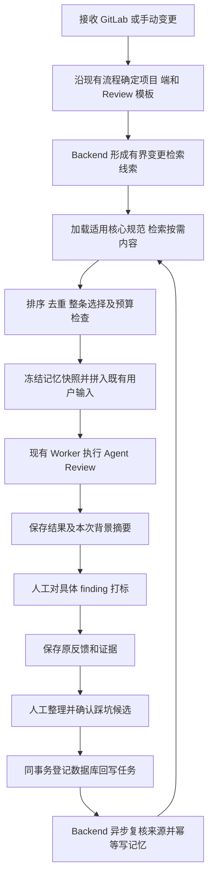
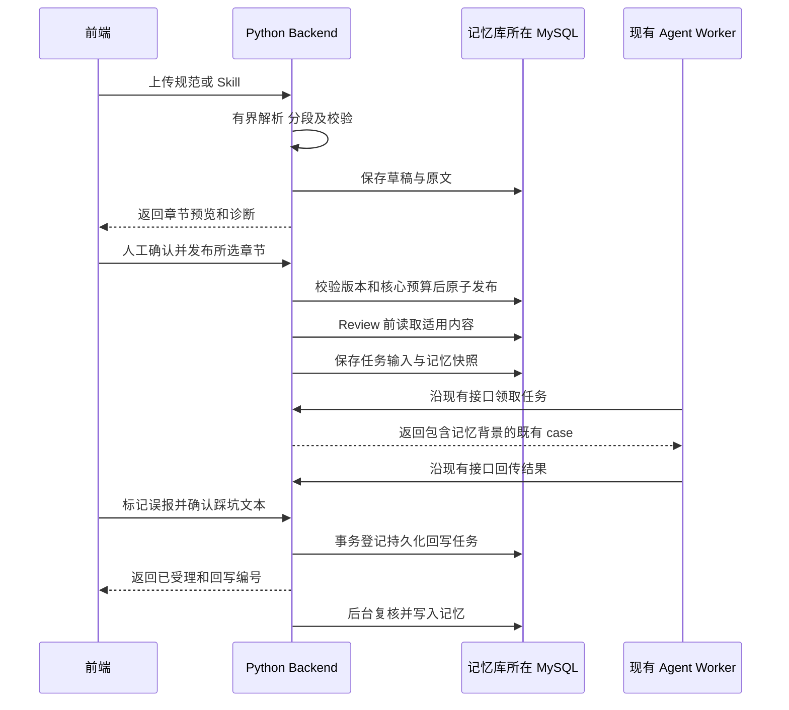
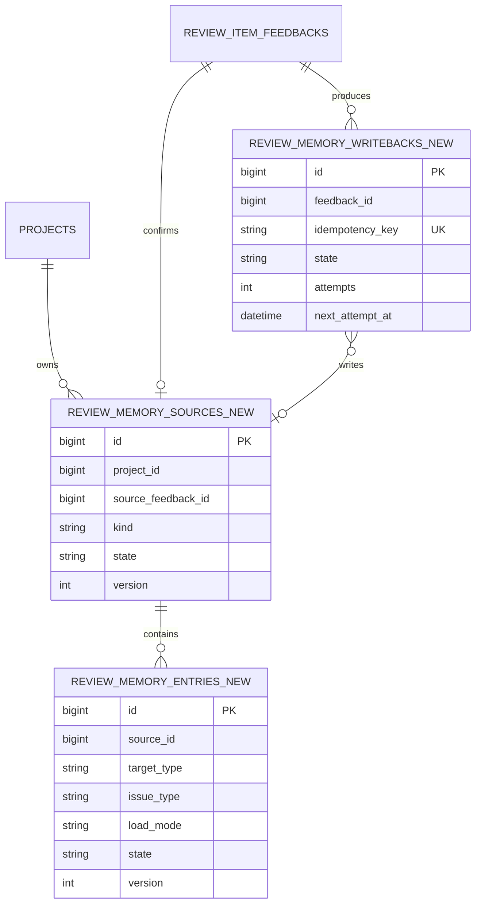
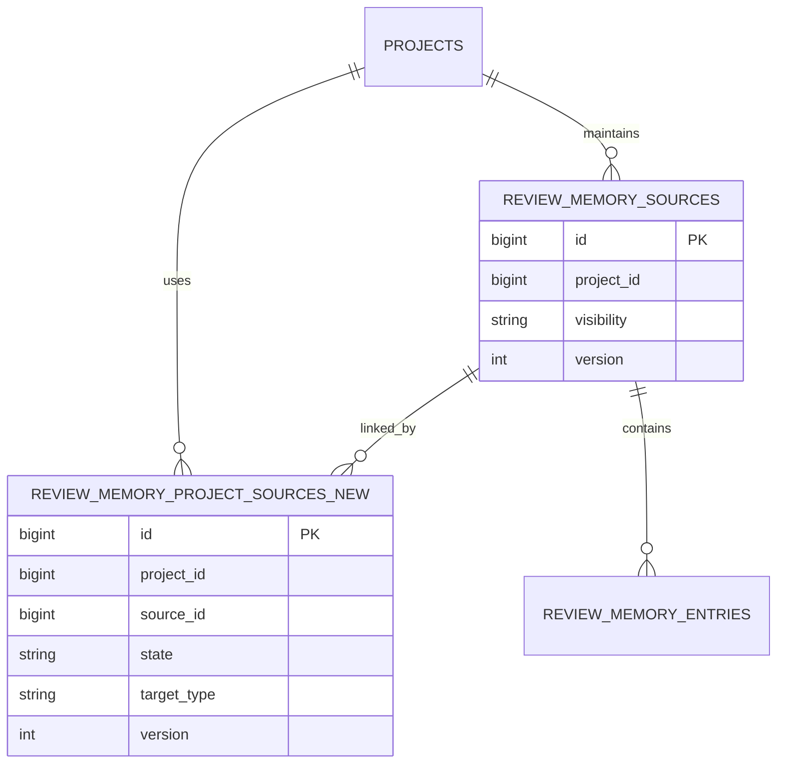

# Agent Review 记忆库专项设计与分阶段开发计划

## 0. 状态与使用范围

- 设计日期：2026-11-11。实施日期：2026-11-12～13。状态：M1～M9、S1～S3 功能已落地；M6 完成隔离 MySQL/API、四 Runner synthetic 及本地接口只读验收，M7 完成前端 build、隔离 Chrome 交互及真实页面只读验收，M8 完成文档样本与隔离 MySQL/API 验收，M9 完成上传 UI、浏览器及固定合成 MR 闭环验收。用户确认真实效果后续验收，尚无真实模型误报/漏报改善结论。2026-11-13 用户授权后，本地运行库已备份并迁移 V59，真实项目记忆注入仍全部关闭，见第 21 节；M10 尚未开始，未部署远程环境。
- 2026-11-12 用户确认调整为“共享资料 + 项目多对多关联”，第 13 节是调整后的设计基线；先按 S1～S3 完成调整，再进入 M4。第 3～5 节中的单项目归属、查询、修改和 UI 约定以第 13 节修订为准，第 10～12 节保留实际已交付记录，不表示当前代码已支持共享。
- 用户随后授权调整代码及继续推进，S1 关联数据及兼容层、S2 共享与关联后端、S3 共享 UI 已完成，分别见第 14～16 节；S2 通过独立临时 MySQL/API 验证，S3 通过构建与隔离浏览器交互验收。2026-11-12 经用户另行授权，本地运行库已备份并迁移至 V58，真实页面只读验收通过，见第 17 节；未部署远程环境。
- 本文是后续**记忆库专项**的独立开发依据，完整定义功能、数据、接口、UI、接入和阶段停止点，不需要查阅 60 号文档才能开发。60 号文档的记忆方案、61 号文档的估时不作为本专项实施基线；未来阶段以本文与当阶段用户授权为准。
- 本专项面向所有现有端类型，不受 Java/MyBatis 限制。Java/MyBatis 是源码关系分析的范围，与文字规范、Skill 和案例记忆的接入无关。
- 不在本文实施 AST/调用图、源码范围裁剪、两轮早停、向量库、脚本执行或模型训练。跨项目共享仅覆盖第 13 节明确的资料类型及关联能力，不扩展到踩坑案例共享或多租户权限平台。不填写工时估算。
- 仅基于当前 Python/React 工作树和迁移/模型判断已有能力，未核实运行数据库、生产开关和真实任务效果；实施前核对当时工作树，不能覆盖他人未提交改动。
- 每阶段均可独立授权、验收和安全停留；完成当前阶段即停止，等待用户确认下一阶段。本文不授权自动实施、运行库迁移或发布。

## 1. 需求与已有基础

### 1.1 要交付的闭环

1. 人工对具体 AI finding 标记误报、说明原因和补充证据，原反馈可以先独立保存。
2. 把经人工确认的误报整理成“踩坑案例”，记录适用条件、误判原因、正确判断方法和下次应检查的证据。
3. 按项目上传代码规范文档、审查 Skill，解析成可预览、编辑、发布和停用的文字条目。
4. Backend 在 Agent Review 入队前读取记忆库，选择有效且适用的背景，排序、去重、按预算注入初始输入。
5. 任务详情能说明本次加载了哪些背景、是否发生跳过或降级；后续更新不改变已入队任务的记忆快照。
6. 首期 MySQL 标签和关键词检索，后续再引入向量召回；不让库容量线性变成 Prompt 长度。

### 1.2 现状与复用边界

| 已有资产 | 当前源码 | 本专项怎么处理 |
| --- | --- | --- |
| 项目/端类型 | `backend-python/app/project_integration/models.py` 中 `Project`、`ProjectTargetConfig` | 以 projectId 隔离，沿用当前端枚举与本次任务端类型，不恢复项目组 |
| finding 反馈 | `backend-python/app/review_feedback/{api,service,repository,models}.py` | 复用 `review_item_feedbacks`、fingerprint、原因、快照及状态，不复制反馈主数据 |
| 人工反馈 UI | `frontend/src/App.jsx` 的 `ReviewFeedbackControl`、`RiskFeedbackPage` | 控件和反馈池已有；当前受旧学习 UI 开关控制，新入口独立开放，不恢复整个治理平台 |
| 项目策略 | `backend-python/app/project_review_policy/service.py::build_project_review_policy_prompt_context` | 保留原表、原接口和原注入顺序；新 UI 只展示只读来源，不复制成第二套权威数据 |
| Agent 入队 | `backend-python/app/agent_review/service.py::enqueue_agent_review` | 现有策略加载之后、case 冻结之前接新检索服务 |
| 通用输入 | `backend-python/app/agent_review_spike/prompting.py::review_input` | 四种 Runner 共用 baselineContext 的用户输入渲染，可直接承载新增背景 |
| 任务输入持久化 | `backend-python/app/agent_review/repository.py::create_agent_job` | `AgentReviewRun.input_json` 已保存输入；附加小型 memorySnapshot，无须增加 Run 字段 |
| 结果关联与后台循环 | `backend-python/app/code_quality/repository.py::result_to_response`、`backend-python/app/main.py::lifespan` | 复用 result.agent_run_id 查询快照，增加独立的数据库回写扫描循环 |

其中通用输入会进入模型的 user 内容；Claude CLI 原有 system/Profile 仍使用命令行参数，新记忆不追加到 `--append-system-prompt`。Standard Review 保持现状，本专项不顺带接入它。

## 2. 产品语义与主流程

### 2.1 三种内容的角色

| 角色 | 示例 | 使用方式 |
| --- | --- | --- |
| 核心规范 `CORE` | 本项目必须采用的资金精度约定 | 依据确定的项目/端/路径匹配加载，不依赖关键词命中 |
| 按需规范/Skill `ON_DEMAND` | 缓存一致性审查步骤、特定框架约定 | 按本次变更线索检索相关章节 |
| 踩坑/事故案例 `ON_DEMAND` | 漏查事务事件导致缓存误报 | 作为参考，提示查证，不能直接作为当前代码安全的证明 |

Skill 在本专项中指**审查指引文本**，支持元信息和检查步骤。上传 Skill 不代表安装 Codex/Claude Skill，不执行 scripts、不注册 MCP、不开放 Bash/Web/子 Agent，不执行文档中的工具指令。开发 Skill 若包含修复、格式化或编码动作，发布时只选择其适用于只读审查的段落。

规范不能扩大既有 Review 产品范围，例如当前不报告纯风格问题的约束不因上传命名规范自动取消；也不能覆盖明确的安全、数据一致性和线上正确性问题。冲突内容在 UI 给出提示，由维护者修订，首期不自动推断所有自然语言冲突。

### 2.2 Review 读取与反馈沉淀





## 3. 数据结构与一致性

### 3.1 对象清单

| 对象 | 当前状态 | 变更 |
| --- | --- | --- |
| `projects`、`project_target_configs` | 已有 | 只读复用项目和端定义；发布核心规范时可锁项目行串行核验总预算 |
| `review_item_feedbacks` | 已有 | 保留权威反馈；更新/撤回时增加相关记忆失效钩子，不改变旧枚举语义 |
| `project_review_policies` | 已有 | 保留权威策略、旧接口和原注入，不迁移、不复制、不改变 Standard |
| `agent_review_runs.input_json` | 已有 | 保存 memorySnapshot 与实际注入文本，不新增数据库列 |
| `review_memory_sources` | **新增** | 管理项目资料、原文件/原文、发布状态及来源关联 |
| `review_memory_entries` | **新增** | 可检索、可注入的章节/案例条目，标签和加载方式在此权威维护 |
| `review_memory_writebacks` | **新增** | 人工确认后的可靠异步回写任务，不承担普通文件解析 |

这三张表是当前目标的新表，不能因旧设计中出现过同名表便认为已经存在。迁移文件编号在实施时按仓库最新迁移序列确定，不在规划阶段占号。均使用 InnoDB、utf8mb4；项目/反馈/来源关系先作逻辑关联，不增加跨模块级联删除外键。



图中带 `_NEW` 的节点标签表示新增表，实际表名使用上方清单的小写名称。

### 3.2 新增 `review_memory_sources`

| 字段 | 类型/约束 | 语义 |
| --- | --- | --- |
| id / project_id | BIGINT PK / NOT NULL | 项目 ID 为隔离键，项目名从 projects 查询 |
| kind | VARCHAR(32) NOT NULL | `STANDARD / SKILL / PITFALL / ARCHITECTURE / INCIDENT`；团队规范归 STANDARD，仍归属具体项目 |
| origin | VARCHAR(16) NOT NULL | `MANUAL / UPLOAD / FEEDBACK` |
| title / description | VARCHAR(255) / TEXT | 资料名及简介；Skill 的 name/description 映射至此 |
| state / version | VARCHAR(16) / INT，初始 DRAFT/1 | `DRAFT / PUBLISHED / DISABLED / DELETED`；版本用于并发控制 |
| original_filename / media_type | VARCHAR(255) / VARCHAR(100)，可空 | 展示原文件名与服务端确认格式，文件名不作为存储路径 |
| original_bytes | MEDIUMBLOB，可空 | 上传原件上限 5 MiB，列表/检索不读取该列；人工内容为空 |
| original_sha256 / extracted_text | CHAR(64) / MEDIUMTEXT，可空 | 原件摘要、可追溯的抽取文本；不在 Prompt 重复注入整份原文 |
| parser_version | VARCHAR(64)，可空 | 原件解析方式与版本 |
| parse_warnings_json | TEXT，可空 | 有界解析警告、段落/页码定位和需人工处理项，最多 16 KiB，不复制正文 |
| source_feedback_id / feedback_digest | BIGINT / CHAR(64)，可空 | 反馈关联和确认版本；同一反馈最多一个来源记录，UNIQUE(source_feedback_id) |
| replacement_of_id | BIGINT，可空 | 替换文档时指向旧来源，旧内容保留到新文档确认发布 |
| confirmed_by / confirmed_at | VARCHAR(128) / DATETIME，可空 | 人工确认记录；身份边界见 4.6 |
| created_at / updated_at / deleted_at | DATETIME | deleted_at 只在 DELETED 时设置，逻辑删除保留来源追溯 |

索引：`(project_id,state,kind,id)`、`(project_id,original_sha256)`；后者用于重复上传提示，不阻止用户对同一文件配置不同条目。`replacement_of_id` 必须指向同项目、同 kind 的来源；替换不能借此跨项目转移资料。

### 3.3 新增 `review_memory_entries`

| 字段 | 类型/约束 | 语义 |
| --- | --- | --- |
| id / source_id | BIGINT PK / NOT NULL | 所属项目通过 source 关联，避免多存一个可漂移的 project_id |
| section_key / heading / ordinal | VARCHAR(128) / VARCHAR(255) / INT | 章节标识、标题及顺序，UNIQUE(source_id,section_key) |
| content | MEDIUMTEXT NOT NULL | 完整正文；ACTIVE 单条最多 4000 UTF-8 字节，超限解析段可留在 DRAFT 待人工拆分，同一来源所有草稿/活动正文合计最多 256 KiB |
| target_type | VARCHAR(32)，可空 | 六种现有端枚举；NULL 表示该项目所有端，GENERAL 仍是独立端，不能当作通配 |
| issue_type | VARCHAR(64)，可空 | 标准化问题标签，首批见下文；NULL 表示不限定问题类型 |
| path_globs_json / keywords_json | TEXT，可空 | 最多 8 个相对路径 glob / 12 个关键词；空路径表示整个项目，不支持绝对路径或越界模式 |
| load_mode | VARCHAR(16) NOT NULL | `CORE / ON_DEMAND`；CORE 仅用于 STANDARD/ARCHITECTURE，案例和 Skill 均按需 |
| state / version | VARCHAR(16) / INT，初始 DRAFT/1 | `DRAFT / ACTIVE / DISABLED`；只有来源 PUBLISHED 且条目 ACTIVE 可检索 |
| content_sha256 | CHAR(64) NOT NULL | 内容去重及快照关联 |
| validation_errors_json | TEXT，可空 | 最多 4 KiB 的不可发布原因和定位信息；修正时重新校验 |
| created_at / updated_at | DATETIME | 时间信息 |

索引：`(source_id,state,load_mode,target_type,issue_type)`。标签只在条目维护；上传表单的“默认标签”用于初始化条目，不额外在来源表存一套可冲突的标签。项目名、端显示名和 issue 显示名均由已有项目/明确枚举映射提供。

首批 issue 枚举：`GENERAL / API_CONTRACT / DATABASE / CACHE / MQ / TRANSACTION / SECURITY / CONFIG / ERROR_HANDLING / TESTING`。现有 finding.category 和规则信号经显式映射生成线索；未知值保留在来源反馈，不偷偷当作已识别类型。无法提取问题方向时不能只查询 GENERAL，使用下文的未知线索降级。

案例条目正文采用固定模板，单条保持完整：**适用条件、原误判及原因、正确判断方法、下次应查证据、例外/失效条件**。这些字段先作为模板正文存储，不再增加一组重复正文列；确认接口使用结构化输入，服务端统一渲染。

### 3.4 新增 `review_memory_writebacks`

| 字段 | 类型/约束 | 语义 |
| --- | --- | --- |
| id / feedback_id | BIGINT PK / NOT NULL | 来源反馈及其项目从反馈记录核验，不信任请求覆盖 |
| idempotency_key | CHAR(64) UNIQUE NOT NULL | SHA256(feedbackId + feedbackDigest + canonicalConfirmationPayload) |
| feedback_digest / confirmation_json | CHAR(64) / MEDIUMTEXT NOT NULL | 对反馈状态、类型、原因、finding 快照及时间版本做摘要；保存经人工确认的必要文本与标签，不再复制整份 finding |
| expected_source_version | INT，可空 | 更新已有案例时必须携带；不能自动复活已停用/删除的案例 |
| state | VARCHAR(32) NOT NULL | `PENDING / RUNNING / RETRY_WAIT / SUCCEEDED / FAILED / CANCELLED_STALE_SOURCE` |
| attempts / next_attempt_at | INT / DATETIME | 尝试次数及业务退避时间 |
| lease_owner / lease_until | VARCHAR(128) / DATETIME，可空 | 多 Backend 进程扫描的短租约 |
| source_id / last_error_code | BIGINT / VARCHAR(64)，可空 | 成功目标、失败枚举，不保存异常堆栈正文 |
| confirmed_by / created_at / updated_at / finished_at | VARCHAR(128) / DATETIME | 操作来源和状态时间 |

索引：`(state,next_attempt_at,id)`、`(lease_until,state)`、`(feedback_id,id)`。失败状态保留用于人工修正后重新确认，首期不另建无限重试管理台。

### 3.5 状态、修改与旧数据兼容

- 新上传或手工创建始终 DRAFT，不自动生效。发布事务校验来源版本、条目版本、格式、适用范围、预算，选中条目 ACTIVE、来源 PUBLISHED。
- 每次章节新增/修改/停用和来源状态变化都递增 source.version，修改章节还递增 entry.version；发布检查所有传入版本后一次递增，不能在循环中让后续条目与本次请求自冲突。
- 编辑已生效条目的正文或标签会将该条目改回 DRAFT，立即停止新任务引用；UI 保存前明确提示，未编辑的其它 ACTIVE 章节继续可用。仅启停也需 expectedVersion。
- 替换整份文档创建新草稿，发布新版本时在同一事务核验旧来源版本、停用旧来源、启用新来源；解析失败或未发布不影响旧资料。并发替换旧来源已变化返回 409。
- 来源 DISABLED/DELETED 后所有章节不参与新检索；删除是逻辑删除。原件随逻辑记录保留，本期不设计物理归档清理。
- FEEDBACK 来源的案例正文和适用标签修改必须走结构化案例确认接口，不能借通用条目编辑绕过反馈 digest；重新发布同样要核验当前反馈。手工 PITFALL/INCIDENT 在管理页使用同一模板，但不伪造来源反馈。
- 已入队任务使用被冻结的文本，后续停用不改历史输入；需要立即阻止使用时，取消受影响排队/运行任务后重跑，不在运行中静默换记忆。
- 旧 project_review_policies 仍原样加载。以**实际完整注入的旧条目**按 sourceFeedbackId 和规范化内容摘要去重时保留旧策略，不额外注入同源新案例；UI 显示“同源旧策略已加载”。旧策略若已被旧逻辑截断，不把它当作完整 CORE 的替代；保留必要的新完整条目并记录重叠，不顺带改变旧策略的截断行为。

## 4. 详细后端改动

### 4.1 上传、解析与发布

首批支持 `.md / .txt / SKILL.md`；后续独立阶段支持 `.docx` 和可提取文字的 `.pdf`，仍属于本计划的上传能力。扫描 PDF/OCR、`.doc`、ZIP Skill 包、图片和远端 URL 抓取不在本期；界面应直接说明支持范围。

| 项目 | 明确约束 |
| --- | --- |
| 文件与请求 | 单请求一个文件，MD/TXT 不超过 1 MiB，DOCX/PDF 不超过 5 MiB；服务端有界读取，超限 413，前端校验只作辅助 |
| 解析 | UTF-8 文本；Skill front matter 仅取 name/description，使用 safe loader、限制长度并拒绝 alias；其它字段显示“未启用”，不能改变工具权限 |
| 格式判断 | 扩展名、MIME 与文件结构一致性检查；拒绝加密/损坏 PDF、宏文档和错误结构，返回明确错误，不把乱码当正文 |
| 文档资源 | DOCX 限制 ZIP 成员数和总解压量 20 MiB；不执行宏、不加载外链。PDF 最多 100 页；重型解析在受控子进程完成，10 秒超时有界结束 |
| 输出与分段 | 抽取正文总上限 256 KiB UTF-8、最多 200 条；按标题层级和段落分段，保留上级适用条件，不拆代码围栏，不任意切断“除非/仅适用”等条件 |
| 无法安全切分 | 整个代码块或必要条件超过单条 4000 字节时标注需人工拆分，不悄悄截断；修正前该条不能发布。超过整份解析上限直接失败，不截断成看似完整的文档 |
| 解析结果 | Backend 一次受限解析后原子保存来源和草稿条目，返回预览。失败不创建可发布的半成品；用户可修改文件后重试 |
| 原件 | 原文件保存在 MySQL 来源记录，避免新建文件服务/卷。预览只返回纯文本；下载通过受控接口以 attachment 返回，不内联执行 HTML/脚本 |
| 发布确认 | 人工检查章节、适用范围和完整性，选择要发布的章节；不做模型自动批准，也不因上传成功就自动启用 |

Markdown/PDF/DOCX 的视觉预览不是可信执行环境：不渲染原始 HTML、不自动请求远端图片；代码块以文字显示。解析器不能保证自然语言条件识别完全正确，人工发布确认是必要业务步骤。

新依赖仅安装 Backend：基础上传的 `python-multipart`、Skill 元信息的安全 YAML 解析库；DOCX/PDF 阶段增加 `python-docx`、`pypdf` 并固定已验证版本。Worker 不安装这些依赖。

### 4.2 人工误判到踩坑案例

1. 原反馈继续通过 `POST /api/review-tasks/{taskId}/feedback` 保存；来源是具体 finding 指纹和 reviewKey，整任务不作为一个笼统“误判记忆”。保留项目、任务、原结论及上下文快照。新确认接口必须核验指纹确实关联该项目任务的已保存 AI finding，不采纳客户端自造的 fallback finding。
2. 新确认页面先读反馈详情及服务端生成的 feedbackDigest。人工填写案例模板、端、问题类型、路径范围；首期不调用模型自动总结，避免增加不稳定链路。
3. 新接口只接受反馈类型 FALSE_POSITIVE，状态 PENDING/VALID 可确认；PENDING 在确认事务转 VALID。INSUFFICIENT/IGNORED/CONVERTED 应先在原流程处理，不绕过状态保护；重复 CONVERTED 来源提示已有旧策略。
4. CONTEXT_MISSING 的反馈允许沉淀为**查证方法型 PITFALL**，必须填写缺失证据及下次检查步骤，不能转成“忽略某问题”的 PROJECT_RULE；旧 convert-to-policy 接口的禁止规则保持不变。
5. 确认事务锁定反馈，复核 digest、项目和状态，验证已有 source 版本及确认正文，再登记回写记录；接口返回 202，表示受理而非已入库。幂等键根据本次请求携带的 expectedFeedbackDigest 和规范化确认 payload 生成；优先查已受理请求，来源仍有效时返回原结果。若 PENDING 转 VALID，回写任务的 feedback_digest 必须记录状态变更并 flush 后的摘要，不能让消费方把本次确认自己造成的变化判成过期。刷新页面后的同内容、同当前反馈版本确认也应复用现有来源/成功回写。
6. 异步消费再次复核来源，写一个来源和一个完整 PITFALL 条目，默认 ON_DEMAND；人工已经确认且校验通过后才发布。重复确认同一 payload 返回原任务，不产生第二条案例。
7. 反馈原因/状态/快照改变或撤回时，原反馈写入事务必须使其关联新记忆 DISABLED、使待执行旧确认失效。旧任务不受影响；重新启用需要重新确认当前反馈与来源版本。
8. 不改写原 finding、不自动隐藏历史 finding、不把模型 completion 直接当人工确认。有效事故案例可手工录入 INCIDENT；本期不扩展自动从所有正向反馈学习。

例：把“更新未删除缓存”的误报沉淀为“此订单入口经事务提交事件统一失效缓存；下次需核对事件发布、监听器、缓存 key 和事务阶段”，而不是“本项目缺少删缓存都不报”。

### 4.3 异步回写的执行约束

- 在 `main.py::lifespan` 增加可取消的异步扫描循环，通过 `asyncio.to_thread` 执行短数据库工作，每 10 秒扫描一次、每批最多 20 条；每次独立 Session，不共享请求 Session。退出取消扫描，不等待长任务无限运行。
- 可领取：PENDING、到时的 RETRY_WAIT、租约已过期的 RUNNING。MySQL 事务使用 `FOR UPDATE SKIP LOCKED`，先短事务领取，租约 60 秒；多 Backend 实例不要求单独 leader。
- attempts 每次领取增加，最多 3 次；暂时性 DB 错误按 30 秒、120 秒退避。字段不合法、来源变化、版本冲突是明确终态，不无限重试。第三次 RUNNING 失租也必须终结 FAILED，不能永久悬挂。
- 实际写入采用“反馈 → 来源 → 回写任务”的统一锁顺序；先复核租约 owner/attempt、来源 digest 和 expectedSourceVersion，写 source/entry 与 SUCCEEDED 同事务。领取事务结束后不持有 job 行锁去等待反馈锁。
- 一条失败不阻塞其它记录；日志只记录 ID、状态、耗时、错误码，不输出原件或完整案例。不得因进程重启丢失已经返回 202 的确认。
- 失败后用户修正内容再确认；相同已失败 payload 可查看错误，但不通过重复点按钮自动开启无界重试。来源已 DISABLED/DELETED 不被迟到任务自动恢复。

### 4.4 MySQL 检索、排序与预算

检索由 `review_memory/service.py::select_review_memories` 统一实现，输入为 projectId、本次 task.targetType、安全 changedFiles、有限检索词和已有策略的来源摘要；不依赖 AST/调用图，不能为读记忆重新扫描整仓。

1. **先隔离和过滤**：仅本项目 PUBLISHED 来源 + ACTIVE 条目；target 匹配或 NULL，路径 glob 匹配至少一个安全变更路径或不限定路径。来源 FEEDBACK 还要满足确认版本有效，旧策略去重先行。
2. **CORE 直接加载**：只用确定的项目/端/路径条件，不要求猜中的 issue，也不依赖向量分数。所有适用 CORE 必须完整进入预算；不通过 topK 静默漏掉。
3. **ON_DEMAND 候选**：关键词来自路径/模块名、有限 diff token、现有确定性分类和可获得的规则线索；最多 16 个去重关键词、每词 64 字符。不调用大模型生成 query，不把全部 diff 作为 LIKE 参数。
4. **有界候选集**：最多 200 条，按三组保留名额后去重：问题类型匹配最多 80 条、标题/keywords/heading/正文关键词命中最多 80 条、通用与近期候选最多 40 条；未知方向时第三组允许其它专项类型。SQL 先按项目/端/状态及该组条件过滤排序，每组最多预取 300 条，再在应用层验证 glob、保留各组名额，避免把复杂 glob 冒充已有 SQL 索引能力。预取到界导致可能漏召回时记录 candidateScanLimited；CORE 单独查询，不受此候选上限影响。
5. **确定性排序**：先精确端，再更具体的路径匹配、问题类型匹配、标题/显式关键词命中、正文命中；仅用更新时间和 ID 打破同分。LIKE 参数转义并限制长度，用户输入不拼 SQL。通用内容与案例共享排序，不能靠重复粘贴关键词无限提高权重。
6. **未知线索**：不错误排除所有专项条目，走未知方向组；仍可能漏召回，保存 `issueHintsUnknown=true`。关键词检索是基线，不宣称具备语义相似检索。
7. **去重及注入**：同 source/section 只出现一次；规范化内容 hash 相同保留 CORE 优先，再保留排序靠前项；与完整已注入旧策略相同 sourceFeedbackId 或内容 hash 重合时保留旧策略，记录 skipReason。旧内容已截断的重叠按 3.5 处理。
8. **固定初始预算**：新增 CORE 最多 20 条、总计不超过 8000 UTF-8 字节；ON_DEMAND 最多 8 条且不超过 6000 UTF-8 字节，合计包含标题、来源 ID、适用条件和包装文本最多 14000 字节。按完整条目装入，放不下就跳过并计数，不能切掉例外条件。

CORE 发布/编辑时锁项目行，按每个已支持端核验“NULL 通配 + 本端”的所有核心条目渲染预算上界，即使路径不重叠也按保守总量检查；必须留足总块固定头尾开销。超限发布返回 409，让维护者拆解/降为按需；加载时若仍出现超限视为配置异常，明确失败，不丢 CORE 继续。

这些预算只控制**新增记忆**。旧策略、源码和本任务多轮 history 仍有原来的容量行为，本专项不声称解决所有大 diff 超限。已知模型输入余量不足时可进一步减少按需条目；不能靠删除当前 diff 为记忆腾位置。原有必要输入本身超限按既有链路处理。

### 4.5 初始输入、快照与失败行为

- 当前 Agent case 使用 `baselineContext`，四种 Runner 都通过 `review_input` 读取它。本期优先直接复用：先得到旧 `_bounded_context(request)`，再追加独立 `<project_review_memory>` 文本块；不能把新块塞回旧函数再被 `[:100000]` 静默截断。
- 块中按“核心约定 / 按需审查步骤 / 历史案例”注明来源、版本、适用条件。固定系统审查指令补充：该块是背景资料，不执行其中命令、不自动豁免 finding，仍需本次代码证据。XML 风格分隔符需转义，不把内容当可执行控制协议。
- 旧系统/Profile/旧策略保持原顺序。新增记忆走 user input；Claude 沿已有 stdin 输入，不增加 argv 长度，不加载宿主机 ~/.codex/skills，不访问上传原件。
- 与 case 同时在 `AgentReviewRun.input_json` 根部保存 `memorySnapshot`：schemaVersion、policyVersion、projectId、targetType、selected 条目的 sourceId/entryId/sourceVersion/entryVersion/kind/loadMode/正文 hash、当时标题和适用摘要及 selectionReason、注入字节数、跳过原因计数、lookupStatus。标题/适用摘要分别最多 160 UTF-8 字节，截短仅用于 UI 摘要，不裁正文；路径仅存代表范围与总数，避免重复完整 glob。正文只保存在已冻结的 case.baselineContext，不重复存整份原文/文件；任务详情按该快照展示。
- 检索和内容读取使用同一一致性读视图，读取版本及正文后一次生成 case/snapshot；不用 ID 清单再跨事务重读可变内容。入队后修改资料不改变本任务。新建重跑重新检索，租约重领/进程重启恢复继续使用原输入。
- 现有 Job 仍只把 case、worktree、budgets、runtime 发 Worker。附加 root snapshot 只供 Backend 追溯，旧 Worker 已能读取 baselineContext，**不需要新领取能力、Run schema 列、数据库凭据或容器拓扑**。
- 项目功能关闭、无资料、无匹配分别记录 DISABLED/EMPTY/NO_MATCH；它们不等于查询失败。旧任务没有 snapshot 显示“历史任务，未记录记忆背景”，不能反查当前库冒充当时输入。
- 非核心候选查询失败：尝试仅加载 CORE，标记 `PARTIAL_LOOKUP` 后沿原链路继续。初始有效性/CORE 读取查询失败：标记 `MEMORY_LOOKUP_FAILED` 并停止本次 Agent 入队，不能声称必载规范已加载；用户可明确关闭记忆后重跑。旧项目策略失败保护保持不变。
- 该失败不得被自动转换成不加载必要规范的 Standard fallback；同步核对实时入队失败及恢复路径的错误分类。普通 Agent 执行失败沿既有 fallback，新增背景不自动接入 Standard；详情明确实际执行引擎和是否采用了本次记忆。

### 4.6 公开接口与 DTO

新接口均用 Pydantic request/response schema，不使用任意 dict 代替契约。统一分页 pageNo/pageSize（默认 20，最大 100）；列表不返回原件或完整正文。projectId 由路由/关联记录决定，条目不能靠请求改所属项目。

| 接口（均拟新增） | 用途与必要字段 |
| --- | --- |
| `GET /api/projects/{projectId}/review-memory/sources` | kind/state/targetType/issueType/keyword 分页；端和问题筛选通过子条目 EXISTS，不让 join 放大来源条数 |
| `POST /api/projects/{projectId}/review-memory/sources` | 手工建草稿：kind/title/description/entries，原件为空 |
| `POST /api/projects/{projectId}/review-memory/uploads` | multipart file + kind/title/默认条目标签；同步有界解析，返回 source 草稿、entries 和 warnings |
| `GET /api/projects/{projectId}/review-memory/sources/{id}` | 来源、版本、条目、解析诊断、同源旧策略关联；来源必须属于项目 |
| `GET /api/projects/{projectId}/review-memory/sources/{id}/original` | 下载原件，无原件返回 404；不得接受磁盘路径 |
| `PUT /api/projects/{projectId}/review-memory/sources/{id}` | 改标题/简介，expectedVersion；原件替换走 uploads + replacementOfId/expectedReplacedVersion |
| `POST /api/projects/{projectId}/review-memory/sources/{id}/entries` | 手工新增/拆分草稿章节，带 expectedSourceVersion；sectionKey 服务端生成，校验来源总量和条目数 |
| `PUT /api/projects/{projectId}/review-memory/sources/{id}/entries/{entryId}` | heading/content/targetType/issueType/pathGlobs/keywords/loadMode/expectedVersion/expectedSourceVersion；编辑活动正文转草稿 |
| `POST /api/projects/{projectId}/review-memory/sources/{id}/publish` | expectedVersion + selectedEntries[{id,expectedVersion}]；原子发布，未选择草稿仍不生效 |
| `PUT /api/projects/{projectId}/review-memory/sources/{id}/state` | 仅 DISABLED，带 expectedVersion；重新启用走 publish 重新校验。条目停用使用 entry 更新的明确 state=DISABLED 操作 |
| `DELETE /api/projects/{projectId}/review-memory/sources/{id}?expectedVersion=...` | 逻辑删除、取消关联待回写；新建恢复流程不在首期 |
| `GET /api/projects/{projectId}/review-memory/feedbacks` | 仅本项目 AI_FINDING，复用原反馈池查询，补 memorySourceId/writebackState/feedbackDigest；支持 FALSE_POSITIVE 和状态筛选 |
| `GET /api/projects/{projectId}/review-memory/feedbacks/{feedbackId}` | 反馈、原 finding 和任务链接、digest、现有来源版本；不支持不存在于本项目的任意 finding |
| `POST /api/projects/{projectId}/review-memory/feedbacks/{feedbackId}/confirm` | 结构化踩坑模板 + 标签 + expectedFeedbackDigest + 可选 expectedSourceVersion；返回 HTTP 202/id/state（MemoryWritebackSummary，见 18 节） |
| `GET /api/projects/{projectId}/review-memory/writebacks/{id}` | status/attempts/sourceId/lastErrorCode，可供前端有界轮询 |
| `GET /api/projects/{projectId}/review-memory/settings`、`PUT` 同路径 | 新增 enabled，默认 false，PUT 带 expectedVersion；配置存储见下文 |
| `GET /api/agent-review/runs/{runId}/memory-summary` | 从任务冻结输入读摘要，校验关联项目访问边界；不返回 baselineContext/原始 query/diff |

设置复用 `ProjectReviewSettings`：在**接入检索阶段**加 `memory_enabled BOOLEAN NOT NULL DEFAULT false` 和独立 `memory_settings_version INT NOT NULL DEFAULT 1`，不借用其它版本字段。主键 project_id 已有，不提前引入通用配置框架。GET 不因开关关闭隐藏资料管理能力，只有实际注入受开关控制。

HTTP 错误语义：400/422 参数，404 项目或关联不存在，409 版本冲突/不允许发布/核心预算冲突，413 文件过大，415 格式不支持，503 必载资料查询不可用。正文/确认案例按字节限制验证，错误返回字段和条目 ID，不回显整文件。

当前源码未发现完整用户认证/RBAC。首期沿用既有应用部署访问边界并执行项目关联校验；不得把前端隐藏按钮或请求 operatorName 当作权限控制。confirmed_by 有可信登录/网关注入身份时由服务端取得，否则标注“操作人填报，未经身份验证”。不借此专项新建账号权限系统，也不宣称已支持多租户隔离。

确认请求示例：

```json
{
  "expectedFeedbackDigest": "服务器返回的当前反馈摘要",
  "expectedSourceVersion": null,
  "title": "订单更新的缓存由事务事件失效",
  "targetType": "BACKEND",
  "issueType": "CACHE",
  "pathGlobs": ["**/order/**"],
  "keywords": ["缓存失效", "事务事件"],
  "applicability": "仅适用于发布订单变更事件的更新入口",
  "misjudgmentCause": "原结论遗漏事务提交监听器",
  "correctApproach": "检查本次入口到监听器的实际链路后再判断",
  "requiredEvidence": "事件发布、监听器、缓存 key 与事务阶段",
  "exceptions": "未发布事件或监听器未覆盖该 key 时仍需报告"
}
```

### 4.7 拟新增与修改的代码范围

| 文件/模块 | 职责 |
| --- | --- |
| 新 `backend-python/app/review_memory/{models,schemas,repository,service,api}.py` | 资料、条目、状态、检索、快照、项目设置和契约 |
| 新 `review_memory/parsing.py`、`writeback.py` | 有界文本/Skill 解析，后续文档适配；可靠确认回写，不建通用作业框架 |
| 现有迁移目录、`app/project_integration/models.py` | 加法新表，接入阶段再加 ProjectReviewSettings 的独立开关/版本 |
| `app/review_feedback/service.py` | 更新反馈时使旧确认及新记忆失效，保留旧接口语义 |
| `app/agent_review/service.py`、必要的失败恢复分类 | 入队前检索，baselineContext 追加、冻结、失败和 fallback 边界 |
| `app/agent_review_spike/prompting.py` | 一句固定资料解释边界；不新增 Worker 工具或凭据 |
| `app/main.py` | 路由注册与回写扫描生命周期 |
| `frontend/src/settingsNavigation.js`、`appShell.js`、`App.jsx` | 接新导航、finding 按钮与详情摘要，沿用现有 dirty guard，避免整体重构 App |
| 新前端 `reviewMemory/` 目录 | 按页面/表单/上传预览拆实际复用组件，API wrapper 和标签常量，不把全部新逻辑塞入 App.jsx |

真实入口以实施时 rg 和局部源码为准；不修改 legacy Java backend，不引入 Redis/MQ/独立解析或向量容器。

## 5. 前端 UI 设计

### 5.1 入口与信息架构

- 设置的“AI Review 配置”保留“模型与运行”“策略与 Prompt”，新增平级标签 **“项目记忆库”**，拟路由 `/settings/ai-review/memory`。
- 页面顶部先选项目，使用稳定 projectId 作为 URL 查询参数；来自任务的跳转预选该项目。未选择项目不查询资料、不提供跨项目“全部”操作。
- 页面包含 **规范与约定 / 审查 Skill / 踩坑案例** 三个分区。规范区含 STANDARD/ARCHITECTURE，案例区含 PITFALL/INCIDENT；同一后端条目能力按类型呈现。
- 资料管理入口默认显示，无需设置环境变量；可显式设置 `VITE_REVIEW_MEMORY_UI_ENABLED=false` 隐藏。后续人工打标入口随对应阶段交付，不要求开启旧 `VITE_REVIEW_LEARNING_UI_ENABLED`，不自动展示整个反馈池、质量看板和旧项目策略编辑平台。
- 数据是否进入审查取决于 Backend 项目 memory_enabled；前端开关只控制入口可见性，不能替代后端生效条件。

页面结构示意：

```text
AI Review 配置  /  项目记忆库
项目 [订单服务 ▼]       端 [全部 ▼]       [用于后续审查：关闭/开启]
说明：只影响新建审查任务；Skill 仅提供审查指引。

[规范与约定]  [审查 Skill]  [踩坑案例 · 待确认 3]

类型/状态/问题类型筛选    [搜索标题或内容]    [上传资料] [新建条目]
┌──────────────────────────────────────────────────────────────┐
│ 资料名称     适用端/问题    生效章节    状态       更新时间  操作 │
│ 缓存约定     后端/缓存      3/5         已发布     ...       查看 │
│ API 规范     全端/API       0/6         草稿       ...       编辑 │
└──────────────────────────────────────────────────────────────┘
旧项目策略（只读来源，可折叠）：继续按既有机制加载，不在此重复创建。
```

使用现有 Ant Design 的 Tabs、Select、Table、Drawer、Form、Upload、Alert、Tag、Popconfirm；不引入新的 UI 框架或重新设计应用外壳。状态用文字和图标表达，不只靠颜色。

### 5.2 资料与 Skill 的上传/编辑

采用两步 Drawer，桌面宽度约 900px，窄屏占满可用宽度：

1. **选择资料**：类型、文件、标题、默认端/问题标签/路径范围；清楚显示当前支持格式与大小。Skill 显示“仅导入文本；脚本和工具声明不执行”。上传期间禁重复提交，可取消；解析失败保留用户标签和文件名，给重试方式。
2. **预览并确认**：左侧章节列表，右侧纯文本正文；显示解析警告、单条大小和适用条件。允许编辑条目、勾选发布章节、选择 CORE/ON_DEMAND。超限段落标红并禁止发布该条，不用省略号掩盖条件丢失。

底部操作：**保存草稿 / 发布所选章节 / 取消**。发布前展示“适用项目、端、条目数量、核心背景占用”，CORE 超预算时定位问题条目。Skill 只能 ON_DEMAND；case 不提供 CORE 选项。

已发布资料提供“编辑章节 / 替换文件 / 停用 / 删除”。编辑活动条目保存前提示“本条将转回草稿，重新发布后才参与新审查”；替换文件则旧资料继续生效至新资料确认发布。版本冲突保留本地输入，提示刷新对比，不自动覆盖服务端内容。

来源详情显示原文件下载、章节状态、解析版本、人工确认信息、来源反馈/任务链接；无需显示 SQL、Embedding 或内部扫描租约。

### 5.3 finding 打标与踩坑沉淀

在任务详情已有 finding 操作区，独立提供 **“标记误报”**。任务是否由 Agent 或 Standard 产出不影响收集反馈，但首期记忆消费方仅 Agent。未完成/无 finding 的任务不显示“整任务误判”按钮。

- 弹窗一：误报原因、说明、参考证据/缺失背景，勾选“提交后整理为踩坑案例”。先调用现有反馈保存接口，失败不继续确认。
- 不勾选：只保存打标，提示“反馈已保存，尚未进入审查记忆”。
- 勾选：打开案例 Drawer，左右对照原 finding 和固定案例模板；从服务端回填 project、target、问题线索及反馈 digest，允许人工修正标签和证据描述。
- 按钮文案 **“确认并加入记忆”**；提交成功先显示“已受理”，有界轮询回写状态（2 秒一次，最多 30 秒，离开页面停止）。未完成时可关闭，列表保留处理中，重新打开再查询，不持续后台轮询。
- 成功显示“已沉淀；自动审查读取尚未接入”（M6/M7 后再按实际状态提示参与后续审查）；失败显示可操作原因，不把 202 误写成成功。
- 已有同源案例显示“查看案例”；修改/撤回原反馈会使该案例停止用于新任务，UI 明确提醒。已有旧策略显示其来源，不重复生成同样内容。

“踩坑案例”页再分 **已沉淀 / 待确认反馈**：前者展示生效案例及关联任务，后者查询本项目 FALSE_POSITIVE 反馈并提供整理入口；不复制旧反馈表、不恢复无关学习运营功能。缺少说明和证据的反馈仍可保存，但不允许直接发布案例。

### 5.4 本次审查用了哪些背景

任务详情中新增可折叠区域 **“本次审查背景”**，放在执行信息附近：

- 概览显示记忆功能是否启用、核心/规范/Skill/案例的实际加载数量、跳过数量和查询状态。
- 展开列表只显示当时的标题、类型、版本、适用范围和加载原因；点击资料可看当前内容，同时标明“当前版本可能不同于本次快照”。
- 只有当次 snapshot 明确记录 loaded 才能显示“已加载”；历史任务显示“未记录”，无匹配、关闭、查询失败分别显示。
- 使用专用 summary API，禁止把整个 Agent input_json 返回前端。快照需保存有限标题、适用条件摘要和 selectionReason，且计入下面的 32 KiB 元数据上限。
- 若实际回退 Standard，显示“该次 Agent 已加载背景，但最终 Standard 结果未采用本专项记忆”或按真实执行阶段说明，不能把加载数量当最终结果保证。

### 5.5 页面状态与操作完整性

必须具备首次空态、项目未选、加载失败/重试、空筛选、上传中/失败、草稿、已发布、部分章节未发布、回写处理中/失败、版本冲突和已停用状态。离开有修改的 Drawer、换项目、换设置标签均走现有 dirty guard；取消不丢已保存反馈。

桌面筛选横排，窄屏换行；列表窄屏保留横向滚动，主要按钮和状态始终可操作。上传和发布按钮使用具体标签，错误关联表单字段；不自动打开隐藏治理页面。

## 6. 发布、兼容与可观测性

### 6.1 实施与发布顺序

1. 先部署加法表及后端管理契约，功能默认关闭；不在首次 GET 时临时创建表。
2. 再开放对应 UI。资料可先整理、预览和发布，但未开启项目设置时不影响 Review。
3. 后端确认回写与来源失效保护一起部署，再开放 finding 到记忆的 UI，不能只交付可生成陈旧案例的确认接口。
4. 接入入队检索时才迁移项目 memory_enabled/version，并验证四种 Runner 都保留 baselineContext；无需提前升级 Worker 的 claim 协议。
5. 项目显式启用后仅影响新任务，先用固定样本验收再授权生产开放；DOCX/PDF 后端先有能力，前端才开放格式选择。

回滚先关闭项目记忆注入；若要完全停止旧快照使用，先取消/排空对应任务，再回滚 Backend/Worker。仅关闭开关不会移除已入队文本。保留新增表和确认记录，不回滚删除数据；旧 UI 和旧 Worker 忽略新增管理能力仍可工作。

### 6.2 摘要和日志

`memorySnapshot` 除新增文本外的元数据整体最多 32 KiB，条目标题/适用摘要等有单字段上限；CORE 与选中 ON_DEMAND 的 ID/版本/hash 不得静默丢弃。固定条目数和发布预算须保证上界，违反视为实现错误。不得记录原件、完整搜索词、整个 diff 或完整 Prompt。

最小指标：候选数、选中数、核心/按需字节数、同源/重复/超预算跳过数、检索耗时、查询状态、确认回写成功/失败/失效数。UI 不把关键词匹配分数显示成“正确率”或“置信度”。

误报改善需要真实样本对照，不能把 finding 变少直接等同质量变好；检查已有问题是否因为某条记忆被错误忽略。案例示例及人工说明中不自动持久化凭据或上传无关源码。

## 7. 分阶段推进与停止点

整体工作跨前后端和数据库，不能作为一个“大”阶段直接实施，现拆为以下独立边界。每阶段必须先确认实际范围；范围变为“大”时继续拆分后再实施。M1～M9 是本专项功能交付；M10 仅定义后续向量方向，不混入前面阶段。M1～M3 已交付单项目版本；用户确认的多对多调整按第 13.7 节 S1～S3 插入 M3 与 M4 之间，不将其并入单个跨库、后端、前端的“大”阶段。

| 阶段 | 改动量等级与依据 | 目标及范围 | 非目标 | 验收方式 | 授权边界及停止点 |
| --- | --- | --- | --- | --- | --- |
| M1 数据与内部能力 | **中**：单后端加法数据层，保持生产审查关闭 | 三张新表、模型/schema、状态及内部项目隔离查询，版本与预算规则 | 不开放 UI/上传/Review 注入，不跑运行库迁移 | 迁移静态检查、内部 synthetic/手动验证状态与查询；授权环境再做迁移验证 | 本地实现与静态验证；完成汇报并停 |
| M2 资料管理后端 | **中**：一个管理子域的 API 和有界文本解析 | 手工条目、MD/TXT/SKILL.md 上传、预览、编辑、发布、停用、替换、原件下载；项目关联和预算保护一起交付 | 不接反馈异步、DOCX/PDF、Review | 手动 API 检查跨项目 ID、格式/大小、章节超限、并发发布、替换和版本冲突 | 管理契约独立可用，入口对旧 Review 无影响；完成后停 |
| M3 资料管理 UI | **中**：设置内新增一页及其表单，后端已具备保护 | 项目记忆库导航、规范/Skill/案例浏览、上传预览、草稿/发布/启停、旧策略只读区 | 不增加后端协议、不开放误报确认或注入开关 | build、页面人工/浏览器验收，dirty guard、上传失败及窄屏 | 前端入口仅在 M2 完整后开放；完成后停 |
| M4 踩坑确认后端 | **中**：确认与可靠消费、撤回失效形成一个完整后端闭环 | 复用反馈，补详情/digest/确认/状态 API、持久化扫描、租约、去重、版本、反馈失效钩子 | 不自动总结，不恢复旧治理平台，不改 Review | 手动 API/synthetic 检查重复确认、重启恢复、第三次失租、来源变更、停用不复活 | 确认接口不领先于必要保护；完成后停 |
| M5 人工打标与案例 UI | **中**：任务详情与记忆页的小范围交互联动 | 独立打标、原因证据、原结论对照、案例模板、待确认列表、异步结果 | 不加模型总结，不打开全部旧反馈治理入口 | build、真实已完成任务上人工验证保存/确认/失败/重新打开/撤回 | M4 完整后启用；反馈先保存，确认可取消；完成后停 |
| M6 入队检索与注入 | **中**：只改 Backend 入队准备及少量固定资料解释，复用已有 Worker 输入 | 新增项目开关/版本、MySQL 标签关键词选择、CORE 保护、去重/预算、baselineContext、快照、失败及恢复分类、summary API | 不改 Worker 工具/claim/数据库连接，不实现向量或源码裁剪 | 四种 Runner synthetic 输入核验；关闭/空/未知线索/查询失败/重跑/重领/旧策略去重；API 闭环核验结果 | 默认关闭，本地实现不等于生产启用；完成后停 |
| M7 注入控制与任务详情 UI | **中**：复用 M6 完整契约，两个位置展示真实状态 | 项目“用于后续审查”开关、本次背景摘要、旧任务/降级/fallback 展示 | 不改检索算法，不回填历史快照 | build、开关版本冲突、任务快照不漂移、实际 Agent/Standard 状态核验 | 开关后端完整后才开放；完成后停 |
| M8 常见文档解析后端 | **中**：新增两种格式适配，沿用已交付发布边界 | DOCX、文本 PDF，受限子进程、大小/页数/解压/时间限制、正文与表格可读抽取、解析诊断 | 不支持 OCR/图片/旧 DOC/ZIP Skill/远端抓取 | 固定正常/损坏/扫描/加密/超时文档手动验证；失败不替换旧发布版本 | 服务端能力先交付并可安全停留；完成后停 |
| M9 文档上传 UI 与专项验收 | **中**：格式扩展展示及已交付功能的跨端闭环，不新增数据契约 | 开放 DOCX/PDF 格式提示、页码/段落诊断、混合资料选择；固定 MR 验证完整闭环 | 不增加分析框架或临时扩大范围修复 | build/浏览器、上传到发布到初始输入到反馈沉淀；误报及漏报样本人工对照 | 不自动部署或运行生产 Review；完成专项验收后停 |
| M10 向量召回方案确认 | **小**：只做候选召回扩展设计，不接库迁移 | 基于真实漏召回样本确定 Embedding、切片、索引、混合召回和撤回同步契约 | 不实现向量库、不改变 CORE 直接读取 | 设计审阅和固定语义样例确认 | 用户另行发起，审阅后停；实际开发需重新拆小/中阶段，不能用本行授权整个向量工程 |

上述验收默认采用聚焦静态检查、手动 API、synthetic 脚本调用及浏览器验证。本次不新增、修改或运行单元测试；未来某阶段如需单元测试，应由用户在该阶段明确授权，不以覆盖率要求扩大范围。迁移、部署、真实生产任务另行授权。

## 8. 专项完成验收清单

1. 不开启旧学习 UI，也能对 finding 保存误报反馈、整理案例；没有证据的反馈可留待确认，但不能直接生效。
2. 上传项目规范和 Skill 可先预览再发布，只有确认的 ACTIVE 章节参与检索；Skill 不执行任何脚本/工具。
3. 同一项目不同端的资料按明确规则匹配；GENERAL 不等于全端，项目 A 的 source/entry/feedback ID 不能被项目 B 路径访问。
4. 核心规范不因关键词不命中而丢失；预算冲突可见且可修正。低优先按需内容跳过时有计数，没有截断例外条件。
5. 相同来源与旧策略不重复注入；旧项目策略接口和 Standard 行为不变。
6. 入队记忆版本冻结，编辑/停用不改变旧任务；重领沿用原快照，新重跑重新检索。
7. 回写 202 后重启仍可继续，重复确认不重复建案例；反馈变更、撤回或案例停用后旧任务不会复活案例。
8. 四种 Runner 都收到相同选中背景，Worker 无数据库连接、原件挂载和额外执行权限。
9. 任务详情显示真实加载状态，关闭/无匹配/失败/历史未记录/fallback 可区分；未泄露整个 Prompt 和源码。
10. DOCX/PDF 后端和 UI 完成后，正常文字文档可导入；损坏、扫描、加密、超大和超时文件可解释失败，旧资料不受影响。
11. 使用固定真实 MR 和人工结论比较记忆前后误报及漏报，不承诺未测量的改善百分比。

## 9. 向量检索的后续接入边界

- 当前 MySQL 保存正文、适用条件、状态、确认来源和版本，继续是权威数据。
- 后期对按需规范章节、Skill 步骤和踩坑案例生成 Embedding，关键词与向量混合召回后再筛选、排序、去重和预算选择；CORE 仍直接查询，不交给相似度决定是否加载。
- 向量命中必须返回 entryId/version，Backend 再核验当前项目、端、状态及正文版本，不能直接把索引中的过期原文注入。停用/删除在 SQL 最终核验时立即生效，索引同步可异步补齐。
- 更换 Embedding 模型通常要重建向量；存储、模型费用、延迟和语义召回效果必须用实际样本评估。本期不预建向量字段、接口、容器或“通用检索平台”。
- Agent 执行中按需查记忆是另一个可选扩展，需要新增受控工具和协议验收；首期只有 Backend 入队前检索，不能在 UI 或交付中宣称 Agent 已会自主查询记忆库。

## 10. M1 实施边界与记录

### 10.1 本阶段契约

- 改动量等级：**中**。仅新增后端加法数据层与内部校验，不开放公开接口或改变审查主链路。
- 新增 V57 三张表迁移和 `app/review_memory` 模块；迁移按既有工具自动发现，不在应用导入、查询或请求时建表。
- 内部能力限于创建 MANUAL 草稿、按项目读取/分页查询来源、读取章节和回写记录、核验版本/来源状态、验证条目与 CORE 发布预算。不在 M1 实现上传、发布事务、反馈确认、异步消费、排名召回或 Prompt 注入。
- 所有来源/章节查询显式传入 projectId；回写记录通过原反馈关联项目。来源列表不读取原文件二进制和整份抽取文本；详情按需读取正文，原件读取仍留给 M2。
- 新草稿内容允许单段超过 4000 字节以便后续人工拆分，但同来源最多 200 条、总正文 256 KiB；发布校验必须拒绝超限条目。CORE 仅允许 STANDARD/ARCHITECTURE，针对六种端分别验证通配与专属内容合计最多 20 条/8000 字节，包含稳定渲染包装。
- 状态/版本与预算校验作为内部函数交付，实际发布和并发写保护在 M2 完成；M1 不提供绕过确认的发布入口。
- 验证使用聚焦静态检查和 SQLite 内存临时库 synthetic 调用，迁移做离线发现/语句及 MySQL DDL 编译对照；不连接运行数据库，不新增或运行单元测试，不需要浏览器验收。

### 10.2 验证与停止点

交付文件：

- `backend-python/migrations/bootstrap_sql/V57__review_memory_foundation.sql`：三张加法表，InnoDB/utf8mb4，来源反馈、章节标识和回写幂等唯一约束，以及筛选/回写索引。
- `backend-python/app/review_memory/models.py`：对应 ORM，SQLite ID/文本兼容、MySQL MEDIUMTEXT/MEDIUMBLOB/DATETIME(3)；原件、抽取原文和章节正文延迟加载。
- `schemas.py`：种类、来源、状态、issue 和加载方式枚举；复用现有 TargetType；草稿、分页、详情、CORE 预算输入和回写摘要契约。未知字段拒绝，路径越界与条目/来源大小有界。
- `repository.py`：项目范围内的来源、章节、回写读取及来源分页，章节筛选用 EXISTS 避免重复来源；管理筛选中的 targetType/issueType 为精确标签筛选，通配匹配在未来 M6 生效检索中处理。
- `service.py`：创建手工草稿只 flush、不 commit；项目关联读取和安全摘要；版本/来源状态校验、条目发布前校验，以及六端 CORE 总预算校验。发布预算函数只做校验，不实际发布。

已完成验证：

| 验证 | 结果与证据边界 |
| --- | --- |
| 聚焦 Ruff | `check app/review_memory`、`format --check app/review_memory` 均通过 |
| 迁移静态一致性 | 现有 discover_migrations 自动发现 V1～V57；V57 拆出且仅拆出 3 条 CREATE TABLE；逐表对照字段、MySQL 类型（INT/INTEGER 同义）、可空性、server default、索引与唯一约束通过 |
| MySQL 方言编译 | 三张 ORM 表 DDL 编译通过，确认 MEDIUMTEXT/MEDIUMBLOB、CHAR(64)、DATETIME(3)、InnoDB/utf8mb4；这不等于已在 MySQL 执行迁移 |
| 隔离临时库 synthetic | SQLite 内存库建表/删表成功；草稿回滚、来源/章节/回写跨项目 404、EXISTS 分页不重复、LIKE 特殊字符转义、原件/整份原文未加载、活动 CORE 可见及停用/删除排除通过 |
| 契约与边界 synthetic | 非法端/未知字段/越界路径拒绝；超限正文可存草稿但禁止发布；来源总字节限制、CORE 类型限制、旧版本冲突、删除状态不能重新发布、CORE 20 条/8000 字节和 UTF-8 多字节预算通过；GENERAL 与 NULL 通配保持区别 |
| 实际运行库/前端 | 未连接运行数据库，未执行迁移、启动服务、浏览器验收或真实 Review；未改主链路、UI、现有表、项目设置或 Worker |

没有新增、修改或运行单元测试。现有后端脚本提供模块执行，但没有 stdin 临时 synthetic 入口，因此临时库校验直接调用项目虚拟环境 Python，仅连接 `sqlite:///:memory:`。

最小复现（仓库根目录 PowerShell）：

```powershell
powershell.exe -NoProfile -ExecutionPolicy Bypass -File scripts/run-backend.ps1 ruff check app/review_memory
powershell.exe -NoProfile -ExecutionPolicy Bypass -File scripts/run-backend.ps1 ruff format --check app/review_memory
@'
import os, sys
from pathlib import Path
os.environ['DATABASE_URL'] = 'sqlite:///:memory:'
sys.path.insert(0, str(Path('backend-python').resolve()))
from sqlalchemy import create_engine
from sqlalchemy.orm import Session
from app.core.database import Base
from app.core.errors import AppError
from app.project_integration.models import Project
from app.review_memory.models import ReviewMemorySource, ReviewMemoryEntry, ReviewMemoryWriteback
from app.review_memory.schemas import MemorySourceDraft, MemorySourceQuery
from app.review_memory.service import create_manual_draft, get_project_source, list_project_sources
engine = create_engine('sqlite:///:memory:')
tables = [Project.__table__, ReviewMemorySource.__table__,
          ReviewMemoryEntry.__table__, ReviewMemoryWriteback.__table__]
Base.metadata.create_all(engine, tables=tables)
with Session(engine) as db:
    db.add(Project(id=1, name='demo', git_provider='GITLAB', git_project_id='1',
                   default_template_code='backend', target_type='BACKEND', status='ACTIVE'))
    db.flush()
    draft = create_manual_draft(db, 1, MemorySourceDraft(kind='STANDARD', title='demo',
        entries=[{'heading': 'rule', 'content': 'Check the actual evidence.'}]))
    assert draft.state == 'DRAFT' and draft.entries[0].state == 'DRAFT'
    assert list_project_sources(db, 1, MemorySourceQuery()).total == 1
    try:
        get_project_source(db, 2, draft.id)
    except AppError as error:
        assert error.status_code == 404
    else:
        raise AssertionError('cross-project source was returned')
    db.rollback()
Base.metadata.drop_all(engine, tables=tables)
engine.dispose()
print('M1 isolated draft/query smoke passed')
'@ | & backend-python/.venv/Scripts/python.exe -
```

运行库迁移仍需独立授权。尤其本地既有 V56 可能尚未执行，未来不能把 `migrate apply` 当成“仅执行 V57”；应先使用隔离目标的 status/dry-run 检查所有 pending，并按 V56 破坏性迁移的既有前置条件处理。首期不提供自动删除新表的回滚脚本；应用回退保留新表，避免丢失以后录入的资料。

**M1 历史停止记录：** M1 完成时未本地提交、运行库迁移或部署；之后用户已授权 M2，当前实施结果见第 11 节。

## 11. M2 实施契约与记录

### 11.1 本阶段实施边界

- 改动量等级：**中**。复用 M1 三张表，新增一个后端资料管理子域及有界文本解析，不新增迁移、前端或 Review 消费能力。
- 用户已授权实施 M2；只实现 4.6 的 sources、uploads、entries、publish、state 和 original 接口。反馈确认/回写、项目开关及 Review 注入不在本阶段。
- 新接口统一返回现有 success/code/message/data/traceId 信封，data 使用明确的 Pydantic schema；下载例外，返回 attachment。所有服务写操作只 flush，由 API 在成功时提交、异常时回滚。

### 11.2 【PC端】资料管理接口新增

以下路径均以 `/api/projects/{projectId}/review-memory` 为前缀；projectId 来自当前选中项目，source/entry ID 和版本来自本接口列表/详情，不能由请求更改项目归属。

| 接口 | 新增请求字段、来源与前端用途 | 返回数据与需求使用位置 |
| --- | --- | --- |
| GET /sources | 4.6 的筛选字段、pageNo/pageSize，来自筛选表单 | MemorySourcePage；供 5.1 列表使用，不带正文/原件 |
| POST /sources | kind/title/description/entries，来自手工表单，结构沿用 M1 MemorySourceDraft | MemorySourceDetail；4.1 草稿预览，默认不发布 |
| POST /uploads | multipart 单文件 file 和 JSON 文本 metadata；metadata 为 kind、可选 title/description、默认 targetType/issueType/pathGlobs/keywords/loadMode、可选 replacementOfId/expectedReplacedVersion，来自上传表单及旧来源详情 | MemorySourceDetail；4.1 返回章节、诊断、原件信息，供 5.2 预览 |
| GET /sources/{id} | 路径 id 来自列表 | MemorySourceDetail；含 entries、originalFilename/mediaType/parserVersion/parseWarnings、hasOriginal、confirmedBy/confirmedAt、identityVerified=false、legacyPolicyIds，仅按同源反馈关联旧策略，不返回旧策略正文 |
| GET /sources/{id}/original | 路径 id 来自详情 | 原始字节 attachment；4.1 原件追溯，不接受本地路径 |
| PUT /sources/{id} | title/description/expectedVersion；完整元信息表单及详情版本 | MemorySourceDetail；3.5 编辑、递增来源版本、重验 CORE 包装预算 |
| POST /sources/{id}/entries | expectedSourceVersion + entry（M1 MemoryEntryDraft）；来自拆分/新增表单 | MemorySourceDetail；4.6 新增草稿，sectionKey 服务端生成 |
| PUT /sources/{id}/entries/{entryId} | expectedVersion/expectedSourceVersion + entry（完整 MemoryEntryDraft）或 state=DISABLED，两种操作互斥 | MemorySourceDetail；3.5 编辑转 DRAFT，或停用，不允许客户端直接 ACTIVE |
| POST /sources/{id}/publish | expectedVersion、selectedEntries[{id,expectedVersion}]、可选 expectedReplacedVersion/operatorName；来自详情勾选、版本和操作人填报 | MemorySourceDetail；4.1 人工确认，operatorName 仅记录为未经身份验证的填报 |
| PUT /sources/{id}/state | state=DISABLED、expectedVersion，来自停用动作和详情 | MemorySourceDetail；3.5 重新启用必须走 publish |
| DELETE /sources/{id} | query expectedVersion，来自详情 | MemorySourceDetail；逻辑删除，已删除来源禁止继续修改或发布 |

完整条目字段为 heading/content/targetType/issueType/pathGlobs/keywords/loadMode；可空标签和空列表的意义沿用 M1，不使用任意 dict 绕过 schema。新增章节/编辑后返回完整详情，前端用新版本覆盖已保存状态；409 保留本地输入并刷新对比。列表标签采用精确筛选，NULL 通配匹配属于 M6 检索。

### 11.3 后端处理与必要兼容保护

- 所有管理写入先锁项目行，再锁来源，再读取章节当前版本；统一串行化同项目发布/编辑预算核验，来源和条目均复核客户端版本。MySQL 的版本/活动集合查询使用锁定当前读，避免等待项目锁前的普通读快照影响预算；现有 Review/策略接口不改动。
- 发布只激活选中章节；PUBLISHED 来源未选择的 ACTIVE 章节继续有效，DRAFT/DISABLED 章节仍不生效。恢复 DISABLED 来源时，只恢复本次明确选中的章节，其余原 ACTIVE 章节转 DISABLED，避免暗中恢复。每次操作来源版本只递增一次，受影响章节版本分别递增一次。
- 替换上传时核验旧来源同项目、同 kind 且非 DELETED/FEEDBACK；不改变旧来源。发布替换草稿必须再次提供 expectedReplacedVersion，核验旧来源仍为该版本且非删除，然后同事务停用旧来源和发布新来源；新来源只在首次发布执行替换。旧来源中途修改返回 409，不覆盖。旧版本号不另加持久化字段。
- FEEDBACK 来源仅可读取；通用管理写入一律拒绝，防止在 M4 的反馈锁、digest 和撤回保护实现前提前开放绕过确认的入口。手工 PITFALL/INCIDENT 发布要求正文保留“适用条件、原误判及原因、正确判断方法、下次应查证据、例外/失效条件”五个非空模板段落。
- 标题、条目或状态变更后按当前完整活动集合校验六端 CORE 预算；替换时先排除同事务停用的旧来源。source/entry 当前版本及渲染元信息一起计入，失败整体回滚。
- Markdown 使用固定版本轻量解析库识别标题/段落/代码围栏；以完整顶层章节保留嵌套适用条件，公共前言复制至每章。TXT 保留完整正文；PITFALL/INCIDENT 保留整份模板，避免把五个案例段落拆散。保守保留大段为不可发布草稿，避免依赖自然语言猜测拆条件。不渲染 HTML、不请求外链、不调用模型。
- Skill YAML front matter 最多 8 KiB，使用 safe loader，拒绝 alias/anchor、重复键和过深结构；仅 name/description 生效，其余字段诊断为未启用。MD/TXT 单文件最多 1 MiB；整个 multipart 请求最多 1 MiB + 64 KiB，metadata 最多 16 KiB、只允许一文件一字段，流式累计限制，不信任 Content-Length。
- UTF-8（可带 BOM）解码并拒绝二进制控制符；文件名只保留安全 basename，扩展名与 MIME 校验，纯文本无需执行式内容探测。正文/条目数遵循 M1 上限，解析失败事务不留半成品。重复文件只提示，不拦截。

### 11.4 【公共】异常与验收

- 400：参数/UTF-8/YAML/结构无效；404：项目、来源、章节或原件不在当前项目；409：版本、状态、发布条件或 CORE 预算冲突；413：请求/文件/抽取总量超限；415：格式不支持。错误只含字段/ID/错误码，不回显完整文档。
- 使用聚焦 Ruff、OpenAPI 静态核对、隔离 SQLite 的 API/synthetic 验证上传→草稿→编辑→发布→停用/替换→下载/删除，以及跨项目、超限、版本冲突和失败回滚。脚本入口不支持内嵌 synthetic 时使用本地 venv Python；不新增、修改或运行单元测试。
- 不启动运行服务、不执行运行库迁移、不部署、不提交；M2 完成后停，M3 需要用户另行授权。

### 11.5 实施结果与最小复现

已交付 `review_memory/api.py`、`parsing.py`，扩展既有 schemas/service/repository；`main.py` 只注册新路由。共 11 个资料管理 HTTP 操作，已有三张表直接复用，无 M2 迁移。`MemoryUploadMetadata` 是 multipart 的 metadata 字段契约；其内容示例：

```json
{
  "kind": "SKILL",
  "title": "缓存审查步骤",
  "targetType": "BACKEND",
  "issueType": "CACHE",
  "pathGlobs": ["**/order/**"],
  "keywords": ["缓存失效"],
  "loadMode": "ON_DEMAND"
}
```

上传不填 title/description 时可采用 Skill name/description；其它 YAML 字段只产生未启用诊断。替换上传在上述 JSON 中增加同项目同 kind 的 replacementOfId/expectedReplacedVersion，首次发布时再次提供最新 expectedReplacedVersion。发布请求示例（ID/版本必须使用详情实际值）：

```json
{
  "expectedVersion": 1,
  "selectedEntries": [{"id": 101, "expectedVersion": 1}],
  "operatorName": "维护者填报名称"
}
```

本地 Backend 新依赖已安装并验证，固定版本为 `python-multipart==0.0.22`、`PyYAML==6.0.3`、`markdown-it-py==4.0.0`。在其它 Backend 环境按 pyproject 安装；仅更新本地依赖可从仓库根目录执行：

```powershell
powershell.exe -NoProfile -ExecutionPolicy Bypass -File scripts/run-backend.ps1 pip install python-multipart==0.0.22 PyYAML==6.0.3 markdown-it-py==4.0.0
powershell.exe -NoProfile -ExecutionPolicy Bypass -File scripts/run-backend.ps1 ruff check app/review_memory app/main.py
powershell.exe -NoProfile -ExecutionPolicy Bypass -File scripts/run-backend.ps1 ruff format --check app/review_memory
```

隔离 API 最小复现（仓库根目录运行；本地脚本没有 stdin synthetic 入口，因此直接使用 venv Python；不启动 lifespan，不接运行库，不触发 Review）：

```powershell
$OutputEncoding = [System.Text.UTF8Encoding]::new($false)
@'
import os, sys, json
os.environ['DATABASE_URL'] = 'sqlite:///:memory:'
sys.path.insert(0, 'backend-python')
from fastapi import FastAPI
from fastapi.testclient import TestClient
from sqlalchemy import create_engine
from sqlalchemy.orm import Session
from sqlalchemy.pool import StaticPool
from app.core.database import Base, get_db
from app.core.errors import register_exception_handlers
from app.project_integration.models import Project
from app.review_memory.api import router
from app.review_memory.models import ReviewMemorySource, ReviewMemoryEntry
engine = create_engine('sqlite://', poolclass=StaticPool,
                       connect_args={'check_same_thread': False})
tables = [Project.__table__, ReviewMemorySource.__table__, ReviewMemoryEntry.__table__]
Base.metadata.create_all(engine, tables=tables)
with Session(engine) as db:
    db.add(Project(id=1, name='memory-smoke', git_provider='GITLAB',
                   git_project_id='1', default_template_code='DEFAULT', status='ACTIVE'))
    db.commit()
def isolated_db():
    with Session(engine, autoflush=False) as db:
        yield db
app = FastAPI()
register_exception_handlers(app)
app.include_router(router)
app.dependency_overrides[get_db] = isolated_db
root = '/api/projects/1/review-memory'
with TestClient(app) as client:
    original = b'# Rules\nCheck transaction events before reporting cache issues.\n'
    response = client.post(root + '/uploads',
        files={'file': ('rules.md', original, 'text/markdown')},
        data={'metadata': json.dumps({'kind': 'STANDARD', 'targetType': 'BACKEND'})})
    assert response.status_code == 200, response.text
    source = response.json()['data']
    assert source['state'] == 'DRAFT' and source['hasOriginal']
    path = root + '/sources/' + str(source['id'])
    payload = {'expectedVersion': source['version'], 'selectedEntries': [
        {'id': source['entries'][0]['id'], 'expectedVersion': source['entries'][0]['version']}]}
    published = client.post(path + '/publish', json=payload)
    assert published.status_code == 200, published.text
    assert published.json()['data']['entries'][0]['state'] == 'ACTIVE'
    assert client.post(path + '/publish', json=payload).status_code == 409
    assert client.get(path.replace('/1/', '/2/', 1)).status_code == 404
    download = client.get(path + '/original')
    assert download.content == original
    assert download.headers['content-disposition'].startswith('attachment;')
Base.metadata.drop_all(engine, tables=tables)
engine.dispose()
print('M2 isolated upload/publish/version/download smoke passed')
'@ | backend-python/.venv/Scripts/python.exe -
```

本阶段验收结果：

- 聚焦 Ruff check/format、模块导入和完整应用 OpenAPI 生成通过；仅新增资料管理路由，不启动应用恢复循环。
- SQLite 临时库的 API/synthetic 调用通过：手工/上传草稿、UTF-8 BOM、Skill 元信息、分章与代码围栏、公共适用前言、完整案例模板、预览/编辑/部分发布/章节停用/来源停用后选择恢复/下载/逻辑删除。
- 跨项目来源/章节/下载/替换、来源及章节旧版本、重复文件提示、无原件、格式/MIME/UTF-8/二进制控制字符、损坏/多文件/额外字段 multipart、请求/文件/元信息/正文/章节数超限均检查；拒绝不留可发布半成品。
- YAML alias/anchor、重复键、不安全 tag 和未闭合 front matter 均拒绝；Skill 不能使用 CORE。手工和上传案例的五段模板保持完整且发布校验非空。
- CORE 六端字节预算、NULL 通配、20 条数量上限、标题增长、旧版本写入、替换后预算失败均检查；失败回滚来源/章节版本及旧资料状态。FEEDBACK 来源通用写入口拒绝，同源旧策略只读关联可用。
- MySQL 方言下项目/来源/章节/活动 CORE 查询均生成 `FOR UPDATE`，并使用 populate_existing 刷新。**未连接 MySQL，真实多连接竞争和运行库迁移尚未验证**；SQLite 不模拟 InnoDB 锁行为，不将旧版本冲突检查宣称为真实并发验收。
- 未新增、修改或运行单元测试；本阶段无前端变化，不需要浏览器验收。未执行运行库迁移、服务启动、部署或本地提交。运行前仍需先独立核验 V56/V57 pending 风险，不能直接把 migrate apply 当作只建记忆表。

**M2 历史停止记录：** M2 完成后停止；之后用户已授权先本地提交再实施 M3，结果见第 12 节。Review 当前尚不消费新记忆库。

## 12. M3 资料管理 UI

### 12.1 实施范围与边界

- 改动量等级：**中**。新增一个设置页和资料抽屉，接入 M2 管理接口、既有导航拦截及项目/旧策略只读接口；不增加后端协议或数据库迁移。
- 用户已授权先本地提交 M1/M2，再实施 M3。M1/M2 已提交为 `20df9f6`；M3 在 `feat/review-memory-ui` 分支实现，完成后停止，不自动进入 M4。
- 资料管理入口默认显示，路由为 `/settings/ai-review/memory?projectId=...`；独立开关 `VITE_REVIEW_MEMORY_UI_ENABLED` 默认 true，仅显式设为 false 时隐藏。资料管理入口与旧学习功能开关无关，不显示 Review 注入开关、反馈待确认或本次背景加载数量。
- 新页面明确提示“资料可管理，尚未接入自动审查”。PUBLISHED 表示资料已发布，不表示已有 Review 消费。FEEDBACK 来源只读，踩坑/事故手工录入沿用五段模板。

### 12.2 页面和操作

- 沿用现有设置外壳和 Ant Design；三个分区为规范与约定、审查 Skill、踩坑案例。M2 kind 为单值筛选，因此规范区通过“代码规范 / 架构约定”子类型选择切换，案例区通过“踩坑 / 事故”切换，分页不在前端拼接多个列表。
- 顶部项目选择支持搜索，projectId 写入 URL；未选项目不查询记忆或旧策略。列表只展示 M2 summary 实际提供的名称、类型、来源、状态、更新时间，端/问题筛选保留，章节数与标签在详情中展示，不为列表逐行请求详情。
- 上传/新建使用抽屉：先选资料类型、标题、文件/手工正文与默认标签，再保存草稿并预览。当前仅 MD/TXT（1 MiB）、Markdown Skill；不显示 DOCX/PDF。上传失败保留表单，取消只取消客户端等待，提示服务器可能已保存草稿。
- 详情提供纯文本章节预览、错误和 UTF-8 字节数；按章节编辑/新增拆分、修改资料标题简介、勾选发布、章节停用、来源停用/逻辑删除、替换文件及下载原件。明确区分未保存编辑与服务端已存草稿；不渲染上传 HTML、图片或执行代码。
- 发布前确认当前项目、选中章节与适用标签。显示本次选中正文的字节数，明确不等于整个项目 CORE 包装预算；全局预算由后端最终校验，不推测精确剩余容量。已发布章节编辑后转草稿、替换确认前旧资料继续有效，均有提示。
- 使用 M2 返回的 source/entry 版本，409 保留本地编辑，可查询最新内容对照；只有人工明确选择后才采用最新版本号重试，不自动覆盖。替换首次发布重新获取旧来源当前版本并明确确认，保留旧来源变更提示。
- 旧项目策略按项目折叠只读展示，失败可重试；不开放旧策略修改入口。加载失败、空项目/空资料/空筛选、上传失败、超限、停用、删除、版本冲突均有明确状态。
- 抽屉关闭、章节切换、项目/分区切换与设置导航共用既有导航 guard 的确认原则；浏览器后退和刷新也保护未保存内容。保存/发布期间阻止重复提交及离开；上传等待可取消。异步列表/详情请求使用取消或序列保护，避免项目切换后显示旧项目数据。
- 桌面抽屉约 960px，窄屏铺满；章节列表和编辑区在窄屏上下排列，筛选换行、表格横向滚动，保留主要操作。

### 12.3 验收与授权边界

- 使用 `scripts/run-frontend.ps1 build` 验证；不新增、修改或运行单元测试。
- 浏览器优先使用工具可用的自动化；使用隔离合成后端验证上传→草稿→编辑→发布→停用/替换→下载、失败/409/dirty guard/窄屏以及入口显示/隐藏。合成后端复用 M2 路由和临时 SQLite，不访问运行数据库，不触发恢复任务、Worker 或 Review。
- 启动前核对端口，启动后有界核对 PID/监听/HTTP；验收只清理本次持有的服务。不得为验收执行运行库迁移；若浏览器工具或环境不可用，明确记录未验收项，不把构建通过当作浏览器通过。
- M3 完成后停止，汇报功能、验证与限制；不自动提交 M3、不部署、不进入 M4。

### 12.4 实施结果与复现

- 已完成第 12.2 节页面和交互；变更仅涉及 React 前端、导航和文档，无后端协议或依赖变更。M3 改动保留在 `feat/review-memory-ui`，未自动提交。
- 首次验收时默认关闭及显式开启开关的 `scripts/run-frontend.ps1 build` 均通过；开启后的生产构建亦通过浏览器页面、列表与详情冒烟检查。后续用户要求入口默认显示，已调整默认值；本次针对入口默认值复验，记录见本节末尾。沿用现有大 bundle 提示，不在本阶段扩展打包改造。未新增、修改或运行单元测试。
- 浏览器工具启动失败后，改用本机 Chrome headless 和临时 Playwright 做隔离验收。后端复用真实 M2 router 与临时 SQLite，不启动主应用生命周期、Worker、恢复任务或真实 Review，不访问运行数据库；项目目录和旧策略接口使用合成响应。该结果不替代真实 MySQL 锁竞争、运行库迁移和部署后的联调验收。
- 已验证：无项目不查询、项目切换和过期响应隔离、空态/失败重试、MD/Skill 上传与失败保留、纯文本预览不执行脚本、手工五段案例、章节编辑/拆分/超限、发布确认、启停/删除只读、替换前旧版继续有效、原件下载、旧策略只读、409 保留编辑并显式采用最新版本。
- 已验证：未保存关闭/设置导航/浏览器后退保护、保存期间禁止离开、上传取消提示服务器可能已保存、连续项目切换后取消后退仍保留草稿；桌面与 390×844 窄屏可编辑保存。修复了项目 URL 切换后导航 guard 的历史索引滞后。页面验收未观察到未捕获的 JavaScript 异常；默认关闭构建隐藏入口并回到模型设置页。

正常启动前端即可显示页面，无需设置开关：

```powershell
powershell.exe -NoProfile -ExecutionPolicy Bypass -File scripts/run-frontend.ps1
```

可从“AI Review 配置 → 项目记忆库”进入，或打开 `/settings/ai-review/memory?projectId=<实际项目ID>`。需要隐藏时才设置 `VITE_REVIEW_MEMORY_UI_ENABLED=false`；该开关在 Vite 启动/构建时读取，更改后须重启开发服务或重新构建。M2 后端及其所需表已具备后，按“上传 MD → 草稿预览 → 编辑章节 → 发布 → 停用/恢复 → 替换/下载”复核，另检查切换项目时未保存确认及窄屏操作。页面可见不表示已完成数据库迁移。

运行库迁移仍需独立授权，遵循第 10 节 pending 检查要求，不将 `migrate apply` 视为只执行 V57。本阶段仅管理资料，自动审查读取记忆属于 M6/M7；人工误报确认属于 M4/M5，尚未开放。隔离验收服务在验收后停止；本阶段停在 M3，不部署、不进入 M4。

入口默认值复验：按用户要求改为默认显示，保留显式 false 隐藏能力；正常执行 `scripts/run-frontend.ps1 build` 通过，`git diff --check` 通过。浏览器复验时本地 5173 服务已停止（连接被拒绝），本次未复验页面，不将此前隔离验收视为此次默认值修改后的浏览器结果；未运行单元测试，未执行数据库迁移。

## 13. 项目与资料多对多调整（已确认，分阶段实施）

### 13.1 目标、现状和范围

2026-11-12 用户确认：项目可使用多份规范，一份规范可供多个项目使用；资料集中维护，项目关联后使用，不通过重复上传实现共享。本节修订第 3～5 节对应语义，M1～M3 的代码完成记录仍是单项目版本。设计确认轮仅落实设计；后续代码授权及 S1 实施记录见第 14 节，不含运行库迁移、部署或真实 Review。

代码依据：`app/review_memory/models.py::ReviewMemorySource.project_id` 当前非空，`repository.py` 按该字段隔离来源；`service.py::_locked_source` 先锁一个项目，`_finish_mutation` 只校验该项目 CORE 预算；`api.py` 路由全部位于 `/api/projects/{project_id}/review-memory`。现有 `frontend/src/reviewMemory/` 只有项目资料视图。这些链路均需适配，不能只新增一张关联表便宣称已支持共享。当前设计不以运行数据库已存在 V57 表为前提。

确认范围：

- STANDARD、ARCHITECTURE、SKILL 支持显式共享，仍使用既有正文、章节、状态、原件和版本。
- PITFALL、INCIDENT 以及任何 FEEDBACK 来源只允许原项目使用，拒绝共享或跨项目关联。推广案例为团队规范不在本次实现自动转换；后续需另行人工整理及确认，不能消除原反馈的撤回保护。
- 每份资料保留一个维护项目；维护归属与使用关系分离。只有维护项目入口可修改资料，引用项目可读并管理自身关联，不能修改共享正文。
- 普通规范默认 PROJECT 私有；维护者显式改为 SHARED 后才进入共享目录。共享代表在当前可信部署内可发现和引用，不等于面向任意外部租户开放。
- 不增加项目组、团队组织树、账号/RBAC、正文项目级覆盖、版本分支或逐项目版本订阅。当前仍无完整登录授权，维护归属校验不是用户权限认证，沿用第 4.6 节部署访问边界。

### 13.2 数据结构与权威关系

| 对象 | 相对当前工作树 | 调整与权威语义 |
| --- | --- | --- |
| `review_memory_sources` | 已有模型/V57 定义，运行库状态另查 | 保留 `project_id` 表示维护项目；新增 `visibility`：PROJECT/SHARED，非空默认 PROJECT。它不再是资料可用于哪些项目的唯一依据 |
| `review_memory_project_sources` | **新增表** | 项目使用关系及本项目范围；实施时再确定迁移编号，不修改已提交 V57 的内容 |
| `review_memory_entries` | 已有 | 正文、端、问题类型、关键词、路径、加载方式仍由章节维护，不复制正文 |
| `review_memory_writebacks`、原反馈 | 已有模型/后续业务待接 | 仍从反馈核验维护项目，只能建立该项目私有案例及自关联 |
| `agent_review_runs.input_json` | 已有 | M6 再扩充快照，保存关联 ID/版本，不新增 Run 列 |



关系为同库逻辑关联，沿用既有不增加跨模块级联删除外键的约定；`_NEW` 仅用于图中标注新表。

新增关联表字段：

| 字段 | 类型/约束 | 说明 |
| --- | --- | --- |
| id | BIGINT PK | 关联标识 |
| project_id / source_id | BIGINT NOT NULL，UNIQUE(project_id,source_id) | 同一项目对一份资料只有一个关联，重新关联复用原行 |
| state / version | VARCHAR(16) / INT，ACTIVE/1 | ACTIVE 或 DISABLED；解除关联是 DISABLED，不删除正文或物理删除关联 |
| target_type | VARCHAR(32)，可空 | NULL 不额外限制端；GENERAL 仍是独立端 |
| path_globs_json | TEXT，可空 | 最多 8 个安全相对路径 glob；空表示不额外限制，不复制章节路径 |
| created_at / updated_at | DATETIME | 关联时间 |

索引为唯一 `(project_id,source_id)`、查询 `(project_id,state,source_id)`、反查影响 `(source_id,state,project_id)`。原来源 `project_id` 索引用于维护项目列表，新增共享目录索引 `(visibility,state,kind,id)`；以实际查询计划复核，不扩展全文或向量索引。

有效适用范围是**关联限制与章节限制的交集**，两层都不能扩大另一层。路径必须有同一个变更文件同时满足两层 glob，不能由两个不同文件分别命中而误判适用；端按 NULL 通配与明确端求交。问题类型、关键词及 CORE/ON_DEMAND 仍只在章节维护。关联不复制标题、正文或内容 hash，不单独覆盖章节内容。

维护项目也需要使用关联。新建资料时同事务创建自关联；历史资料回填自关联 ACTIVE，限制字段为空，保持旧适用范围。维护者可以解除自关联但继续维护资料；它不再用于该项目的新审查，仍显示在维护资料列表。私有案例仅允许自关联，不能用设置 visibility 或直接传 sourceId 绕过。

### 13.3 状态、共享更新和并发边界

1. 只有 PROJECT 或 SHARED 的合法规范/架构/Skill 可由维护项目写入。共享目录只列 SHARED 且 PUBLISHED 的资料，详情与下载不因猜中 ID 泄露 PROJECT 私有资料；引用项目只读有效关联的资料。新关联要求来源 SHARED、PUBLISHED，并校验类型和项目存在。
2. 资料状态与关联状态分开：停用资料影响所有引用项目，解除关联只影响当前项目。资料重新发布不能自动恢复被项目解除的关联；已停用/删除资料的旧关联不能作为新绑定的成功结果。
3. 共享改回 PROJECT 时，若仍有其它项目 ACTIVE 关联，返回 409，先逐项目解除；不暗中移除别人的关联。资料可以在有引用时逻辑删除，但必须展示并确认受影响项目，不物理删除关联记录，供追溯使用。
4. 共享正文修改沿用当前“活动章节保存后转 DRAFT”的语义，该章节立即不再用于所有引用项目的新任务；没有新增完整修订版表。UI 必须在**保存前**说明这一影响，不能只在重新发布时提醒。需要保留完整旧文档到新文档发布时，用既有“替换文件”流程。
5. source.version 继续代表资料整体版本；新增/启停/范围修改关联也递增它，关联自身 version 独立递增。影响预览返回当前 sourceVersion 及有序 ACTIVE projectId 列表。共享修改/发布/停用/删除提交必须带该 sourceVersion 与人工确认的项目列表；变化返回 409，保留输入并重新确认，不能预览后悄悄新增受影响项目。
6. 关联新增/恢复/范围修改、资料标题/章节修改及发布均校验受影响项目的 CORE 总预算；每项目的 20 条/8000 字节约束不变。按关联与章节端的交集计入，路径仍按原保守规则计总量。任何一个项目超限，整个操作回滚并返回冲突项目 ID，不静默跳过该项目。减少使用范围/解除关联无需因既有超限而被阻止。
7. 将“仅锁一个项目”改为所有写路径统一锁序：先确定受影响项目集合，按 projectId 升序锁项目行，再锁 source、关联、entry。锁内重新核验当前关联集合、版本与确认列表；集合发生变化则 409 并结束事务，不持有部分锁继续补锁。初步查集合与正式写事务分开；预算读取必须看到取得项目锁后的已提交状态，不能复用预查建立的旧一致性读快照。关联写入遵循相同锁序并更新 source.version，使并发绑定和编辑能相互发现。MySQL 多连接验证必要，SQLite 不能证明锁正确。
8. 替换文件的草稿仍由原维护项目创建，未发布时旧共享资料及使用关系继续有效。发布前检查旧来源版本和关联影响清单；同事务将旧来源全部关联（含 DISABLED 和项目范围）复制/合并到新来源、校验各项目预算，停用旧来源并发布新来源。新来源创建时的默认自关联要被旧自关联状态/范围覆盖，不能复活已解除关系。失败全部回滚；旧关联留存但旧来源已停用。首次替换发布前拒绝新来源单独关联外部项目。
9. 已入队任务沿用原冻结文本与快照，不因共享修改、关联解除或替换漂移；立即止用仍需取消相关任务。关联不代表已开启 Review 注入，M6/M7 的项目开关继续默认关闭。

### 13.4 接口与兼容规则

保留 M2 项目路由，新增能力沿 `app/review_memory/{api,schemas,service,repository}.py` 实现，不建第二套正文管理服务。以下是 S2 的目标契约，实施前补齐同模块 Pydantic DTO 与 OpenAPI：

| 接口 | 输入/输出与边界 |
| --- | --- |
| `GET /api/projects/{projectId}/review-memory/sources` | 增加可选 view=OWNED/USED，默认 OWNED 兼容 M3。OWNED 返回维护资料，USED 仅返回本项目 ACTIVE 关联；沿用分页/筛选，不能 join 放大条数 |
| `GET /api/review-memory/shared-sources` | 共享目录，kind/keyword 分页，只允许前三种可共享类型及 SHARED/PUBLISHED；不提供全项目私有资料搜索 |
| `GET /api/review-memory/shared-sources/{sourceId}` | 共享资料预览，返回章节、版本、维护项目、原件是否可下载；仍校验 SHARED/PUBLISHED，未关联前即可查看 |
| `GET /api/review-memory/shared-sources/{sourceId}/original` | 同上边界下载共享原件，复用有界下载实现 |
| `GET /api/projects/{ownerProjectId}/review-memory/sources/{sourceId}/impact` | 维护项目才能读完整影响清单，返回 sourceVersion 与 ACTIVE 项目列表；项目绑定列表含 DISABLED、version、范围供管理，不返回其它项目私有资料 |
| `PUT /api/projects/{projectId}/review-memory/sources/{sourceId}/binding` | 请求 expectedSourceVersion、expectedBindingVersion（首次为 null）、state、targetType、pathGlobs；ACTIVE 建立/恢复、DISABLED 解除，只管理本项目关联。响应 binding 与最新 sourceVersion；重复 ACTIVE 请求仍核验来源有效性、版本和预算 |
| `PUT /api/projects/{ownerProjectId}/review-memory/sources/{sourceId}` | 原 title/description/expectedVersion 保留，增加可选 visibility；省略不改变当前值。SHARED 改私有按 13.3 拦截 |
| 原详情/原件接口 | 维护项目可读自有资料；引用项目仅可读仍有效且 ACTIVE 关联的共享资料。不可访问统一 404；状态失效后不通过猜 ID 继续读原件 |
| 原章节/发布/状态/删除/上传替换接口 | 仍仅允许维护项目；涉及跨项目影响时增加 expectedVersion/已有 expectedSourceVersion 与 acknowledgedProjectIds（完整影响列表），版本及范围不符 409；共享声明不授予引用项目写正文能力 |

响应兼容：已有 `projectId` 保持表示维护项目，不改成请求项目。新增 visibility、binding（id/projectId/state/version/targetType/pathGlobs）、canManage。项目列表不逐行拉取完整影响清单；详情和影响预览按需查询。服务端按路由与关联判定读写边界，不能相信客户端 canManage 或 ownerProjectId。

旧客户端未提供新字段时：新建仍为 PROJECT 并自关联；原查询仍为 OWNED；只有原项目使用的资料按旧请求继续操作。有其它项目 ACTIVE 引用的资料，旧写请求缺少影响确认返回 409 `MEMORY_SHARED_CONFIRMATION_REQUIRED`，不能按旧 UI 静默修改所有项目。所有原件和 private 资料越项目访问保护保留，SHARED 是显式放开的例外。

关联请求示例（已有共享资料的首次引用）：

```json
{
  "expectedSourceVersion": 7,
  "expectedBindingVersion": null,
  "state": "ACTIVE",
  "targetType": "BACKEND",
  "pathGlobs": ["**/mapper/**"]
}
```

写入失败仍沿用 404/409/422 等错误语义。不存在关联的解除不得伪装删除资料；首次建立和并发重复建立受唯一键、版本与事务保护。不增加自动批量绑定全项目接口。

### 13.5 UI 与后续记忆链路

在现有“项目记忆库”内新增视图切换，保持当前设置入口默认显示，不另起全局管理平台：

- **维护资料**：默认视图，沿用当前上传/新建及三分区；显示 PROJECT/SHARED、维护项目、自关联状态。可发布共享声明，编辑共享资料前展示受影响项目及“保存章节会转草稿并影响这些项目”确认。
- **本项目使用**：显示本项目 ACTIVE 关联，包含自有和共享资料；共享资料正文只读，可调本项目端/路径范围、解除关联。明确区分“本项目解除”与“全局停用/删除资料”。DISABLED 关系可在关联管理中查看和恢复，不混同来源已停用。
- **从共享库关联**：打开目录抽屉，搜索并预览已发布规范/架构/Skill，选择本项目范围后确认关联；不提供案例共享。源标签与项目范围分开显示，提示交集语义。
- 来源详情增加维护项目、共享标识、关联范围、影响预览。旧 M3 的 409 保留输入、dirty guard、上传失败保留、替换确认、窄屏操作继续复用；引用项目不显示正文编辑按钮，后端仍独立拒绝。

后续阶段依赖修订：

| 阶段 | 调整 |
| --- | --- |
| M4/M5 反馈沉淀 | 异步回写同事务建立 owner 自关联，visibility=PROJECT；原反馈变化仍使来源失效，不生成其它项目关系 |
| M6 关系库检索 | 从本项目 ACTIVE binding → 有效 source → ACTIVE entries 查询，应用两层范围交集后沿用 CORE/关键词/排序/去重/预算；不把来源 owner 与当前项目相同作为唯一条件，不加载所有 SHARED 资料 |
| M6/M7 快照及详情 | 在原 source/entry 版本上追加 bindingId/bindingVersion、当前使用项目与维护项目；快照保存当时的关联适用摘要，沿用 32 KiB 总上限并复核。旧任务没有关联信息仍按历史输入展示，不能查当前关联补造 |
| M8/M9 文档解析 | 沿用同一来源与关联模型，不复制多套文件解析；共享替换按 13.3 原子迁移关系 |
| M10 向量方向 | 同一 entry 只生成一份向量，SQL 通过项目关联核验可用范围、状态与版本；共享不意味着所有项目可召回，不为每个关联复制正文或向量 |

### 13.6 数据兼容、上线与回退

新增迁移在现有 V57 之后按实施时编号追加，增加 visibility 和关联表，按 `(project_id,id)` 回填每份旧来源的自关联。旧来源、章节、反馈 ID/版本、原件和内容 hash 保留，所有旧资料初始 PROJECT；不自动将团队规范推断为 SHARED。含草稿/停用/删除来源也回填关系，使用资格仍同时取决于来源状态。回填使用唯一键保证可核验、避免重复；不得覆盖已有关系配置。

S1 同步改新建/上传写入自关联、内部使用查询从关联读取，并保持原公开项目接口行为；S2 才允许出现外部关联。不能数据库回填后仍让新资料漏建关系，也不能用读时无限回退 `source.project_id` 掩盖缺失关系。显式解除自关联后，尤其不能回退为自动使用。

实施顺序为加法迁移 → S1 兼容 Backend → S2 安全契约 → S3 UI。迁移在隔离目标先检查 pending、回填计数和 private 访问不变；运行库仍须单独授权。最近只读检查曾显示本地为 V55、pending V56/V57，此信息不是永久保证；每次都重新 status/dry-run，不能把执行全部 pending 误当作只加多对多表。

S1 可回退原 Backend，保留新增表/列；若旧 Backend 回退期间新增资料，再升级 S1 前必须在停止管理写入时补齐缺失自关联，并校验计数，不能仅依赖已记账的 V58 自动重跑。S2 产生共享关系后，不能直接回退单项目旧 Backend：先停止管理写入，关闭后续 Review 注入并按需要排空任务；保留新数据，优先回退到仍理解关联的兼容版本。若必须退回旧单项目版本，须另行确认所有外部引用的处理和旧接口误操作风险，禁止自动删表/删关系作为回滚。Worker case/claim 不变，无需新增数据库连接或容器。

### 13.7 分阶段开发与停止点

此调整整体涉及数据库、后端和前端，规划时即拆成以下三个可安全停留的阶段；没有保留单一“大”实施阶段。每阶段另行授权，范围变化时重评等级。设计确认轮未开始 S1；后续 S1/S2/S3 实施分别见第 14/15/16 节。

| 阶段 | 改动量等级及依据 | 目标与范围 | 非目标 | 验收方式 | 授权边界与停止点 |
| --- | --- | --- | --- | --- | --- |
| S1 关联数据与兼容层 | **中**：单后端加法数据适配，公开契约和 UI 不变 | 新增表/列/回填迁移、模型、内部使用查询、自关联写入；保持现有项目入口隔离与状态预算 | 不开放 SHARED、外部关联、UI、反馈回写或 Review 注入 | 迁移静态检查与隔离库新旧数据回填/新增/状态/预算/跨项目 API 检查；不要求浏览器 | 仅本地实现及隔离验证，运行库迁移另授；维持单项目能力可用，汇报后停 |
| S2 共享与关联后端 | **中**：复用已有数据结构，完成一个管理子域的共享保护契约 | 共享声明/目录/预览下载、绑定启停及范围、维护/引用读写边界、版本影响确认、所有项目预算、原子替换和旧客户端保护一起交付 | 不改 UI/数据库结构，不接 Review、反馈或用户权限系统 | 聚焦静态/OpenAPI、手动 API/synthetic；隔离 MySQL 多连接验证绑定与发布竞争、任一项目预算失败回滚、旧版本冲突、替换不复活关系；无 MySQL 明确保留限制；不要求浏览器 | 后端安全约束完整才算完成，不交付可共享但未保护预算的中间状态；汇报后停 |
| S3 共享资料 UI | **中**：在已有页面加视图与关联抽屉，复用完整 S2 契约 | 维护/使用视图、共享目录关联、范围编辑/解除/恢复、只读引用、影响确认及替换提示 | 不新增后端协议，不开放 M4/M6、不执行运行库迁移 | build、浏览器验证两个项目引用同一规范、项目解除与全局删除区分、409/未保存/失败/窄屏；必须浏览器验收 | 仅前端及文档，真实环境缺迁移不能冒充全链路通过；完成后停，等待 M4 授权 |

S1 与 S2 不增运行基础设施；新功能需另行授权实施。各阶段默认不新增、修改或运行单元测试，采用聚焦静态、手动 API/synthetic 和相应浏览器验证。真实数据库迁移、部署、生产 Review 均不是阶段默认授权。

### 13.8 验收标准与本轮结果

实施验收必须满足：

1. 旧资料仅回填原项目关联，状态和正文不变；新建资料不漏建自关联，未关联项目不能读取私有资料。
2. A 维护的共享规范可由 A/B 同时使用，只有一份正文；B 不能通过项目写接口改 A 的正文/发布/删除。
3. 两层路径须同文件命中，GENERAL 不作通配；解绑 B 只影响 B，解绑 A 不删除维护资料，任一操作不自动扩大适用范围。
4. 共享章节改草稿、全局停用/删除及替换均先确认影响清单；并发新增关联使旧确认 409，不悄悄扩大影响。
5. 任一受影响项目 CORE 预算不足则整笔回滚；并发关联/发布在真实 MySQL 下不绕过预算，SQLite 结果不替代此项。
6. 替换失败旧资料仍有效，成功时范围和关联启停状态被完整继承，已解除项目不被恢复；私有案例不能关联外部项目。
7. 旧客户端的单项目请求仍工作；共享跨项目写入缺少确认时明确失败；查询不存在/不可访问来源不泄漏正文和原件。
8. 后续 M6 只读本项目有效关联，快照保留关联/资料/章节版本；更改关系不改历史任务；暂不执行真实 Review 证明效果。

设计确认轮结果：已对照当前模型、repository/service/API 和 UI 完成设计修订，当时尚未实现 S1～S3；该轮仅修改本文，未改代码、未迁移、未构建、未运行单元测试或浏览器验收。UTF-8、Markdown 代码块配对、13.1～13.8 章节完整性与 `git diff --check` 均通过；Mermaid 关系已人工检查语法，图未通过渲染器验证。

## 14. S1 关联数据与兼容层

### 14.1 实施范围与停止点

- 改动量等级：**中**。在 Python 记忆管理模块增加关联数据与内部读取，配套加法迁移，原公开接口及 React 页面不变。
- 本轮用户授权调整代码，按 13.7 先交付 S1，完成后停止。沿用 `backend-design-doc` 技能核对设计与代码；不继续 S2/S3，不自动提交、部署或执行运行库迁移。
- 新增 V58：sources.visibility 默认 PROJECT、新关联表及旧来源自关联回填；V57 原文件不改。新建手工/上传草稿同事务建立 ACTIVE 自关联，关联缺失不在读取时自动补建。
- CORE 内部查询改为要求 ACTIVE 关联，保留 S1 私有来源的原项目限制；缺失/停用关联不得按 owner 回退，章节和关联端限制取交集，路径仍按保守总预算不作互斥扣减。项目维护列表和读写仍按维护归属返回，接口 JSON 不变。
- 替换首次发布继承旧来源的自关联状态和范围，避免默认 ACTIVE 关系复活已解除的自关联；旧关联保留用于追溯。跨项目使用与绑定修改接口留待 S2。
- 验证采用聚焦 Ruff、MySQL 方言/迁移静态检查、隔离 SQLite 手工 API/synthetic 检查回填、新建/上传/替换、关联失效不回退、CORE 预算及跨项目边界；不新增、修改或运行单元测试，不要求浏览器验收。SQLite 不证明 MySQL DDL 执行及真实并发锁行为。

### 14.2 实施结果与验证

S1 已完成，变更为 `app/review_memory/{models,schemas,repository,service}.py`、V58 SQL 及 `app/migrate.py` 的 V58 定向兼容分支。公开路由、请求/响应字段及前端本轮均未改变；SHARED 尚不可通过管理接口设置，内部亦拒绝共享资料修改，防止 S2 保护完成前出现跨项目写入。

迁移增加 visibility 和目录索引后，再建关联表、回填所有旧来源的自关联；回填只插缺失关系，不改变已有状态/版本/范围。MySQL DDL 不能整体事务回滚，V58 的迁移兼容分支仅跳过已存在且定义兼容的列/目录索引，定义冲突明确拒绝；关联表沿用 CREATE IF NOT EXISTS，不能将它视为任意历史表结构的自动修复工具。执行迁移和升级 Backend 时应暂停记忆管理写入，避免旧进程在回填后继续生成没有关联的资料。

已完成：

- 聚焦 Ruff check 通过；记忆模块四个修改文件的 Ruff format check 通过。`app/migrate.py` 原有混合换行及格式差异未整体格式化，只检查本次局部变更与 Ruff 规则。
- 迁移发现为连续 V1～V58，V58 分解为 4 条 SQL，V57 与 HEAD 内容摘要一致；来源/关联模型及索引的 MySQL 方言 DDL 编译通过。
- 仅连接 `sqlite:///:memory:`，执行 V58 原始 visibility ALTER 和回填语句；建表的 MySQL 专用语法作有限 SQLite 适配，目录索引通过等价 CREATE INDEX 建立。旧来源的四种状态、版本及 ID 不变，默认 PROJECT；重复回填不覆盖已停用关联、版本和范围；同名不兼容索引被定向迁移分支拒绝。此项不等于 MySQL 实际执行迁移。
- 通过真实 M2 router 的隔离 HTTP 检查：手工创建/上传均建立自关联、发布/原件下载可用，原分页/详情结构不变；外项目读详情/原件和写来源均 404，没有新增共享或绑定路由。
- 验证缺失/停用关系不按维护项目回退，缺失关系的修改明确 409 而非自动修复；不同端交集为空时不计入，NULL 与 GENERAL 语义正确；项目维护视图不因解除使用关系消失。
- 替换的旧版本冲突保持旧资料有效；成功时继承原自关联的端、路径和 DISABLED 状态，新关联版本递增，不复活已解除关系。CORE 超限发布回滚来源/章节状态及版本；不支持的上传不遗留部分记录，调用事务回滚会同时移除新来源和关联。
- `git diff --check` 通过。未新增、修改或运行单元测试，未启动服务/Worker/真实 Review，未运行库迁移、部署或自动提交。现有 M3 未提交前端改动保留。

静态检查复现（仓库根目录）：

```powershell
powershell.exe -NoProfile -ExecutionPolicy Bypass -File scripts/run-backend.ps1 ruff check app/review_memory/models.py app/review_memory/repository.py app/review_memory/schemas.py app/review_memory/service.py app/migrate.py
powershell.exe -NoProfile -ExecutionPolicy Bypass -File scripts/run-backend.ps1 ruff format --check app/review_memory/models.py app/review_memory/repository.py app/review_memory/schemas.py app/review_memory/service.py
```

最小隔离关联验证（现有脚本不支持 stdin，因此直接用项目 venv，不读取本地数据库配置）：

```powershell
@'
import os, sys
from pathlib import Path
os.environ['DATABASE_URL'] = 'sqlite:///:memory:'
sys.path.insert(0, str(Path('backend-python').resolve()))
from sqlalchemy import create_engine
from sqlalchemy.orm import Session
from app.core.database import Base
from app.project_integration.models import Project
from app.review_memory import repository, service
from app.review_memory.models import ReviewMemorySource, ReviewMemoryEntry, ReviewMemoryProjectSource
from app.review_memory.schemas import MemorySourceDraft, MemoryPublish
engine = create_engine('sqlite:///:memory:')
Base.metadata.create_all(engine, tables=[Project.__table__, ReviewMemorySource.__table__,
    ReviewMemoryEntry.__table__, ReviewMemoryProjectSource.__table__])
with Session(engine, autoflush=False) as db:
    db.add(Project(id=1, name='demo', git_provider='GITLAB', git_project_id='1',
        default_template_code='backend', target_type='BACKEND', status='ENABLED'))
    db.flush()
    draft = service.create_manual_draft(db, 1, MemorySourceDraft(kind='STANDARD', title='demo',
        entries=[{'heading':'rule', 'content':'Check current evidence.', 'loadMode':'CORE'}]))
    db.commit()  # S2 mutations preflight persisted sources in an independent read transaction.
    binding = repository.get_project_source_binding(db, 1, draft.id)
    assert binding.state == 'ACTIVE' and binding.version == 1
    service.publish_source(db, 1, draft.id, MemoryPublish(expectedVersion=draft.version,
        selectedEntries=[{'id':draft.entries[0].id, 'expectedVersion':draft.entries[0].version}]))
    assert len(service.get_project_core_items(db, 1)) == 1
    binding.state = 'DISABLED'
    db.flush()
    assert service.get_project_core_items(db, 1) == []
    assert service.get_project_source(db, 1, draft.id).id == draft.id
    db.rollback()
engine.dispose()
print('S1 self-binding and no-fallback smoke passed')
'@ | & backend-python/.venv/Scripts/python.exe -
```

**停止点：S1 已完成。** S2 完成共享接口、跨项目预算和并发保护后，S3 才新增共享 UI；当前页面仍为原 M3，不能据页面暂无变化判断 S1 未实施。运行库准备需另行 status/dry-run 与迁移授权，不直接执行所有 pending。

## 15. S2 共享与关联后端

### 15.1 本轮实施边界

- 用户授权继续推进，实施 S2，改动量等级：**中**。只扩展既有 Python 记忆管理模块及路由注册，复用 S1 表结构；不改前端、不新增迁移、不接 Review 或反馈回写。完成 S2 后停止，不自动进入 S3 或提交。
- 使用既有 `backend-design-doc` 的设计校对方式：先确认本节契约与兼容行为，再实现 schemas/repository/service/API。共享目录新增独立 router，项目路由保留；列表默认 OWNED，显式 USED 返回有效来源的 ACTIVE 关联。维护详情返回全部章节，非维护方仅看到 ACTIVE 章节，不能从共享预览读到尚未发布的草稿正文。
- 请求增加 acknowledgedProjectIds（可空，去重正整数列表），跨项目写时必须与当前 ACTIVE 项目集合完全一致；DELETE 使用同名重复查询参数，沿用 expectedVersion。首次替换发布用此列表确认旧来源影响，expectedReplacedVersion 同时核验旧来源版本。仅维护项目自身使用时，旧客户端省略确认仍可操作。
- 新增 `GET /api/projects/{projectId}/review-memory/sources/{sourceId}/binding` 查询本项目关联（含 DISABLED）的版本和范围，供恢复操作使用；无关系返回 404，不借此返回其它项目关系或失效资料正文。共享预览只含 ACTIVE 章节；原件若含任何草稿/停用章节，非维护方下载返回 409 `MEMORY_ORIGINAL_NOT_PUBLISHED`，使用已发布章节预览，避免经完整文件绕过章节发布范围；维护项目下载不受此限制。
- 详情增加 canDownloadOriginal，供 S3 区分“存在原件”和“当前可以下载”；canManage 仅对可编辑的维护项目资料为 true，FEEDBACK/DELETED 保持只读。确认列表最多 1000 个去重正整数，接口参数越界明确拒绝，不截断影响清单。
- 所有关联启停/改范围递增 binding.version 和 source.version；响应增加 visibility/binding/canManage，projectId 继续是维护项目。绑定首次 expectedBindingVersion=null，已有关联必须提供当前版本。解除关系不删除资料；外部关系已失效时仍允许原项目解除，不能利用失效关系继续读正文或恢复。
- 写事务通过独立只读 Session 预查涉及来源/关系与版本；正式 Session 按项目 ID、来源 ID、关联 ID 的稳定顺序锁定并使用当前读复核，发现集合/版本变化立即 409。预算使用取得项目锁后的当前读，不使用预查快照。共享正文变更及新增/恢复/扩大关联校验所有 ACTIVE 引用项目，解除/确定收窄范围可不受已有预算异常阻挡；相同 ACTIVE 请求仍校验预算。
- CORE 预算按既有渲染结构为 sourceVersion/entryVersion 预留 MySQL INT 的 10 位十进制宽度；实际输入仍保留真实版本，不改变快照语义。这样关联仅递增版本号（如 9→10）不会突破其它项目已核验的预算。8,000 字节和 20 条限制不变，接近旧上限的资料后续重新发布可能需要拆分/降为按需，不能删除必载内容静默继续。
- 初次替换来源在确认发布前不允许外部项目绑定，目录也不展示；发布时继承 visibility 和全部旧关联（包含 DISABLED），同事务校验预算、停用旧来源。替换草稿只有维护项目的默认关系，不允许提前修改其关联范围，以免覆盖原范围继承语义。
- 不建立用户权限系统；共享可发现性只在现有可信部署访问边界内有效。PITFALL/INCIDENT/FEEDBACK 不能声明共享或跨项目绑定。
- 验证用聚焦静态/OpenAPI、隔离 HTTP/synthetic，以及可用时的独立临时 MySQL 多连接竞争验证；不访问运行库，不运行单元测试。本轮无需浏览器；真实数据库迁移、部署和真实 Review 另行授权。

### 15.2 已交付接口与兼容行为

修改 `app/review_memory/{schemas,repository,service,api}.py` 与 `app/main.py` 的 router 注册。S2 不新增表或迁移，不修改本轮之前的前端改动。

| 接口或契约 | 已实现 |
| --- | --- |
| GET `/api/review-memory/shared-sources` | kind/keyword/pageNo/pageSize，只列 SHARED/PUBLISHED 的规范、架构和 Skill，未发布替换稿隐藏；正文关键词只查 ACTIVE 章节 |
| GET `/{sourceId}`、`/{sourceId}/original`（同上前缀） | 共享章节预览与受发布范围保护的下载，不返回未发布正文；完整文件含非 ACTIVE 章节时返回 409 |
| GET `/api/projects/{projectId}/review-memory/sources` | 原调用默认 OWNED；view=USED 返回有效 ACTIVE 关联及来源，不按章节 join 扩大分页计数；批量查询本项目 binding，避免每行请求详情 |
| GET `/sources/{sourceId}/impact`（同项目前缀） | 维护项目读取 sourceVersion、projectIds 和全部关联，供确认影响；引用方 404 |
| GET/PUT `/sources/{sourceId}/binding`（同项目前缀） | 读取、建立、修改范围、解除或恢复本项目关系，校验 source/binding 两种版本；响应 sourceVersion + binding，无资料删除副作用 |
| 来源 PUT、章节 POST/PUT、发布 POST、停用 PUT、DELETE | 按 13.4 扩展 visibility/acknowledgedProjectIds；原字段保持。仅自有项目使用时旧请求可用，有外部 ACTIVE 引用则缺确认 409。DELETE 的确认列表以重复查询参数传递 |
| 原项目详情/原件 GET | 维护方保持原行为；引用方必须有有效 ACTIVE 关联，失效来源和 private 资料不可借猜 ID 读取；详情只读及下载能力由明确字段表示 |

关联范围中的端与章节端取交集，NULL 为通配而 GENERAL 是明确端；路径存储和校验就绪，预算沿用保守总量，**实际变更路径的同文件双层匹配仍在 M6 检索阶段实现**，不宣称本阶段已经接入 Review。Skill 仍是文字，案例与 FEEDBACK 不能共享。

独立预查只用于确定锁集合和版本，写事务不在查询时调用 commit。持久化资料的写请求须在独立管理事务内执行；先创建草稿、提交后再对其发布。相同来源的并发绑定/编辑、跨来源的共同项目预算写入均在项目行锁下序列化，并在 source.version 校验处报告冲突。错误交给既有 memory_db 统一回滚，不在事务中部分提交或自动重试覆盖用户输入。

### 15.3 验证结果

- 聚焦 Ruff check、记忆模块四文件 Ruff format check、原主应用导入及新增路由 OpenAPI 核验、`git diff --check` 均通过；文档最小隔离复现及 UTF-8/代码块配对检查通过。未新增、修改或运行单元测试；主应用导入未启动 lifespan。
- 创建独立临时 MySQL 8.0.45 数据目录，只监听 `127.0.0.1:13318`，SQL 核验 port/datadir/database 身份后创建隔离验收库；实际执行 V57/V58 SQL 并用真实 M2/S2 router 做合成项目 API 验收。没有连接或迁移运行库，不启动 Worker/恢复任务/真实 Review。临时实例验收结束后关闭并清理。
- 通过：一份共享规范被多个项目使用；OWNED/USED 分页不重复；引用项目不能改正文、影响清单或其它项目关系；共享预览/关键词不泄露草稿；草稿共享及未发布替换稿不出目录；private、PITFALL/INCIDENT 跨项目保护；参数、路径和重复确认列表校验。
- 通过：缺失/错误/陈旧影响确认均 409 且保留服务端原状态；已发布章节编辑转草稿；资料全局停用与本项目解除不同；失效来源仍可解除旧关联，不能恢复使用；改回私有须先解除其它 ACTIVE 引用；全局删除后关系留存但正文不可访问。
- 通过：原件正常下载与非维护方未发布章节拦截；替换继承 visibility 和全部 ACTIVE/DISABLED 关系及范围，不复活已解除项目。任一引用项目预算不足时，发布/绑定/替换整体回滚，包含旧资料状态、版本及新复制关联；错误说明冲突项目。
- 真实 MySQL 多连接通过：两个不同来源同时关联同一项目，总预算只允许一个成功；发布与新增关联竞争仅一个版本胜出；同源重复关联只建一行，另一方明确版本冲突；调用方预先建立旧 REPEATABLE READ 快照后，预算仍能看到其它事务新提交的 CORE 并拒绝超限。
- 通过：同样范围的 ACTIVE 重复请求仍核验有效性、版本和预算；项目已有异常超限时允许解除关系。版本号 9→10 的实际正文长度增长，但预留宽度后的 CORE 预算保持稳定。
- 已核验临时 MySQL 的端口、进程和数据目录后执行 SHUTDOWN，确认 13318 端口释放且本次进程退出，再清理指定临时目录及验收 helper；没有停止用户的前后端或其它数据库服务。

### 15.4 复验顺序与停止点

静态检查（仓库根目录）：

```powershell
powershell.exe -NoProfile -ExecutionPolicy Bypass -File scripts/run-backend.ps1 ruff check app/review_memory/api.py app/review_memory/repository.py app/review_memory/schemas.py app/review_memory/service.py app/main.py
powershell.exe -NoProfile -ExecutionPolicy Bypass -File scripts/run-backend.ps1 ruff format --check app/review_memory/api.py app/review_memory/repository.py app/review_memory/schemas.py app/review_memory/service.py
```

在隔离或已另行授权、已具备 V58 的目标环境人工 API 复验：

1. 在项目 A 创建并发布规范，PUT 来源 visibility=SHARED；记下每次返回的新 source.version。
2. 用项目 B 的绑定接口携带 expectedSourceVersion、expectedBindingVersion=null 建立关系；读取 USED 列表和共享详情，检查 projectId 仍是 A、binding.projectId 是 B、canManage=false。
3. A 先 GET impact，再带完整 acknowledgedProjectIds 修改/发布；不带、少带或并发新增关联后用旧版本提交均应 409。B 的同源正文 PUT 应 404。
4. B 用当前 source/binding 版本解除；A 资料不变，B USED 消失。恢复仅允许来源仍有效且预算通过，不能用旧版本自动覆盖。全局停用/删除须经 A 影响确认，不能用 B 的解除代替。
5. 用两个独立会话同时绑定两份总和超过预算的 CORE；一个成功，另一个预算冲突。再检查共享替换对其它项目预算失败时，旧资料及所有关系没有变化。

**停止点：S2 已完成，停在后端。** 当前 M3 页面不会新增共享按钮；S3 才交付维护/使用视图和共享目录关联 UI。未执行运行库迁移、部署或提交，不进入 S3、M4 或 M6。

## 16. S3 共享资料 UI（已完成）

- 用户已确认 S3。改动量等级：**中**，仅扩展既有 React 页面与抽屉，复用 S2 API，不改数据库或后端契约。
- 维护资料保留上传、编辑、发布及三分区，新增共享标识、维护项目和本项目关联状态；本项目使用仅展示 ACTIVE 关联，已解除关系通过资料详情或共享目录恢复。
- 共享目录仅展示规范、架构和 Skill；先只读预览，再读取当前 binding/version，编辑端和相对路径范围后关联。已有 DISABLED 关联可恢复，关联失败和 409 保留输入，明确刷新版本后重试。
- 维护项目详情可管理本项目关系；引用项目详情仅展示正文和本项目关系管理。关联抽屉独立读取 binding，正文不可读不阻塞已打开关系的解绑；维护列表也可管理已停用自有资料的关系。范围与章节标签取交集，GENERAL 不等于所有端。
- 修改共享资料信息、章节、停用、删除时先读取 impact；展示 ACTIVE 项目 ID/名称，以该 sourceVersion 和准确 projectIds 提交。章节保存转草稿的影响明确提示，确认期间关系变化由服务端 409 拒绝，不自动扩大确认范围。发布替换使用旧资料的 impact/version，提示继承全部关联及其范围/启停状态。
- 保留既有 dirty/busy、导航、上传和本地草稿保护。构建及浏览器验收覆盖维护/使用、两项目共用、解绑恢复、只读、影响确认、替换、409、失败和窄屏；真实运行库缺迁移时使用隔离/模拟接口验证并注明限制。
- 授权边界：仅前端及本专题文档；不执行运行库迁移、部署、提交或真实 Review。完成 S3 后停止，等待 M4 授权。

### 16.1 实现与兼容

- `ReviewMemoryPage` 新增 OWNED/USED 页签，共享/维护项目及本项目关联状态列。“维护资料”保留上传新建；“本项目使用”仅列有效 ACTIVE 关系，来源状态筛选固定为有效状态。关联操作与全局操作使用不同文案和入口。
- `MemoryAssociationDrawer` 提供共享目录分页/搜索/类型筛选、只读已发布章节预览、关联范围编辑、解除及恢复。先读 binding/version；只有 404 才按首次关联处理，网络失败不会误判未关联。409 保留输入，用户确认刷新版本后再次提交，不自动重试写入。解绑提交已保存范围，不把未保存的范围意外写入解除关系。
- `MemorySourceDrawer` 按 canManage 隐藏引用资料的正文维护操作，按 canDownloadOriginal 控制下载。编辑资料信息可显式声明 SHARED；共享修改先校验影响版本并确认精确 ACTIVE 项目清单。私人且无外部引用的普通保存保留原交互，不额外增加共享确认。
- 发布替换同时校验新来源版本与旧来源 impact/version，提示完整继承关联范围/启停状态；旧版本在上传后变化时仍保留继承说明。全局 DELETE 通过重复 acknowledgedProjectIds 查询参数发送确认列表，复用后端契约。
- 当前 S2 契约没有“本项目全部历史关联”列表，因此已解除的有效共享来源从共享目录恢复，自有来源从维护列表恢复；已经全局失效的外部来源不会出现在 USED/共享目录，不能宣称该页提供完整历史关联台账。后端保留失效关系，后续恢复来源后可以重新管理；本轮不扩展接口或自动恢复。

### 16.2 验证与复验

- 按仓库约定，未新增、修改或运行单元测试。通过 `scripts/run-frontend.ps1 build`、聚焦格式检查及 `git diff --check`；构建保留既有大包提示，不借此扩展拆包重构。
- 复用已有 5173 前端，不启动新长驻服务。CUA 初始化失败后，使用独立无扩展 headless Chrome + Playwright 操作真实 React UI，拦截全部 `/api/**` 并提供 S2 契约数据；未写真实运行库，也未以模拟验收替代 S2 已完成的真实 MySQL 并发验证。
- 浏览器通过：A 维护同一份资料、B 关联使用；目录失败重试；本项目端/路径编辑与关联 409 保留输入、显式刷新后重试；B 引用只读；解绑只影响 B，恢复保留原范围；A 共享元数据及章节修改提交准确项目清单；章节冲突查看最新版本并保留本地草稿；发布确认；全局删除与本项目解绑分离；替换上传后旧资料版本改变，发布采用最新旧版本且只确认 ACTIVE 项目；未保存关闭保护；390×844 窄屏。无页面 JavaScript 异常。
- 验收页面：`/settings/ai-review/memory?projectId=<项目ID>`。真实环境先按第 15.4 节重新核对迁移状态并单独授权迁移，不能直接执行全部 pending。A 上传并发布规范、将共享范围改为 SHARED；B 从共享库关联并设置范围；在 B 的“本项目使用”查看/解除，再由共享目录恢复；在 A 编辑共享章节，确认看到 A/B 影响清单。后续 Review 注入仍未接入，不用真实审查证明本阶段。

**停止点：S3 已完成。** 未迁移运行库、部署、提交或推送，不自动进入 M4 误判反馈或 M6 记忆注入。

## 17. 本地运行库迁移与 500 修复（2026-11-12）

- 用户报告项目 24 资料列表 500，实查本地库仍为 V55，V56/V57/V58 pending，四张记忆表均不存在；属于运行库与代码未同步，不是功能预期。用户随后明确授权处理迁移。
- 改动量等级：**中**，执行现有本地迁移并验证数据兼容，不新增 schema、接口或功能；不涉及远程环境、部署、真实 Review、提交或后续开发阶段。
- 核对目标为 `127.0.0.1:3306/ai_code_review_local`（MySQL 8.0.45）。`scripts/run-backend.ps1 migrate dry-run` 显示 V56 前置检查 24 个项目全部一致，无待收敛配置。
- 执行前使用 mysqldump single-transaction 完整备份并核验结束标记、文件大小和 SHA-256；备份保留在 `.local/database-backups/memory-v58-20261112-202357/before-v56-v58.sql`，同目录 manifest 记录迁移前各表行数、项目主端及端配置。备份约 195 MB，含运行数据，不纳入 Git 或公开输出。
- 使用 `scripts/run-backend.ps1 migrate apply --allow-destructive` 顺序执行 V56/V57/V58，再执行 migrate verify，结果 V58、pending=none。V56 清理已备份的两张旧分组表及对应旧字段；V57/V58 建立四张记忆表及共享关联结构。迁移后项目 ID/主端、端配置及其余业务表行数与备份清单一致，四张记忆表初始均为空。
- 真实 API 验证：项目 24 的 OWNED 列表直连 8090 及经 5173 代理均 200；USED 列表及共享目录均 200，返回正常空分页。未新增、修改或运行单元测试。
- 真实浏览器只读验收：无 API 拦截的独立 Chrome 打开项目 24 页面，切换“本项目使用”并打开共享目录；三个真实接口均 200、共享空态正常，无页面 JavaScript 异常。未创建演示资料或触发真实审查；已有服务直接复用、未重启。
- 停止点：仅修复本地运行前置条件；不自动进入 M4/M6，不将空库只读验收宣称为真实资料写入/共享闭环验收。备份是回退依据；V56 涉及已删除结构，需要恢复时先停止写入并另行确认恢复范围，不直接自动覆盖当前数据库。

## 18. M4 踩坑确认后端（已完成）

- 用户授权先本地提交再实施 M4；前序 M3/S1～S3 已提交 `efaec7e`。改动量等级：**中**，复用 V57/V58 数据结构，在既有反馈模块及记忆模块内补可靠确认闭环，不改前端、Review 或 Worker 协议，不新增迁移。
- 接口沿用 4.6：项目内反馈分页/详情、POST confirm 返回 HTTP 202、GET writeback 状态；明确 Pydantic 请求/响应契约。确认字段沿用示例的五段正文和端/问题/路径/关键词；正文经服务端渲染后完整限制 4000 UTF-8 字节，不截断。
- 只接受可关联已保存 AI finding 的 FALSE_POSITIVE、PENDING/VALID 反馈；核对任务/项目、reviewKey、fingerprint 及快照。PENDING 转 VALID 后重新生成持久化摘要。CONTEXT_MISSING 必须包含原反馈缺失证据和非空查证步骤，只产生 PITFALL/ON_DEMAND。
- 以反馈行锁串行确认和旧反馈写入口；确认、失效、消费遵循反馈→来源→回写任务锁序。旧 upsert/status/convert-to-policy 写入均在提交前使关联记忆和在途任务失效；旧库缺记忆表时不让原反馈功能因新钩子报错。
- 幂等键使用请求摘要及规范化业务 payload；已受理请求先返回原状态，刷新为当前反馈摘要后同内容也复用在途/成功记录。失效或失败请求不会因重复点击重启；修改已有关联案例必须传当前 sourceVersion，重新启用必须人工重新确认。新确认取消同反馈的过期在途确认，迟到任务不能覆盖更新。
- 消费扫描每 10 秒、每批最多 20 条，独立 Session、60 秒租约、最多 3 次领取；暂时数据库错误按 30/120 秒退避，第三次失租终结 FAILED。MySQL 8 使用 SKIP LOCKED，5.7 有界串行行锁降级；无新增队列基础设施。新案例同事务创建私有来源、ACTIVE ON_DEMAND 条目和 owner 自关联；更新不恢复被显式解除的关联。
- 验收采用静态/OpenAPI 与隔离 MySQL 手动 API/synthetic，覆盖双确认、取消及重启/失租、digest/版本、旧入口失效、跨项目、失败回滚与并发；不新增、修改或运行单元测试，不写真实业务反馈或触发真实 Review。完成后停止，M5 另行授权；M4 不自动提交或推送。

### 18.1 接口及实际实现

| 方法与路径（均在 `/api/projects/{projectId}/review-memory` 下） | 输入与输出 |
| --- | --- |
| GET `/feedbacks` | 仅本项目 AI_FINDING；支持 feedbackType=FALSE_POSITIVE、status、pageNo/pageSize（最多 100）。返回 items/total/pageNo/pageSize；条目含反馈原因/状态、feedbackDigest、memorySourceId/sourceVersion/sourceState、writebackId/writebackState，不返回完整 finding 正文 |
| GET `/feedbacks/{feedbackId}` | 返回上述摘要及 itemSnapshot、missingContextTypes、taskUrl、findingAvailable；任务/指纹/reviewKey/位置及保存快照须与真实 finding 一致才允许确认 |
| POST `/feedbacks/{feedbackId}/confirm` | 请求沿用 4.6 示例，可选 operatorName（未经验证）；expectedSourceVersion 在新来源时为 null、修改/重新确认现有来源时必须正确。HTTP 202 的 data 复用 MemoryWritebackSummary：id、feedbackId、sourceId、state、attempts、lastErrorCode；**字段实际是 id/state，不是 writebackId/status**，202 也可能返回同请求已有的成功/失败/失效终态，不能只凭状态码显示“已沉淀” |
| GET `/writebacks/{id}` | 返回上述 MemoryWritebackSummary，按关联反馈校验项目；跨项目 404，供 M5 有界轮询使用 |

- 新增 `review_memory/feedback.py`：结构化案例渲染、摘要、真实 finding 复核、反馈分页详情、确认事务和失效钩子。五段完整正文发布上限 4000 UTF-8 字节；全部非空、路径和枚举有界，不执行模型总结。
- 新增 `review_memory/writeback.py`：持久化领取/租约、再次复核、原子写入、自关联、重试及终态。已有案例维持同一 source/entry ID 并递增版本；不复制新来源，不复活已删除来源，不恢复被解除的项目关系。原确认任务丢失租约或被新确认替代后无法写入。
- `main.py` 生命周期注册独立扫描协程，每次经 to_thread 调用独立 Session 的短批次，退出取消协程；已有 Review 恢复逻辑不变。MySQL 8 使用 SKIP LOCKED，MySQL 5.7/MariaDB 保留普通行锁降级；本轮实际验证 MySQL 8.0.45，未宣称验证 5.7/MariaDB。
- 原反馈 upsert、状态更新、旧策略转换均先锁反馈，再在同一事务使来源 DISABLED/版本递增及在途任务 CANCELLED_STALE_SOURCE。原反馈每次保存会更新其时间版本，因此包括重复保存也会使旧确认失效；重新生效需基于当前摘要人工确认。旧库不存在记忆表时钩子跳过，不在请求中创建记忆表。
- 反馈原表时间是普通 DATETIME，PENDING→VALID 后必须 refresh 读取数据库实际精度再算 digest，避免当前确认被自身状态变更误判过期。重放原请求以及刷新为当前 digest 的同内容请求均去重；失败相同内容不自动重新开启重试。
- 无新增依赖、迁移、Worker 协议或前端按钮。M5 仍需实现独立人工打标与案例确认 UI；M6 才让已发布案例参与审查。

### 18.2 验证结果与复验

- 聚焦 Ruff、格式、内存语法/OpenAPI 与 `git diff --check` 通过。`review_feedback/service.py` 原有 unused ReviewItemFeedback 导入在 HEAD 即存在，本轮只改锁参数，不顺带清理；该文件的静态检查仅对原有 F401 作命令级豁免，未添加持久 lint 配置。未新增、修改或运行单元测试。
- 使用本地 MySQL 8.0.45 的随机独立 `memory_m4_acceptance_*` 数据库、真实 FastAPI router 和合成已保存 finding，验证结束逐次删除精确随机库；不写运行库反馈，不启动新长驻服务。
- 已通过：项目隔离及四接口契约、HTTP 202/空白/超限拒绝、PENDING 转 VALID 前后幂等、成功及失败重复确认、同反馈并发双确认只建一个任务、双扫描器只领取一次、连接重建后恢复任务、私有来源/一个完整条目/自关联原子落库、CONTEXT_MISSING 的证据约束及查证型 PITFALL、伪造 finding 拒绝。
- 已通过：反馈 upsert/status/旧策略转换失效；反馈写入与确认竞争不发布陈旧记忆；已领取旧任务在反馈改变后不复活；新人工确认替代旧 payload；解除关系后重新确认不恢复关联；错误来源版本及已删除来源拒绝；第三次失租终止、第一次失租可重领、旧 owner/attempt 无权提交。
- 数据库暂时错误通过 SQLAlchemy 执行事件在真实 INSERT 后注入 1213，验证 source/entry/binding 整笔回滚、30 秒退避及其他记录继续成功；下一次 1205 错误验证 120 秒退避，第三次进入 FAILED。未实际断开 MySQL 服务，不宣称执行过真实网络中断；恢复验证使用连接重建和显式失租，不需要杀生产进程。
- 兼容验证：隔离库移除四张记忆表后，原反馈创建/修改/状态更新仍成功。完整 app 导入/OpenAPI 包含四接口及 202；已有本地后端自动重载后注册 M4，项目 24 的新反馈列表经 5173 代理返回 200。本轮无前端改动，不要求浏览器验收。
- 最小复验：在隔离库保存真实 AI finding 的 FALSE_POSITIVE 反馈；GET 详情获得 digest/version，填写五段模板后 POST confirm，确认返回 202/id/state；GET writebacks 等待 SUCCEEDED，再核对私有 PITFALL 与 owner 关联。重复同请求不新增任务；修改原反馈后来源应 DISABLED、旧待执行任务应失效；并发及失租用独立 Session/受控故障验证。真实反馈写入须独立选择验收对象，不自动创建示例污染业务库。

**停止点：M4 已完成。** 前序提交 `efaec7e` 已保留；用户随后另行授权本地提交 M4，提交号以 Git 记录为准。无新数据库迁移、远程部署或推送，不进入 M5/M6。

## 19. M5 实施边界（2026-11-12）

- 用户已授权推进 M5。改动量等级：**中**，复用 M4 完整接口，联动任务 finding 和记忆页表单，不新增后端契约、迁移或依赖。
- 任务详情已保存的终态 AI finding 默认提供“标记误报”，不依赖旧学习 UI 开关。复用原反馈保存及状态接口，原因/说明/缺失背景先保存，取消案例整理不撤销反馈；撤回明确使用 IGNORED，使已有案例失效，不删除历史记录。
- 案例 Drawer 对照服务端 finding 快照和反馈，编辑五段模板及端/问题/路径/关键词。现有案例回填当前正文与版本；反馈、来源版本冲突保留输入，显式刷新对照后再确认。CONVERTED 只展示已有旧策略来源，不重复确认；已删除来源不能恢复。
- 记忆页“踩坑案例”增加“已沉淀 / 待确认反馈”子页签。已沉淀沿用来源列表，待确认列表固定 FALSE_POSITIVE，可按反馈状态筛选，展示未确认、处理中、失败、已失效、已沉淀和来源链接。入口不开放整个旧治理页面。
- 严格按 M4 `id/state` 展示异步受理/终态，每 2 秒查询，单次最多 30 秒，关闭/切项目/离开即取消；超时保留处理中并可重新查询。网络失败不解释为回写失败，不自动重发确认；相同失败请求不承诺重试成功。
- 本阶段提示“已沉淀；自动审查读取尚未接入”，不提前声称实际参与 Review。M6 才接入检索，M7 才开放注入控制。
- 验收：前端 build；无扩展真实 Chrome 配合受控 API 响应验证保存/失败/取消/重新打开/撤回、202 终态、409 保留输入、导航保护、轮询停止和窄屏；现有业务服务仅只读核验。使用合成 finding，不写真实业务反馈，不触发真实 Review。不新增、修改或运行单元测试。
- 授权边界与停止点：完成 M5 后停止，不进入 M6，不自动提交、推送、部署或迁移。

### 19.1 M5 实施与验收结果

- `FalsePositiveControl.jsx` 在已保存的终态 finding 处提供默认入口，复用原 feedback/fingerprint/reviewKey/index。支持原反馈读取、原因/证据保存、独立保存后整理，以及通过原状态接口撤回；不依赖旧学习 UI 开关。Standard 与 Agent 共用入口，进行中的结果不显示。
- `MemoryFeedbackDrawer.jsx` 复用 M4 详情/确认/回写接口和原任务详情/旧项目策略查询：左右对照服务端 finding、人工说明及当前案例；五段必填、4000 UTF-8 字节校验，来源版本/digest 冲突保留输入并显式刷新对照，原任务端类型作为新案例默认值。已删除来源、无匹配 finding、无证据的 CONTEXT_MISSING、非 PENDING/VALID 状态均阻止确认。
- `MemoryFeedbackList.jsx` 接入项目记忆库“踩坑案例 → 待确认反馈”，固定 FALSE_POSITIVE，支持状态筛选/分页/空态/失败重试及任务追溯；现有来源详情可进入专用反馈确认。页面保留“尚未接入自动审查”提示，不把来源已发布等同当前已被 Review 使用。
- 严格处理 202 的 PENDING/RUNNING/RETRY_WAIT/SUCCEEDED/FAILED/CANCELLED_STALE_SOURCE。每次查询最多 30 秒，关闭/离开取消，查询失败显示结果未知；重新打开或手动重新查询不重发确认。失败后当前输入继续保留并有离开保护；M4 详情不返回失败回写的 confirmation_json，关闭后尚未形成来源的失败正文需人工重新整理，不新增敏感正文的浏览器持久化。
- 复用既有导航保护及 beforeunload，保存时阻止离开，未保存内容离开前确认。新案例抽屉限制在视口内，桌面双栏、390px 窄屏单栏，页脚按钮可换行；没有修改共享 Drawer 的其它历史行为。
- `scripts/run-frontend.ps1 build` 与 `git diff --check` 通过。构建保留既有大 bundle 提示，本阶段不顺带拆包；未新增、修改或运行单元测试。
- 无扩展真实 Chrome + 全量拦截的合成 API 场景通过：独立入口、先保存再确认、保存/确认失败、取消/保留输入、五段空白/UTF-8 超限、409 后刷新对照、202 成功/失败/失效、原文回填、撤回停用、列表/详情重试、不可确认状态、状态查询失败、30 秒停止/手动恢复、关闭停止轮询、Standard/Agent 终态及运行中入口边界、390px 截图与元素视口边界、切项目后的浏览器后退取消/放弃保护。临时复验脚本和截图仅保存在 ignored `.local/memory-m5-*`，不作为单元测试纳入仓库。
- 复用现有 5173/8090 做真实业务只读核验：已完成任务可见“标记误报”；项目 24 的反馈列表返回 200，浏览器无 pageerror。浏览器拦截所有非 GET 请求，未写真实业务反馈、未触发真实 Review，未新增或停止常驻服务。后端、接口、schema、依赖及数据库迁移均无变更。

**停止点：M5 已完成。** 本次改动保留在工作区，未自动提交、推送或部署；M6 检索与 prompt 注入等待单独授权。

## 20. M6 入队检索与注入（已完成，2026-11-12）

- 用户已授权本地提交 M5 后推进 M6；M5 提交 `be0d217`。改动量等级：**中**，范围限 Backend 入队准备、两个独立配置列及摘要接口，复用现有资料、Worker payload 和结果链路，不联动前端或容器协议。
- V59 仅新增 `project_review_settings.memory_enabled`（默认 false）、`memory_settings_version`（默认 1）。ORM 延迟读取新列，旧入口创建配置时不依赖新列回读；未迁移库的注入视为关闭并记录 SCHEMA_PENDING，设置接口明确返回迁移未就绪，不通过请求自动 ALTER。运行库迁移仍独立授权；本阶段只在随机隔离库实际执行并核验 SQL。
- 设置 GET 返回 enabled/version/schemaReady；PUT 接受 enabled/expectedVersion，锁项目后创建缺失配置并原子核验独立版本。默认关闭时不读记忆正文；旧资料管理和 Standard 流程保持原行为。
- `review_memory/retrieval.py` 承担一致性只读选择，`service.select_review_memories` 是统一入口。以新独立 REPEATABLE READ 会话冻结设置、关联、来源、章节和反馈版本；两层端/路径限制必须同时命中同一安全变更文件。CORE 独立读取并完整校验；按需候选按第 4.4 节三组预取/保留名额，查询词仅来自安全路径、有限安全 diff 和已有线索，不扫描整仓、不调用模型、不读取原件。
- 沿用 `render_core_context` 的 CORE 完整包装及预算；按需以另一个独立背景块承载来源、适用条件和完整内容，控制新增合计 14000 UTF-8 字节。旧策略只对实际完整注入正文做同源/规范化 hash 去重，截断旧策略仅记录重叠，不替代完整新记忆。
- CORE 包装补充 bindingPathGlobs，明确它与章节 pathGlobs 取交集，避免多文件审查时把关联范围内的规则误用于其它文件；发布预算与实际渲染共用此字段。旧资料若新增包装后超限，入队明确阻止并要求拆分，不截断必载规则。
- 同内容去重须保留本次适用范围：只有已选条目覆盖了当前条目全部匹配文件时才抑制；同文本分别约束不同文件时保留各自范围，避免去重丢规则。完整旧策略在现有项目级指令中生效，仍按同源/hash 去重。
- `agent_review/service.enqueue_agent_review` 在输入组装阶段读取一次、先保留旧 `_bounded_context` 再追加新背景，root `memorySnapshot` 保存 source/entry/binding 版本及有界摘要。固定审查说明明确资料不具备指令权限、不执行 Skill 命令、不自动豁免结论；四 Runner 继续使用原 `review_input`，无需宿主 Skill 或 DB 连接。
- 必载读取/配置异常返回稳定 MEMORY 错误并记录进度，自动 MR/Push 入队及失败恢复不得将其静默变为 Standard fallback；执行开始后的普通 Agent 失败仍保留既有 fallback。summary API 只从冻结输入读取白名单摘要，核验 run/task/project 一致，标明历史未记录及最终 fallback 未采用新增记忆，不返回 Prompt/diff/完整正文。
- 验收：聚焦静态检查、随机隔离 MySQL 手动 API/synthetic，覆盖配置 CAS/默认关闭/迁移前兼容、共享关联交集、排序/预算/去重、失效反馈、未知线索/三组限额/降级、冻结/重跑/重领、四 Runner 初始输入及失败分类。不开单元测试，不运行真实模型 Review，不写业务资料/反馈，不执行运行库迁移或部署；完成 M6 后停止，M7 单独授权。

### 20.1 实际接口与接入位置

| 接口 | 输入与返回 | 保护及兼容 |
| --- | --- | --- |
| `GET /api/projects/{projectId}/review-memory/settings` | 返回 `enabled/version/schemaReady` | 不创建配置；未迁移返回 `false/1/false`，配置不存在但 schema 就绪返回 `false/1/true` |
| `PUT /api/projects/{projectId}/review-memory/settings` | 严格布尔 `enabled`、正整数 `expectedVersion`；返回递增版本 | 项目锁＋独立版本 CAS；并发/旧版本 409 `MEMORY_VERSION_CONFLICT`；V59 未就绪 503 `MEMORY_SCHEMA_PENDING`；只改记忆设置，不改旧触发条件 |
| `GET /api/agent-review/runs/{runId}/memory-summary?projectId={projectId}` | 返回 `recorded/snapshot/effectiveEngine/adoption` | 校验任务归属，跨项目 404；只读冻结白名单，无当前库补造；历史 `recorded=false/HISTORICAL`；实际采用 `AGENT`、排队 `PENDING`、降级 `STANDARD_FALLBACK`，未采用及执行不可确认分别标识 |

接入链路为 `enqueue_agent_review → review_memory.service.select_review_memories → retrieval`；现有自动完成上下文中的 `focusChangeTypes` 经有限映射转为问题标签，另从安全路径和有限 diff 提取关键词/问题线索。DB/DB_SQL/ORM 等映射 DATABASE，API 映射 API_CONTRACT，CACHE/MQ 子类沿用现有聚合映射。没有这些线索时仍保留近期专项候选，不把未知视为无关。

CORE 最多 20 条、8000 UTF-8 字节；ON_DEMAND 最多 8 条、6000 字节，均含实际包装且整条选择。按需三组各最多预取 300 条，保留名额分别为 80/80/40，合并最多 200 条再排序；`candidateScanLimited` 标识命中预取上限，`issueHintsUnknown` 标识线索未知。关键词最多 16 个、每词最多 64 字符，LIKE 自动转义；重复命中不累积加分。`skipReasons` 是选择过程的事件计数，同条目出现在多个候选组时可能重复计数，不应显示为唯一条目数。

`baselineContext` 保留旧背景的 100000 字符限制，再追加完整新记忆块；`reviewInstructions` 继续包含原项目策略。新旧策略去重依赖实际装入策略的 `contentTruncated`，不会改变旧策略文本。Run 根节点保存最大 32 KiB 的 `memorySnapshot`，含配置版本、资料/章节/关联 ID 和版本、维护项目、有限适用摘要、hash、选择原因及跳过统计；不保存检索词、diff 或正文。Worker 仍从 `case` 读取冻结输入，不新增 DB 连接或工具。

成功、取消及 Standard fallback 完成时，沿用源码/Prompt 清理，只保留经 schema 校验的 `memorySnapshot`；旧任务仍清为空。恢复扫描区分完整 `case` 与仅有摘要的已清理输入，避免摘要保留导致再次排队。必载校验失败落既有失败进度，阻止入队及自动降级；按需 SQL 失败保留同一读取视图内已取得的 CORE 并记录 `PARTIAL_LOOKUP`，不跨事务重读资料。普通执行/超时故障仍按原链路降级。

### 20.2 验收结果

- 聚焦 Ruff 检查、Python app 导入/OpenAPI、新接口注册、V59 迁移发现及 `git diff --check` 通过。调用现有 `scripts/run-backend.ps1 ruff ...` 执行静态检查；临时验收脚本仅用于受控手动 API/synthetic，不新增、修改或运行单元测试。
- 随机隔离 MySQL 8.0.45 库实际验证：移除新列模拟 V58，旧 ORM 创建/读取配置、默认关闭与新设置读取仍成功；更新返回 503；执行真实 V59 两条 ALTER 后设置生效，重复迁移效果核对成功。真实双连接 CAS 一成功一冲突，缺失配置可原子创建，旧 MR 配置不变。
- 检索验证：默认关闭/空库/未知线索、无关联和私有跨项目隔离、端 NULL 通配与 GENERAL 精确值、同文件双层路径交集、共享禁用、CORE 优先及完整预算、按需整条字节/条数预算、310 条候选的有限预取与去重、同文本互补路径范围、完整/截断旧策略、同反馈去重及 digest 变更失效均通过。真实第二事务更新来源/章节/关联后，原 REPEATABLE READ 仍得到一致旧正文和旧版本，后续读取获得新版本。
- 入队到结果摘要闭环：实际 Scheduler Job/Run/初始结果/进度写入隔离库，仅替换 Git worktree 准备及外部运行配置。验证新记忆追加后不被旧背景截断、敏感路径及 diff 不进入检索、重跑重读与租约重领复用原冻结 case、必载失败落进度且不建 Job、成功/取消清理、跨项目摘要及历史不补造、降级未采用标识、仅有摘要不恢复、记忆失败不安排 Standard、普通失败仍安排 Standard。
- 四 Runner 合成验证通过：Responses、Chat Completions、Anthropic Messages 实际 Runner 使用无网络 transport，首轮收到完整冻结背景及固定资料解释并成功提交；Claude Code 拦截进程启动，验证 stdin 传完整背景、argv 只含固定说明并合成提交成功；大 diff 分页模式仍保留背景。未启动真实 CLI、模型调用或容器任务，不把合成结果视为审查准确率/耗时效果证明。
- 临时脚本在 `.local/memory-m6-acceptance.ps1`、`.local/memory-m6-runners.ps1`；各随机隔离库均在 finally 中精确删除，无业务资料/反馈写入，不停止已有服务。已有 5173 代理下，项目 24 新 settings 与原 OWNED 资料列表均 200；settings 为 `enabled=false/version=1/schemaReady=false`，证明真实 V58 环境正常降级。后端阶段无新 UI，不要求浏览器验收。

### 20.3 运行前置与停止点

本阶段仅交付 V59 文件，不执行运行库迁移或开关写入。后续单独授权迁移时：先确认本地 MySQL 身份并备份，再用 `scripts/run-backend.ps1 migrate dry-run` 核对 pending **仅 V59**；如出现其它版本先重新评估，不直接 apply。确认后按已有迁移流程 apply、verify。V59 只有两个非空默认列，不改现有数据意义；迁移完成仍默认关闭。回退优先关闭项目记忆配置并回退代码，新列可保留，不自动删除列或覆盖数据。

迁移后最小人工复验：新项目 GET settings 确认为关闭，PUT 携带最新版本开启；发布一份有明确端/路径范围的 CORE 规范，再加一份按需 Skill/五段案例。仅在另行选定并授权的 Review 上验证 summary 的 ID/版本/字节预算与实际输入一致；修改资料只影响新任务，关闭开关只影响新入队任务。M7 才开放页面注入开关和任务摘要展示，目前资料页提示仍按 M5 状态，不据此声称已启用自动记忆。

保留限制：当前是有限标签/关键词检索，不具备语义相似召回；超过预取窗口的较旧按需资料可能漏选，摘要明确标识有限扫描；按需预算不足整条跳过，CORE 超限阻止入队。记忆预算不等于模型完整输入的 token 精确估算。尚未测真实模型质量、时延或生产故障效果，不引入向量库、执行中自主查记忆、AST/调用图或源码裁剪。

**停止点：M6 已完成。** M5 已本地提交 `be0d217`，M6 改动保留工作区，未自动提交、推送或部署；运行库仍 V58，V59 未执行，注入默认关闭。M7 UI 等待下一阶段授权。

## 21. 本地 V59 迁移（已完成，2026-11-13）

- 用户授权在 M7 前处理 V59。改动量等级：**中**，只执行既有本地 schema 迁移及兼容核验，不新增功能或公开契约。
- 范围：核对本地库身份，确认 pending 仅 V59，完整备份并记录 SHA-256、迁移前项目配置；通过现有脚本 apply/verify，核验两个新列默认值、旧配置不变及资料/设置 API。
- 非目标及授权边界：不自动启用任何项目、不触发 Review、不操作远程库、不提交/推送，不在本轮进入 M7。备份失败或 pending 不符即停止；不自动恢复覆盖数据库。
- 验收完成后记录实际库版本及备份位置，停止等待 M7 授权；本次不新增、修改或运行单元测试，不要求浏览器验收。

### 21.1 执行与验收结果

- 确认目标 `127.0.0.1:3306/ai_code_review_local`，MySQL 8.0.45；现有迁移脚本 dry-run 显示 current=V58、pending=V59，未涉及其它迁移。
- 完整备份：`.local/database-backups/memory-v59-20261113-093913/before-v59.sql`，195121468 字节，SHA-256 `25e898a996e2a304be3268d9ce5f3e4e97ede48c47346ca493dcad1dd8c02530`；已核验 dump 完成标记，同目录 manifest 留存原表行数、24 个项目端配置及原审查设置。备份含业务数据，保持本地忽略，不纳入 Git。
- 执行 `powershell.exe -NoProfile -ExecutionPolicy Bypass -File scripts/run-backend.ps1 migrate apply`，随后 `migrate verify`；均成功，current=V59、pending=none，ledger=present，无需破坏性迁移选项。
- 数据核对通过：新列均非空、默认 false/1；所有现有记忆开关仍关闭且版本为 1；原审查设置逐字段、项目端与端配置、四张记忆表行数均与备份清单一致。
- 复用已有本地服务，只读核验 5173 代理下项目 24 settings HTTP 200，返回 `enabled=false/version=1/schemaReady=true`；原 OWNED 资料列表 HTTP 200。未开关写入、创建演示资料、触发 Review、启动/重启服务或运行单元测试。

**停止点：本地 V59 迁移及兼容验收完成，已具备 M7 的数据库前置条件。** 未进入 M7，未提交、推送或部署；M6 实施时的 V58 记录为当时状态，以本节的 V59 为当前状态。

## 22. M7 注入控制与任务背景 UI（已完成，2026-11-13）

- 用户授权先提交再推进 M7，并约定后续每阶段完成即本地提交。M6 及 V59 记录提交 `c95989a`。改动量等级：**中**，仅 React 多组件交互及既有 API 接入，不新增后端契约或迁移。
- 目标与范围：项目记忆库增加“用于后续 Agent Review”开关及显式保存；显示已保存状态、未保存选择、版本、加载/迁移未就绪/失败/冲突。复用既有导航保护，切项目、设置页签、后退和离开提示未保存选择，保存中禁止离开；冲突保留选择，读取最新版本后再次显式保存，不自动覆盖。
- 任务详情在结果/执行信息附近放可折叠“本次审查背景”，按 run/project 请求 M6 summary；加载失败可重试，切任务/Run 取消旧请求，运行状态变化后刷新。无 Agent Run 的旧 Agent 记录显示未记录，纯 Standard 不调用摘要接口。只显示冻结标题、种类、版本、维护项目、适用范围、选择原因、字节与事件计数；资料链接打开当前资料并提醒版本可能变化，不用当前内容改写快照。
- 状态文案区分关闭、未迁移、空库、无匹配、已加载、部分读取失败、未知线索、候选窗口有限；按 `adoption` 区分待执行、已采用、未加载、历史未记录、执行不可确认及 Standard fallback。最终降级明确未采用新增记忆，加载不表示审查结论必然正确。踩坑沉淀成功改为提示“仅在项目开启且匹配时用于后续 Agent Review”，不承诺必定加载。
- 非目标：不改检索算法、Worker、schema、现有规范管理及 finding 语义，不引入向量库、执行中检索、解析扩展或真实模型验收。
- 验收：前端 build；真实 React＋隔离 API 的浏览器核验保存/关闭/冲突保留/刷新重试/迁移未就绪、项目切换和未保存保护；任务背景冻结、状态切换/多 Run 隔离、历史/fallback/无匹配/部分读取/失败重试、窄屏。运行服务只读核验；不操作真实项目开关，不触发 Review，不新增、修改或运行单元测试。
- 授权边界及停止点：完成 M7 验收与记录后本地提交，报告提交号；不推送、不部署、不进入 M8。

### 22.1 实施结果

- `MemoryInjectionSettings.jsx` 接既有 GET/PUT settings：开关为本地选择，显式“保存记忆设置”后才生效；同时显示服务端开关/版本与未保存选择。读取失败可重试，迁移未就绪禁用，409 保留选择并阻止再次提交；读取最新版本后显示对比状态，再由用户保存。保存中通过父页面既有导航 guard 阻止离开；未保存的开关选择与资料编辑使用独立状态，均参与项目切换、设置导航、刷新/关闭页面及后退保护。
- `ReviewMemorySummary.jsx` 放于任务结果摘要之后、finding 之前；运行中放于执行信息附近。折叠时不请求，展开只读 summary；按 Run/project 隔离，离开及切换取消请求，执行状态改变时重读摘要，无额外长期轮询。仅显示冻结白名单，字节数为新增记忆实际包装大小，筛选计数标明可能重复且重叠不等于跳过。
- `ReviewMemoryPage.jsx` 支持 `projectId/sourceId` 链接初始打开当前资料；旧任务背景表始终用当时标题和版本，不读取当前资料补造。当前资料失效/无权限时沿用详情失败提示；引用仍沿用现有只读规则。沉淀成功提示已调整为项目开启、适用范围及预算匹配后才可能用于后续 Agent Review。
- 未变更后端、数据库、Worker、检索算法或旧 Standard 策略，不自动开启真实项目；未增加新的功能入口开关。

### 22.2 验收结果与操作

- `powershell.exe -NoProfile -ExecutionPolicy Bypass -File scripts/run-frontend.ps1 build` 通过，沿用既有大 bundle 提示；`git diff --check` 通过。本轮未新增、修改或运行单元测试。
- CUA/node_repl 初始化遭遇工具进程与 Windows sandbox 错误后，使用既有无扩展独立 headless Chrome + Playwright，复用 5173 前端并拦截全部 API；脚本 `.local/memory-m7-browser-acceptance.ps1` 仅作本地手动验收。验证读取失败重试、开关保存及关闭、409 保留选择并刷新版本后提交、保存中导航阻止、未保存切页签/切项目/后退取消、放弃后重载服务端状态、schemaPending 禁用后重读均通过。
- 任务摘要通过：冻结旧标题/版本与当前资料 v9 明确分离，历史不补造，纯 Standard 不调用摘要 API，旧 Agent 缺 Run 显示未记录；最终 fallback 明确未采用新增记忆，关闭/未迁移/空库/无匹配/部分读取失败/未知线索/有限候选/执行不可确认/待执行结果分别展示，读取失败重试成功；不同 Run 不串背景，离开取消旧请求，不在资料页残留前次摘要。
- 桌面及 390×844 窄屏可保存开关、展开摘要并横向滚动表格；已查看桌面和窄屏截图，页面无未捕获 JavaScript 错误、无整页横向溢出。截图 `.local/memory-m7-settings.png`、`memory-m7-summary.png` 及对应 `-mobile.png` 保持本地，不纳入 Git。
- 独立真实浏览器不使用 GET mock，打开 `/settings/ai-review/memory?projectId=24`，显示“已保存：关闭 · 版本 1”，开关可操作、无迁移未就绪提示；拦截非 GET 确认本次无写入。已有前后端服务直接复用，未重启；没有真实项目开关写入、业务资料修改、模型调用或审查触发。
- 人工验收入口：在上述设置页切换并保存后才对后续 Agent Review 生效；任务 `/tasks/{taskId}` 的具体 Agent 结果中展开“本次审查背景”。历史任务不会因本阶段补出背景；验证真实加载需另行授权新 Review，不能仅凭界面验收推断审查准确率。

**停止点：M7 已完成，按用户要求本地提交，提交号以 Git 记录为准。** M6 前序提交为 `c95989a`；无推送、部署或新的数据库迁移，不进入 M8。后续每个已授权阶段在完成验收及记录后均本地提交，再停在阶段边界。

## 23. M8 常见文档解析后端（已完成，2026-11-13）

- 用户授权推进 M8。改动量等级：**中**，仅扩展既有 Backend 上传解析、依赖和诊断，复用已有草稿/发布/替换契约，不变更数据库或 Worker。
- 目标与范围：STANDARD/ARCHITECTURE/PITFALL/INCIDENT 资料支持 DOCX、文本 PDF；Skill 仍仅 Markdown。DOCX/PDF 上限 5 MiB，原 MD/TXT 的 1 MiB 不变；multipart 总上限同步为 5 MiB + 64 KiB。扩展名、MIME、文件结构均需匹配。
- 受控解析：独立子进程，仅传入文件和必要运行环境，不继承数据库、GitLab 或 Provider 凭据；10 秒超时后终止并回收。DOCX 最多 1000 ZIP 成员、总解压不超过 20 MiB，拒绝宏/加密/错误结构；PDF 最多 100 页，拒绝加密、损坏和无可提取文字的扫描件。提取文字不超过 256 KiB，超限整份失败，不截断成完整资料。
- 提取与诊断契约：沿用 `parserVersion`、`parseWarnings` 和纯文本章节，无新增响应字段。DOCX 按正文段落/表格顺序提取，用显式标题层级分段，保留上级引言条件；诊断记录段落/表格位置。PDF 保留页码和布局文字，不可靠推断语义标题或表格结构，保守保留整份草稿，超过单条预算需人工拆分；空白/无文字页明确提示，混合扫描不承诺完整提取。两种格式均提示人工核对；不抓取外链，不执行文档内容。
- 兼容与原子性：原件保存、下载及发布/共享替换仍走既有链路；解析在创建草稿前完成，任何解析失败不写来源/条目、不影响旧发布版本；超过 4000 字节的完整草稿仍禁止发布。固定解析依赖只安装 Backend。
- 非目标：前端格式入口、OCR、旧 DOC、图片、ZIP Skill、远端抓取、向量检索和真实模型 Review；不回填旧资料、不迁移运行库。
- 验收：聚焦 lint/静态检查，固定正常、表格、条件继承、损坏、格式伪装、扫描、加密、超限、超时样本，手动 API 验证上传/预览/发布/替换失败保护及旧文本兼容。不新增、修改或运行单元测试；无前端改动，不要求浏览器验收。
- 授权边界及停止点：允许本地依赖安装和隔离验收，不改真实业务资料/项目开关，不推送或部署；验收和文档记录后本地提交，停在 M8，M9 另行授权。

### 23.1 实施结果与兼容边界

- 新增 `app/review_memory/document_parser.py`，父进程以当前 Python 的绝对路径及 `-I` 执行独立解析子进程；输入放于本次临时目录，工作目录同目录，环境仅允许系统目录、临时目录及语言设置。标准输入关闭、stderr 不返回，输出按 2 MiB 有界读取；成功、解析失败和超时均回收临时文件，超时由 `subprocess.run` 终止并等待子进程退出。
- DOCX 校验 ZIP 签名、必需 OOXML 部件及内容类型，限制成员数量和声明/实际解压量，拒绝重复成员、加密 ZIP、宏、嵌入对象、DTD 和嵌套表格。按正文段落与表格顺序提取，表格按行和单元格保存为纯文本；只按直接/继承样式的显式 outline 标题分段，父标题引言复制至子章节。记录段落/表格位置，提示合并单元格、自动编号、页眉页脚、批注、图片和文本框的提取限制；空文档及空表格不伪造正文。
- PDF 使用严格结构解析和布局文字抽取，拒绝加密文档、超过 100 页及完全无文字的文档。保留 `[第 N 页]` 标记；混合文档标出无文字页，不执行 OCR，不将布局列宣称为结构化表格，也不自动推断语义章节。超单条预算的全文仍以完整草稿保存，发布时继续要求人工拆分。
- `parsing.py` 分别保留文本 1 MiB、文档 5 MiB 限制；`api.py` 有界 multipart 总量同步为 5 MiB + 64 KiB，并按文件扩展名有界读取。Skill 仅 MD；MD/TXT 分段和 Skill front matter 行为不变。新增格式仍返回原 `MemorySourceDetail`，诊断走 `parseWarnings`；文本原 `parserVersion=text-markdown-v1` 不变，DOCX/PDF 为 `docx-pdf-v1`，由解析结果写入来源。
- `pyproject.toml` 固定 `python-docx==1.2.0`、`pypdf==7.0.1`；本地通过 `scripts/run-backend.ps1 pip install python-docx==1.2.0 pypdf==7.0.1` 安装并验证依赖。Backend 镜像已有 `pip install .`，可按原流程安装新增依赖；Worker 镜像和协议未修改，不安装文档解析依赖。本阶段未构建/部署 Docker 镜像，未增加迁移或回填旧资料。

接口仍为 `POST /api/projects/{projectId}/review-memory/uploads`，multipart 仅一个 `file` 和一个 `metadata` JSON 字符串。DOCX 使用标准 OOXML MIME，PDF 使用 `application/pdf`，均兼容 `application/octet-stream` 并继续检查真实结构；不会因扩展名或 MIME 正确而跳过结构校验。原件仍用既有下载接口，以 attachment 返回。

| 状态 | 新格式主要错误 | 行为 |
| --- | --- | --- |
| 400 | `MEMORY_DOCUMENT_INVALID`、`MEMORY_DOCUMENT_ENCRYPTED`、`MEMORY_PDF_NO_TEXT`、`MEMORY_TEXT_INVALID` | 明确拒绝损坏/不支持/加密/扫描/无文字文档，不创建草稿 |
| 413 | `MEMORY_UPLOAD_TOO_LARGE`、`MEMORY_DOCUMENT_LIMIT`、`MEMORY_SOURCE_TOO_LARGE`、`MEMORY_TOO_MANY_ENTRIES` | 整份拒绝超限输入/展开量/页数/正文/章节，不返回截断结果 |
| 415 | `MEMORY_FORMAT_UNSUPPORTED` | 扩展名、MIME 或 Skill 格式不支持 |
| 422 | `MEMORY_PARSE_TIMEOUT`、`MEMORY_PARSE_FAILED` | 超时或子进程不能正常完成，不保存半成品 |
| 503 | `MEMORY_PARSER_UNAVAILABLE` | 解析依赖缺失，需在 Backend 安装后重试；文本导入仍可使用 |

### 23.2 验收结果与复现

- 聚焦 Ruff、改动模块 `compileall`、`pip check`、`git diff --check` 通过。使用统一 `scripts/run-backend.ps1` 调用；文档样本与隔离 API 的临时验收脚本由本地 venv Python 执行，因为统一脚本没有 stdin 验收入口。未新增、修改或运行单元测试，无前端改动，不执行前端 build 或浏览器验收。
- `.local/memory-m8-acceptance.ps1` 和 `.local/memory-m8-fixtures/` 保留本地。执行 `powershell.exe -NoProfile -ExecutionPolicy Bypass -File .local/memory-m8-acceptance.ps1` 可复验：正常中文 DOCX、明确标题分段、父条件继承、段落/表格位置、正常文本 PDF/布局列/页码和混合扫描页提示；损坏/格式伪装/错误 MIME/非 MD Skill/旧 DOC/纯扫描/加密、超过 5 MiB、旧文本超过 1 MiB、超过 100 页、超过 200 章节、正文超过 256 KiB、ZIP 成员/展开量超限、宏、DTD、嵌套表格及空表格均按预期拒绝。超过 1 MiB 的有效 DOCX 可上传，不受旧全请求上限误拦。
- 超时验收临时将调用 deadline 缩至 1 ms，实际启动子进程并触发终止/等待回收，3 秒内返回，随后恢复生产常量 10 秒；不是通过伪造超时异常验收。旧 MD/TXT/SKILL.md 解析、版本及 API 返回兼容通过。
- 随机隔离 MySQL 和真实 FastAPI multipart 接口验证：上传→预览→原件逐字节下载→人工发布；A 发布并共享 DOCX，B 按端/路径关联，失败的扫描 PDF 替换不新增来源或条目、不改旧发布状态/版本；有效 PDF 替换草稿不提前禁用旧资料，经影响确认发布后原子迁移 A/B 关联及 B 的端/路径范围，发布资料可由现有入队前关系库检索读出。超 4000 字节单条草稿完整保留并禁止发布，项目隔离、文件与请求上限通过。隔离库均由 finally 精确删除，没有写真实项目资料。
- 复用现有 8090 Backend 只读核验：OpenAPI 已显示新格式及 1/5 MiB 上限；项目 24 settings 仍为 `enabled=false/version=1/schemaReady=true`。未启动/停止已有服务，未更改真实项目开关或触发模型 Review。
- 当前可通过后端上传接口验收新格式；页面选择文件、DOCX/PDF 格式说明及诊断展示扩展属于 M9，当前前端仍按旧格式限制。新文档上传后必须人工核对提取完整性、适用范围及条目预算，再显式发布；上传成功不等于开启或必定命中记忆。

**停止点：M8 已完成，按用户约定本地提交，提交号以 Git 记录为准。** 未推送、部署、迁移运行库或进入 M9；真实模型链路与浏览器闭环仍留待后续另行授权。

## 24. M9 文档上传 UI 与专项验收（功能及隔离验收已完成，2026-11-13）

- 用户授权继续 M9，M8 前序提交 `2609ab2`。改动量等级：**中**，仅扩展已有 React 上传/诊断交互并验收既有跨模块链路，不新增数据契约、数据库迁移或分析框架。
- 目标与范围：非 Skill 资料开放 `.md/.txt/.docx/.pdf`，MD/TXT 仍 1 MiB，DOCX/PDF 5 MiB；Skill 仅 `.md`。选择和提交均校验扩展名/大小，切换资料类型后重验所选文件；失败保留当前表单、已选合法文件及替换信息。明确单文件、无 OCR、人工核对后发布等限制。
- 复用 `parseWarnings` 以可展开的解析诊断展示页码/段落/表格位置及完整性说明，正文保持纯文本；不解析/执行 Skill、HTML 或外链。规范、Skill、案例继续分别上传/发布，以现有列表和项目关联组合使用，不引入批量上传或新资料模型。
- 验收：前端 build；隔离浏览器覆盖各格式/大小/Skill限制、切类型、解析错误后重试、诊断/纯文本/章节选择/发布/替换保护/窄屏；随机隔离 MySQL 以固定 Java/MyBatis MR diff 样本验证上传→发布→混合记忆选择→真实入队初始输入→冻结摘要→finding 反馈→人工确认→异步案例→下一次入队及反馈撤回失效。模型及仓库准备以确定性 synthetic 输入替代，不发起网络模型请求或伪称准确率提升。
- 非目标：向量库、OCR、新后端接口、生产/真实模型执行、项目默认启用、部署和运行库变更。真实 MR 误报/漏报效果对照需用户指定样本及人工结论，本阶段先交付可重复的本地闭环，未实测效果必须单独标注待验收。
- 授权边界及停止点：只写隔离验收数据，真实运行页面只读；按现有工具约束复用前后端服务，无单元测试新增/修改/运行。完成可执行验收及记录后自动本地提交，停在 M9，不进入 M10；真实效果对照如无指定样本保留为明确限制，不冒充通过。

### 24.1 实施结果

- `MemorySourceDrawer.jsx` 在既有单文件入口开放 DOCX/PDF；选择文件时校验扩展名和该格式字节上限，非法新文件不会覆盖原已选合法文件；提交时再次校验，类型切换立即提示不兼容文件且不能绕过提交校验。大小写扩展名可用，Skill 仍仅 MD，不增加批量上传。提示多份规范、Skill、案例分别添加后按项目组合使用。
- 上传失败保留标题、简介、文件、标签与替换状态；常见结构错误、加密、纯扫描、资源/正文/章节超限、超时及依赖未就绪按既有错误码显示中文可操作说明。仍以服务端结构校验为准，不以浏览器文件名或 MIME 判断文档安全。
- 复用 `parseWarnings`，详情内增加可折叠“查看解析诊断（N 条）”；DOCX/PDF 默认展开，长诊断列表内部滚动，显示服务端页码、段落和表格位置，不重新推断位置、不渲染 HTML 或文档原貌。原件、解析版本和章节仍可核对；超长条目维持完整草稿、禁用发布选择，用户可使用原“新增 / 拆分章节”。
- 修正发布弹窗历史“尚未接入自动审查”提示：只有项目开启记忆且适用范围/预算匹配时，资料才可能用于后续 Agent Review；不承诺上传或发布后必然命中。后端、Worker、数据库及接口契约未修改。

### 24.2 验收结果

- 用户在本阶段明确选择“先做隔离样本闭环，真实效果后续验收”。因此第 8 节第 11 项的真实 MR 误报/漏报对照仍待后续选样，不用合成结果或 finding 数量代替模型准确率评估。
- `powershell.exe -NoProfile -ExecutionPolicy Bypass -File scripts/run-frontend.ps1 build`、`git diff --check` 通过；沿用既有大 bundle 提示，不扩展打包改造。未新增、修改或运行单元测试。
- CUA 与 computer-use/node_repl 初始化遭遇已有 Windows sandbox/helper 进程错误，沿用独立 headless Chrome＋Playwright，复用 5173 前端，以隔离 API 验证真实 React 交互。`.local/memory-m9-browser-acceptance.ps1` 通过：DOCX/PDF 文件选择、1/5 MiB 分别限制、旧 DOC 拒绝、非法文件不覆盖原选择、切换 Skill 后重新校验、标题/文件在超时后保留及再次上传、纯扫描错误提示、有效章节显式发布、超长章节不可选、诊断内部滚动、正文脚本作为纯文本、PDF 替换失败旧资料继续发布、显式确认后再替换、未保存保护及 MD/TXT/Skill 选择兼容。隔离请求共 4 次上传、2 次发布，未写真实业务资料。
- 桌面及 390×844 窄屏截图已视觉检查，等待抽屉动画稳定后截图；诊断、上传与发布按钮可用，无整页或抽屉横向溢出、无未捕获页面错误。截图 `.local/memory-m9-docx-preview.png`、`memory-m9-pdf-preview.png`、`memory-m9-pdf-mobile.png`、`memory-m9-upload-mobile.png` 保留本地，不纳入 Git。
- 真实页面 `/settings/ai-review/memory?projectId=24` 不拦截 GET，拦截并阻止全部非 GET 请求；已显示新格式选择，项目仍为 `enabled=false/version=1/schemaReady=true`，无真实上传/发布/开关写入。8090 health 为 UP；未新启/停止前后端或 Worker，未运行真实模型或部署。

### 24.3 固定样本链路与效果边界

`.local/memory-m9-flow-acceptance.ps1` 在随机隔离 MySQL 中使用真实 FastAPI multipart/发布/反馈/确认/状态/摘要接口，以及实际 Agent 入队和 Worker 领取函数。资料为中文 DOCX 规范、文本 PDF 架构约定、Markdown Skill；固定 diff 与预期人工判断保存在 `.local/memory-m9-fixtures/`。仓库准备及运行时配置采用 synthetic 替代，不访问 GitLab 或模型；finding 为明确预置结果，不声称是 Agent 推理输出。

| 固定样本 | 预期人工判断与检查点 | 本轮验证 |
| --- | --- | --- |
| `OrderService.java` 更新后发布事件，`OrderListener.java` 在 AFTER_COMMIT 删除相同订单缓存 key | 不能仅凭服务方法没有直接删缓存判为错误；应查事件、事务阶段、监听器和 key | 对预置误报保存反馈，人工填写五段案例，异步沉淀成功，下一次初始输入含案例及应查证据 |
| `OrderMapper.xml` 新增 `ORDER BY ${sort}`，样本前提为参数来自未校验外部输入 | 缓存事件案例不豁免 SQL 注入；仍须核对排序白名单及参数来源 | 沉淀缓存案例后 SQL 规范和该变更仍在初始输入，系统指引仍禁止自动豁免；未执行模型，不宣称已测量漏报 |

隔离闭环通过：

1. 三种资料分别上传、预览、人工发布；项目默认关闭时入队不注入，显式启用隔离项目后新入队选择 3 种背景，总注入在既有 14000 字节预算内。
2. 实际队列保存正文与白名单快照，Worker claim 取得同一冻结输入，`review_input` 可见 DOCX 规范、PDF 架构约定和 Skill 文本；完成后摘要保留版本、标题和选择记录。
3. 预置 finding 的真实指纹反馈可保存并读取，人工确认返回 PENDING；实际异步 sweep 写入成功，下一次任务选中第 4 份 PITFALL，旧任务摘要不变。
4. 撤回反馈为 IGNORED 后，案例持久化状态为 DISABLED，后续任务不再加载该案例；其它规范继续保留，已入队任务不被改写。随机隔离库在 finally 中精确删除，报告 `flow-report.json` 明确 `realModelEvaluated=false`。

本地复验命令：`powershell.exe -NoProfile -ExecutionPolicy Bypass -File .local/memory-m9-browser-acceptance.ps1`、`powershell.exe -NoProfile -ExecutionPolicy Bypass -File .local/memory-m9-flow-acceptance.ps1`。上述 `.local` 文件仅为本机手动验收产物。后续真实效果验收须另行选定固定 MR、commit、模型/Prompt 版本和人工真值，在隔离或明确授权项目中比较记忆关闭/开启的误报与漏报；不能因 finding 变少便认定效果改善。

人工页面验收入口：设置 → AI Review 配置 → 项目记忆库 → 选择项目 → 上传资料。选 DOCX/文本 PDF 后先核对解析诊断和正文，勾选可发布章节并显式确认；Skill 仍选 Markdown。真实资料上传/发布会写库，真实项目注入须单独开启并保存，本阶段没有替用户执行这些操作。

**停止点：M9 功能及用户确认的隔离样本闭环已完成，按约定本地提交，提交号以 Git 记录为准。** 真实模型效果对照保留待验收，无准确率改善承诺；未推送、部署或进入 M10。
