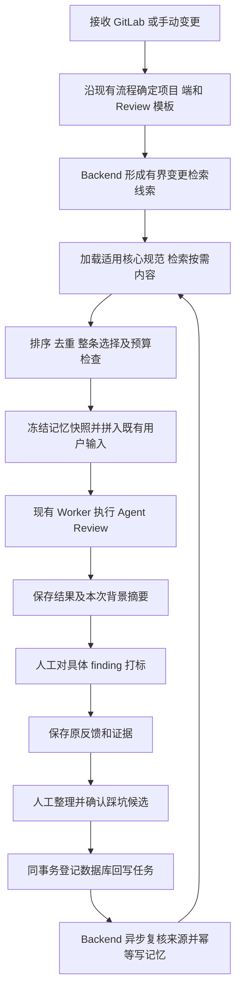
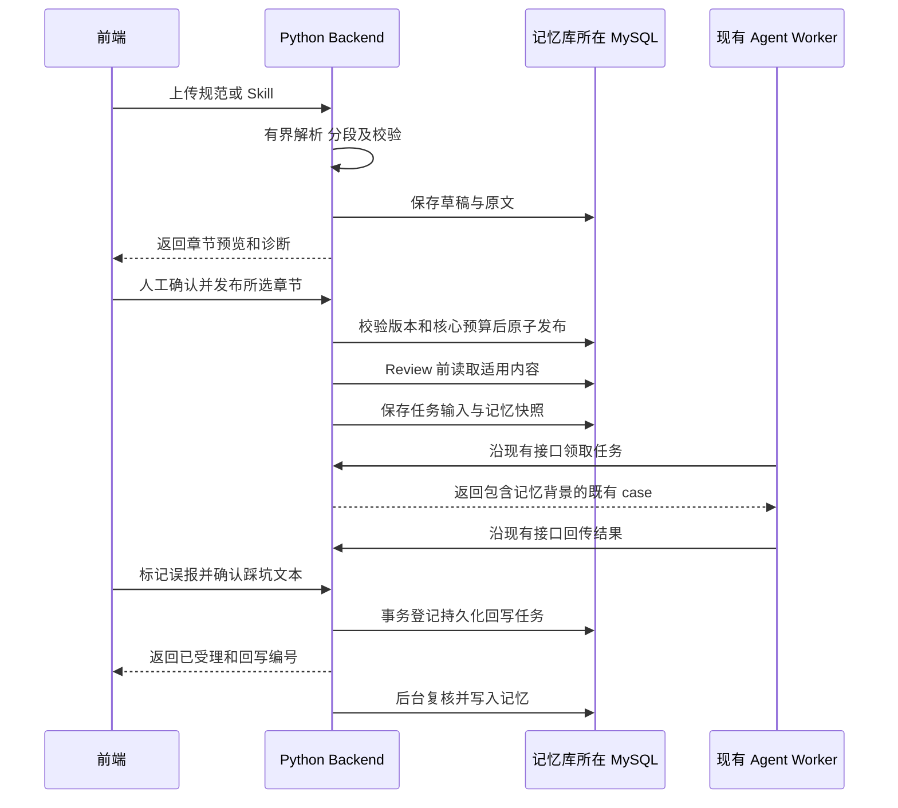
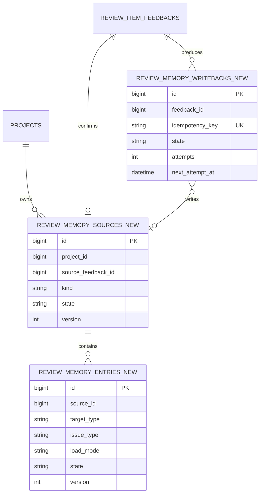

# Agent Review 记忆库专项设计与分阶段开发计划

## 0. 状态与使用范围

- 设计日期：2026-11-11。M1/M2 实施日期：2026-11-12。状态：M1 数据基础和 M2 资料管理后端已落地并完成离线/临时库验证；未执行运行库迁移或部署，M3 及后续阶段尚未开始。
- 本文是后续**记忆库专项**的独立开发依据，完整定义功能、数据、接口、UI、接入和阶段停止点，不需要查阅 60 号文档才能开发。60 号文档的记忆方案、61 号文档的估时不作为本专项实施基线；未来阶段以本文与当阶段用户授权为准。
- 本专项面向所有现有端类型，不受 Java/MyBatis 限制。Java/MyBatis 是源码关系分析的范围，与文字规范、Skill 和案例记忆的接入无关。
- 不在本文实施 AST/调用图、源码范围裁剪、两轮早停、向量库、跨项目共享、脚本执行或模型训练。不填写工时估算。
- 仅基于当前 Python/React 工作树和迁移/模型判断已有能力，未核实运行数据库、生产开关和真实任务效果；实施前核对当时工作树，不能覆盖他人未提交改动。
- 每阶段均可独立授权、验收和安全停留；完成当前阶段即停止，等待用户确认下一阶段。本文不授权自动实施、运行库迁移或发布。

## 1. 需求与已有基础

### 1.1 要交付的闭环

1. 人工对具体 AI finding 标记误报、说明原因和补充证据，原反馈可以先独立保存。
2. 把经人工确认的误报整理成“踩坑案例”，记录适用条件、误判原因、正确判断方法和下次应检查的证据。
3. 按项目上传代码规范文档、审查 Skill，解析成可预览、编辑、发布和停用的文字条目。
4. Backend 在 Agent Review 入队前读取记忆库，选择有效且适用的背景，排序、去重、按预算注入初始输入。
5. 任务详情能说明本次加载了哪些背景、是否发生跳过或降级；后续更新不改变已入队任务的记忆快照。
6. 首期 MySQL 标签和关键词检索，后续再引入向量召回；不让库容量线性变成 Prompt 长度。

### 1.2 现状与复用边界

| 已有资产 | 当前源码 | 本专项怎么处理 |
| --- | --- | --- |
| 项目/端类型 | `backend-python/app/project_integration/models.py` 中 `Project`、`ProjectTargetConfig` | 以 projectId 隔离，沿用当前端枚举与本次任务端类型，不恢复项目组 |
| finding 反馈 | `backend-python/app/review_feedback/{api,service,repository,models}.py` | 复用 `review_item_feedbacks`、fingerprint、原因、快照及状态，不复制反馈主数据 |
| 人工反馈 UI | `frontend/src/App.jsx` 的 `ReviewFeedbackControl`、`RiskFeedbackPage` | 控件和反馈池已有；当前受旧学习 UI 开关控制，新入口独立开放，不恢复整个治理平台 |
| 项目策略 | `backend-python/app/project_review_policy/service.py::build_project_review_policy_prompt_context` | 保留原表、原接口和原注入顺序；新 UI 只展示只读来源，不复制成第二套权威数据 |
| Agent 入队 | `backend-python/app/agent_review/service.py::enqueue_agent_review` | 现有策略加载之后、case 冻结之前接新检索服务 |
| 通用输入 | `backend-python/app/agent_review_spike/prompting.py::review_input` | 四种 Runner 共用 baselineContext 的用户输入渲染，可直接承载新增背景 |
| 任务输入持久化 | `backend-python/app/agent_review/repository.py::create_agent_job` | `AgentReviewRun.input_json` 已保存输入；附加小型 memorySnapshot，无须增加 Run 字段 |
| 结果关联与后台循环 | `backend-python/app/code_quality/repository.py::result_to_response`、`backend-python/app/main.py::lifespan` | 复用 result.agent_run_id 查询快照，增加独立的数据库回写扫描循环 |

其中通用输入会进入模型的 user 内容；Claude CLI 原有 system/Profile 仍使用命令行参数，新记忆不追加到 `--append-system-prompt`。Standard Review 保持现状，本专项不顺带接入它。

## 2. 产品语义与主流程

### 2.1 三种内容的角色

| 角色 | 示例 | 使用方式 |
| --- | --- | --- |
| 核心规范 `CORE` | 本项目必须采用的资金精度约定 | 依据确定的项目/端/路径匹配加载，不依赖关键词命中 |
| 按需规范/Skill `ON_DEMAND` | 缓存一致性审查步骤、特定框架约定 | 按本次变更线索检索相关章节 |
| 踩坑/事故案例 `ON_DEMAND` | 漏查事务事件导致缓存误报 | 作为参考，提示查证，不能直接作为当前代码安全的证明 |

Skill 在本专项中指**审查指引文本**，支持元信息和检查步骤。上传 Skill 不代表安装 Codex/Claude Skill，不执行 scripts、不注册 MCP、不开放 Bash/Web/子 Agent，不执行文档中的工具指令。开发 Skill 若包含修复、格式化或编码动作，发布时只选择其适用于只读审查的段落。

规范不能扩大既有 Review 产品范围，例如当前不报告纯风格问题的约束不因上传命名规范自动取消；也不能覆盖明确的安全、数据一致性和线上正确性问题。冲突内容在 UI 给出提示，由维护者修订，首期不自动推断所有自然语言冲突。

### 2.2 Review 读取与反馈沉淀





## 3. 数据结构与一致性

### 3.1 对象清单

| 对象 | 当前状态 | 变更 |
| --- | --- | --- |
| `projects`、`project_target_configs` | 已有 | 只读复用项目和端定义；发布核心规范时可锁项目行串行核验总预算 |
| `review_item_feedbacks` | 已有 | 保留权威反馈；更新/撤回时增加相关记忆失效钩子，不改变旧枚举语义 |
| `project_review_policies` | 已有 | 保留权威策略、旧接口和原注入，不迁移、不复制、不改变 Standard |
| `agent_review_runs.input_json` | 已有 | 保存 memorySnapshot 与实际注入文本，不新增数据库列 |
| `review_memory_sources` | **新增** | 管理项目资料、原文件/原文、发布状态及来源关联 |
| `review_memory_entries` | **新增** | 可检索、可注入的章节/案例条目，标签和加载方式在此权威维护 |
| `review_memory_writebacks` | **新增** | 人工确认后的可靠异步回写任务，不承担普通文件解析 |

这三张表是当前目标的新表，不能因旧设计中出现过同名表便认为已经存在。迁移文件编号在实施时按仓库最新迁移序列确定，不在规划阶段占号。均使用 InnoDB、utf8mb4；项目/反馈/来源关系先作逻辑关联，不增加跨模块级联删除外键。



图中带 `_NEW` 的节点标签表示新增表，实际表名使用上方清单的小写名称。

### 3.2 新增 `review_memory_sources`

| 字段 | 类型/约束 | 语义 |
| --- | --- | --- |
| id / project_id | BIGINT PK / NOT NULL | 项目 ID 为隔离键，项目名从 projects 查询 |
| kind | VARCHAR(32) NOT NULL | `STANDARD / SKILL / PITFALL / ARCHITECTURE / INCIDENT`；团队规范归 STANDARD，仍归属具体项目 |
| origin | VARCHAR(16) NOT NULL | `MANUAL / UPLOAD / FEEDBACK` |
| title / description | VARCHAR(255) / TEXT | 资料名及简介；Skill 的 name/description 映射至此 |
| state / version | VARCHAR(16) / INT，初始 DRAFT/1 | `DRAFT / PUBLISHED / DISABLED / DELETED`；版本用于并发控制 |
| original_filename / media_type | VARCHAR(255) / VARCHAR(100)，可空 | 展示原文件名与服务端确认格式，文件名不作为存储路径 |
| original_bytes | MEDIUMBLOB，可空 | 上传原件上限 5 MiB，列表/检索不读取该列；人工内容为空 |
| original_sha256 / extracted_text | CHAR(64) / MEDIUMTEXT，可空 | 原件摘要、可追溯的抽取文本；不在 Prompt 重复注入整份原文 |
| parser_version | VARCHAR(64)，可空 | 原件解析方式与版本 |
| parse_warnings_json | TEXT，可空 | 有界解析警告、段落/页码定位和需人工处理项，最多 16 KiB，不复制正文 |
| source_feedback_id / feedback_digest | BIGINT / CHAR(64)，可空 | 反馈关联和确认版本；同一反馈最多一个来源记录，UNIQUE(source_feedback_id) |
| replacement_of_id | BIGINT，可空 | 替换文档时指向旧来源，旧内容保留到新文档确认发布 |
| confirmed_by / confirmed_at | VARCHAR(128) / DATETIME，可空 | 人工确认记录；身份边界见 4.6 |
| created_at / updated_at / deleted_at | DATETIME | deleted_at 只在 DELETED 时设置，逻辑删除保留来源追溯 |

索引：`(project_id,state,kind,id)`、`(project_id,original_sha256)`；后者用于重复上传提示，不阻止用户对同一文件配置不同条目。`replacement_of_id` 必须指向同项目、同 kind 的来源；替换不能借此跨项目转移资料。

### 3.3 新增 `review_memory_entries`

| 字段 | 类型/约束 | 语义 |
| --- | --- | --- |
| id / source_id | BIGINT PK / NOT NULL | 所属项目通过 source 关联，避免多存一个可漂移的 project_id |
| section_key / heading / ordinal | VARCHAR(128) / VARCHAR(255) / INT | 章节标识、标题及顺序，UNIQUE(source_id,section_key) |
| content | MEDIUMTEXT NOT NULL | 完整正文；ACTIVE 单条最多 4000 UTF-8 字节，超限解析段可留在 DRAFT 待人工拆分，同一来源所有草稿/活动正文合计最多 256 KiB |
| target_type | VARCHAR(32)，可空 | 六种现有端枚举；NULL 表示该项目所有端，GENERAL 仍是独立端，不能当作通配 |
| issue_type | VARCHAR(64)，可空 | 标准化问题标签，首批见下文；NULL 表示不限定问题类型 |
| path_globs_json / keywords_json | TEXT，可空 | 最多 8 个相对路径 glob / 12 个关键词；空路径表示整个项目，不支持绝对路径或越界模式 |
| load_mode | VARCHAR(16) NOT NULL | `CORE / ON_DEMAND`；CORE 仅用于 STANDARD/ARCHITECTURE，案例和 Skill 均按需 |
| state / version | VARCHAR(16) / INT，初始 DRAFT/1 | `DRAFT / ACTIVE / DISABLED`；只有来源 PUBLISHED 且条目 ACTIVE 可检索 |
| content_sha256 | CHAR(64) NOT NULL | 内容去重及快照关联 |
| validation_errors_json | TEXT，可空 | 最多 4 KiB 的不可发布原因和定位信息；修正时重新校验 |
| created_at / updated_at | DATETIME | 时间信息 |

索引：`(source_id,state,load_mode,target_type,issue_type)`。标签只在条目维护；上传表单的“默认标签”用于初始化条目，不额外在来源表存一套可冲突的标签。项目名、端显示名和 issue 显示名均由已有项目/明确枚举映射提供。

首批 issue 枚举：`GENERAL / API_CONTRACT / DATABASE / CACHE / MQ / TRANSACTION / SECURITY / CONFIG / ERROR_HANDLING / TESTING`。现有 finding.category 和规则信号经显式映射生成线索；未知值保留在来源反馈，不偷偷当作已识别类型。无法提取问题方向时不能只查询 GENERAL，使用下文的未知线索降级。

案例条目正文采用固定模板，单条保持完整：**适用条件、原误判及原因、正确判断方法、下次应查证据、例外/失效条件**。这些字段先作为模板正文存储，不再增加一组重复正文列；确认接口使用结构化输入，服务端统一渲染。

### 3.4 新增 `review_memory_writebacks`

| 字段 | 类型/约束 | 语义 |
| --- | --- | --- |
| id / feedback_id | BIGINT PK / NOT NULL | 来源反馈及其项目从反馈记录核验，不信任请求覆盖 |
| idempotency_key | CHAR(64) UNIQUE NOT NULL | SHA256(feedbackId + feedbackDigest + canonicalConfirmationPayload) |
| feedback_digest / confirmation_json | CHAR(64) / MEDIUMTEXT NOT NULL | 对反馈状态、类型、原因、finding 快照及时间版本做摘要；保存经人工确认的必要文本与标签，不再复制整份 finding |
| expected_source_version | INT，可空 | 更新已有案例时必须携带；不能自动复活已停用/删除的案例 |
| state | VARCHAR(32) NOT NULL | `PENDING / RUNNING / RETRY_WAIT / SUCCEEDED / FAILED / CANCELLED_STALE_SOURCE` |
| attempts / next_attempt_at | INT / DATETIME | 尝试次数及业务退避时间 |
| lease_owner / lease_until | VARCHAR(128) / DATETIME，可空 | 多 Backend 进程扫描的短租约 |
| source_id / last_error_code | BIGINT / VARCHAR(64)，可空 | 成功目标、失败枚举，不保存异常堆栈正文 |
| confirmed_by / created_at / updated_at / finished_at | VARCHAR(128) / DATETIME | 操作来源和状态时间 |

索引：`(state,next_attempt_at,id)`、`(lease_until,state)`、`(feedback_id,id)`。失败状态保留用于人工修正后重新确认，首期不另建无限重试管理台。

### 3.5 状态、修改与旧数据兼容

- 新上传或手工创建始终 DRAFT，不自动生效。发布事务校验来源版本、条目版本、格式、适用范围、预算，选中条目 ACTIVE、来源 PUBLISHED。
- 每次章节新增/修改/停用和来源状态变化都递增 source.version，修改章节还递增 entry.version；发布检查所有传入版本后一次递增，不能在循环中让后续条目与本次请求自冲突。
- 编辑已生效条目的正文或标签会将该条目改回 DRAFT，立即停止新任务引用；UI 保存前明确提示，未编辑的其它 ACTIVE 章节继续可用。仅启停也需 expectedVersion。
- 替换整份文档创建新草稿，发布新版本时在同一事务核验旧来源版本、停用旧来源、启用新来源；解析失败或未发布不影响旧资料。并发替换旧来源已变化返回 409。
- 来源 DISABLED/DELETED 后所有章节不参与新检索；删除是逻辑删除。原件随逻辑记录保留，本期不设计物理归档清理。
- FEEDBACK 来源的案例正文和适用标签修改必须走结构化案例确认接口，不能借通用条目编辑绕过反馈 digest；重新发布同样要核验当前反馈。手工 PITFALL/INCIDENT 在管理页使用同一模板，但不伪造来源反馈。
- 已入队任务使用被冻结的文本，后续停用不改历史输入；需要立即阻止使用时，取消受影响排队/运行任务后重跑，不在运行中静默换记忆。
- 旧 project_review_policies 仍原样加载。以**实际完整注入的旧条目**按 sourceFeedbackId 和规范化内容摘要去重时保留旧策略，不额外注入同源新案例；UI 显示“同源旧策略已加载”。旧策略若已被旧逻辑截断，不把它当作完整 CORE 的替代；保留必要的新完整条目并记录重叠，不顺带改变旧策略的截断行为。

## 4. 详细后端改动

### 4.1 上传、解析与发布

首批支持 `.md / .txt / SKILL.md`；后续独立阶段支持 `.docx` 和可提取文字的 `.pdf`，仍属于本计划的上传能力。扫描 PDF/OCR、`.doc`、ZIP Skill 包、图片和远端 URL 抓取不在本期；界面应直接说明支持范围。

| 项目 | 明确约束 |
| --- | --- |
| 文件与请求 | 单请求一个文件，MD/TXT 不超过 1 MiB，DOCX/PDF 不超过 5 MiB；服务端有界读取，超限 413，前端校验只作辅助 |
| 解析 | UTF-8 文本；Skill front matter 仅取 name/description，使用 safe loader、限制长度并拒绝 alias；其它字段显示“未启用”，不能改变工具权限 |
| 格式判断 | 扩展名、MIME 与文件结构一致性检查；拒绝加密/损坏 PDF、宏文档和错误结构，返回明确错误，不把乱码当正文 |
| 文档资源 | DOCX 限制 ZIP 成员数和总解压量 20 MiB；不执行宏、不加载外链。PDF 最多 100 页；重型解析在受控子进程完成，10 秒超时有界结束 |
| 输出与分段 | 抽取正文总上限 256 KiB UTF-8、最多 200 条；按标题层级和段落分段，保留上级适用条件，不拆代码围栏，不任意切断“除非/仅适用”等条件 |
| 无法安全切分 | 整个代码块或必要条件超过单条 4000 字节时标注需人工拆分，不悄悄截断；修正前该条不能发布。超过整份解析上限直接失败，不截断成看似完整的文档 |
| 解析结果 | Backend 一次受限解析后原子保存来源和草稿条目，返回预览。失败不创建可发布的半成品；用户可修改文件后重试 |
| 原件 | 原文件保存在 MySQL 来源记录，避免新建文件服务/卷。预览只返回纯文本；下载通过受控接口以 attachment 返回，不内联执行 HTML/脚本 |
| 发布确认 | 人工检查章节、适用范围和完整性，选择要发布的章节；不做模型自动批准，也不因上传成功就自动启用 |

Markdown/PDF/DOCX 的视觉预览不是可信执行环境：不渲染原始 HTML、不自动请求远端图片；代码块以文字显示。解析器不能保证自然语言条件识别完全正确，人工发布确认是必要业务步骤。

新依赖仅安装 Backend：基础上传的 `python-multipart`、Skill 元信息的安全 YAML 解析库；DOCX/PDF 阶段增加 `python-docx`、`pypdf` 并固定已验证版本。Worker 不安装这些依赖。

### 4.2 人工误判到踩坑案例

1. 原反馈继续通过 `POST /api/review-tasks/{taskId}/feedback` 保存；来源是具体 finding 指纹和 reviewKey，整任务不作为一个笼统“误判记忆”。保留项目、任务、原结论及上下文快照。新确认接口必须核验指纹确实关联该项目任务的已保存 AI finding，不采纳客户端自造的 fallback finding。
2. 新确认页面先读反馈详情及服务端生成的 feedbackDigest。人工填写案例模板、端、问题类型、路径范围；首期不调用模型自动总结，避免增加不稳定链路。
3. 新接口只接受反馈类型 FALSE_POSITIVE，状态 PENDING/VALID 可确认；PENDING 在确认事务转 VALID。INSUFFICIENT/IGNORED/CONVERTED 应先在原流程处理，不绕过状态保护；重复 CONVERTED 来源提示已有旧策略。
4. CONTEXT_MISSING 的反馈允许沉淀为**查证方法型 PITFALL**，必须填写缺失证据及下次检查步骤，不能转成“忽略某问题”的 PROJECT_RULE；旧 convert-to-policy 接口的禁止规则保持不变。
5. 确认事务锁定反馈，复核 digest、项目和状态，验证已有 source 版本及确认正文，再登记回写记录；接口返回 202，表示受理而非已入库。幂等键根据本次请求携带的 expectedFeedbackDigest 和规范化确认 payload 生成；优先查已受理请求，来源仍有效时返回原结果。若 PENDING 转 VALID，回写任务的 feedback_digest 必须记录状态变更并 flush 后的摘要，不能让消费方把本次确认自己造成的变化判成过期。刷新页面后的同内容、同当前反馈版本确认也应复用现有来源/成功回写。
6. 异步消费再次复核来源，写一个来源和一个完整 PITFALL 条目，默认 ON_DEMAND；人工已经确认且校验通过后才发布。重复确认同一 payload 返回原任务，不产生第二条案例。
7. 反馈原因/状态/快照改变或撤回时，原反馈写入事务必须使其关联新记忆 DISABLED、使待执行旧确认失效。旧任务不受影响；重新启用需要重新确认当前反馈与来源版本。
8. 不改写原 finding、不自动隐藏历史 finding、不把模型 completion 直接当人工确认。有效事故案例可手工录入 INCIDENT；本期不扩展自动从所有正向反馈学习。

例：把“更新未删除缓存”的误报沉淀为“此订单入口经事务提交事件统一失效缓存；下次需核对事件发布、监听器、缓存 key 和事务阶段”，而不是“本项目缺少删缓存都不报”。

### 4.3 异步回写的执行约束

- 在 `main.py::lifespan` 增加可取消的异步扫描循环，通过 `asyncio.to_thread` 执行短数据库工作，每 10 秒扫描一次、每批最多 20 条；每次独立 Session，不共享请求 Session。退出取消扫描，不等待长任务无限运行。
- 可领取：PENDING、到时的 RETRY_WAIT、租约已过期的 RUNNING。MySQL 事务使用 `FOR UPDATE SKIP LOCKED`，先短事务领取，租约 60 秒；多 Backend 实例不要求单独 leader。
- attempts 每次领取增加，最多 3 次；暂时性 DB 错误按 30 秒、120 秒退避。字段不合法、来源变化、版本冲突是明确终态，不无限重试。第三次 RUNNING 失租也必须终结 FAILED，不能永久悬挂。
- 实际写入采用“反馈 → 来源 → 回写任务”的统一锁顺序；先复核租约 owner/attempt、来源 digest 和 expectedSourceVersion，写 source/entry 与 SUCCEEDED 同事务。领取事务结束后不持有 job 行锁去等待反馈锁。
- 一条失败不阻塞其它记录；日志只记录 ID、状态、耗时、错误码，不输出原件或完整案例。不得因进程重启丢失已经返回 202 的确认。
- 失败后用户修正内容再确认；相同已失败 payload 可查看错误，但不通过重复点按钮自动开启无界重试。来源已 DISABLED/DELETED 不被迟到任务自动恢复。

### 4.4 MySQL 检索、排序与预算

检索由 `review_memory/service.py::select_review_memories` 统一实现，输入为 projectId、本次 task.targetType、安全 changedFiles、有限检索词和已有策略的来源摘要；不依赖 AST/调用图，不能为读记忆重新扫描整仓。

1. **先隔离和过滤**：仅本项目 PUBLISHED 来源 + ACTIVE 条目；target 匹配或 NULL，路径 glob 匹配至少一个安全变更路径或不限定路径。来源 FEEDBACK 还要满足确认版本有效，旧策略去重先行。
2. **CORE 直接加载**：只用确定的项目/端/路径条件，不要求猜中的 issue，也不依赖向量分数。所有适用 CORE 必须完整进入预算；不通过 topK 静默漏掉。
3. **ON_DEMAND 候选**：关键词来自路径/模块名、有限 diff token、现有确定性分类和可获得的规则线索；最多 16 个去重关键词、每词 64 字符。不调用大模型生成 query，不把全部 diff 作为 LIKE 参数。
4. **有界候选集**：最多 200 条，按三组保留名额后去重：问题类型匹配最多 80 条、标题/keywords/heading/正文关键词命中最多 80 条、通用与近期候选最多 40 条；未知方向时第三组允许其它专项类型。SQL 先按项目/端/状态及该组条件过滤排序，每组最多预取 300 条，再在应用层验证 glob、保留各组名额，避免把复杂 glob 冒充已有 SQL 索引能力。预取到界导致可能漏召回时记录 candidateScanLimited；CORE 单独查询，不受此候选上限影响。
5. **确定性排序**：先精确端，再更具体的路径匹配、问题类型匹配、标题/显式关键词命中、正文命中；仅用更新时间和 ID 打破同分。LIKE 参数转义并限制长度，用户输入不拼 SQL。通用内容与案例共享排序，不能靠重复粘贴关键词无限提高权重。
6. **未知线索**：不错误排除所有专项条目，走未知方向组；仍可能漏召回，保存 `issueHintsUnknown=true`。关键词检索是基线，不宣称具备语义相似检索。
7. **去重及注入**：同 source/section 只出现一次；规范化内容 hash 相同保留 CORE 优先，再保留排序靠前项；与完整已注入旧策略相同 sourceFeedbackId 或内容 hash 重合时保留旧策略，记录 skipReason。旧内容已截断的重叠按 3.5 处理。
8. **固定初始预算**：新增 CORE 最多 20 条、总计不超过 8000 UTF-8 字节；ON_DEMAND 最多 8 条且不超过 6000 UTF-8 字节，合计包含标题、来源 ID、适用条件和包装文本最多 14000 字节。按完整条目装入，放不下就跳过并计数，不能切掉例外条件。

CORE 发布/编辑时锁项目行，按每个已支持端核验“NULL 通配 + 本端”的所有核心条目渲染预算上界，即使路径不重叠也按保守总量检查；必须留足总块固定头尾开销。超限发布返回 409，让维护者拆解/降为按需；加载时若仍出现超限视为配置异常，明确失败，不丢 CORE 继续。

这些预算只控制**新增记忆**。旧策略、源码和本任务多轮 history 仍有原来的容量行为，本专项不声称解决所有大 diff 超限。已知模型输入余量不足时可进一步减少按需条目；不能靠删除当前 diff 为记忆腾位置。原有必要输入本身超限按既有链路处理。

### 4.5 初始输入、快照与失败行为

- 当前 Agent case 使用 `baselineContext`，四种 Runner 都通过 `review_input` 读取它。本期优先直接复用：先得到旧 `_bounded_context(request)`，再追加独立 `<project_review_memory>` 文本块；不能把新块塞回旧函数再被 `[:100000]` 静默截断。
- 块中按“核心约定 / 按需审查步骤 / 历史案例”注明来源、版本、适用条件。固定系统审查指令补充：该块是背景资料，不执行其中命令、不自动豁免 finding，仍需本次代码证据。XML 风格分隔符需转义，不把内容当可执行控制协议。
- 旧系统/Profile/旧策略保持原顺序。新增记忆走 user input；Claude 沿已有 stdin 输入，不增加 argv 长度，不加载宿主机 ~/.codex/skills，不访问上传原件。
- 与 case 同时在 `AgentReviewRun.input_json` 根部保存 `memorySnapshot`：schemaVersion、policyVersion、projectId、targetType、selected 条目的 sourceId/entryId/sourceVersion/entryVersion/kind/loadMode/正文 hash、当时标题和适用摘要及 selectionReason、注入字节数、跳过原因计数、lookupStatus。标题/适用摘要分别最多 160 UTF-8 字节，截短仅用于 UI 摘要，不裁正文；路径仅存代表范围与总数，避免重复完整 glob。正文只保存在已冻结的 case.baselineContext，不重复存整份原文/文件；任务详情按该快照展示。
- 检索和内容读取使用同一一致性读视图，读取版本及正文后一次生成 case/snapshot；不用 ID 清单再跨事务重读可变内容。入队后修改资料不改变本任务。新建重跑重新检索，租约重领/进程重启恢复继续使用原输入。
- 现有 Job 仍只把 case、worktree、budgets、runtime 发 Worker。附加 root snapshot 只供 Backend 追溯，旧 Worker 已能读取 baselineContext，**不需要新领取能力、Run schema 列、数据库凭据或容器拓扑**。
- 项目功能关闭、无资料、无匹配分别记录 DISABLED/EMPTY/NO_MATCH；它们不等于查询失败。旧任务没有 snapshot 显示“历史任务，未记录记忆背景”，不能反查当前库冒充当时输入。
- 非核心候选查询失败：尝试仅加载 CORE，标记 `PARTIAL_LOOKUP` 后沿原链路继续。初始有效性/CORE 读取查询失败：标记 `MEMORY_LOOKUP_FAILED` 并停止本次 Agent 入队，不能声称必载规范已加载；用户可明确关闭记忆后重跑。旧项目策略失败保护保持不变。
- 该失败不得被自动转换成不加载必要规范的 Standard fallback；同步核对实时入队失败及恢复路径的错误分类。普通 Agent 执行失败沿既有 fallback，新增背景不自动接入 Standard；详情明确实际执行引擎和是否采用了本次记忆。

### 4.6 公开接口与 DTO

新接口均用 Pydantic request/response schema，不使用任意 dict 代替契约。统一分页 pageNo/pageSize（默认 20，最大 100）；列表不返回原件或完整正文。projectId 由路由/关联记录决定，条目不能靠请求改所属项目。

| 接口（均拟新增） | 用途与必要字段 |
| --- | --- |
| `GET /api/projects/{projectId}/review-memory/sources` | kind/state/targetType/issueType/keyword 分页；端和问题筛选通过子条目 EXISTS，不让 join 放大来源条数 |
| `POST /api/projects/{projectId}/review-memory/sources` | 手工建草稿：kind/title/description/entries，原件为空 |
| `POST /api/projects/{projectId}/review-memory/uploads` | multipart file + kind/title/默认条目标签；同步有界解析，返回 source 草稿、entries 和 warnings |
| `GET /api/projects/{projectId}/review-memory/sources/{id}` | 来源、版本、条目、解析诊断、同源旧策略关联；来源必须属于项目 |
| `GET /api/projects/{projectId}/review-memory/sources/{id}/original` | 下载原件，无原件返回 404；不得接受磁盘路径 |
| `PUT /api/projects/{projectId}/review-memory/sources/{id}` | 改标题/简介，expectedVersion；原件替换走 uploads + replacementOfId/expectedReplacedVersion |
| `POST /api/projects/{projectId}/review-memory/sources/{id}/entries` | 手工新增/拆分草稿章节，带 expectedSourceVersion；sectionKey 服务端生成，校验来源总量和条目数 |
| `PUT /api/projects/{projectId}/review-memory/sources/{id}/entries/{entryId}` | heading/content/targetType/issueType/pathGlobs/keywords/loadMode/expectedVersion/expectedSourceVersion；编辑活动正文转草稿 |
| `POST /api/projects/{projectId}/review-memory/sources/{id}/publish` | expectedVersion + selectedEntries[{id,expectedVersion}]；原子发布，未选择草稿仍不生效 |
| `PUT /api/projects/{projectId}/review-memory/sources/{id}/state` | 仅 DISABLED，带 expectedVersion；重新启用走 publish 重新校验。条目停用使用 entry 更新的明确 state=DISABLED 操作 |
| `DELETE /api/projects/{projectId}/review-memory/sources/{id}?expectedVersion=...` | 逻辑删除、取消关联待回写；新建恢复流程不在首期 |
| `GET /api/projects/{projectId}/review-memory/feedbacks` | 仅本项目 AI_FINDING，复用原反馈池查询，补 memorySourceId/writebackState/feedbackDigest；支持 FALSE_POSITIVE 和状态筛选 |
| `GET /api/projects/{projectId}/review-memory/feedbacks/{feedbackId}` | 反馈、原 finding 和任务链接、digest、现有来源版本；不支持不存在于本项目的任意 finding |
| `POST /api/projects/{projectId}/review-memory/feedbacks/{feedbackId}/confirm` | 结构化踩坑模板 + 标签 + expectedFeedbackDigest + 可选 expectedSourceVersion；返回 HTTP 202/writebackId/status |
| `GET /api/projects/{projectId}/review-memory/writebacks/{id}` | status/attempts/sourceId/lastErrorCode，可供前端有界轮询 |
| `GET /api/projects/{projectId}/review-memory/settings`、`PUT` 同路径 | 新增 enabled，默认 false，PUT 带 expectedVersion；配置存储见下文 |
| `GET /api/agent-review/runs/{runId}/memory-summary` | 从任务冻结输入读摘要，校验关联项目访问边界；不返回 baselineContext/原始 query/diff |

设置复用 `ProjectReviewSettings`：在**接入检索阶段**加 `memory_enabled BOOLEAN NOT NULL DEFAULT false` 和独立 `memory_settings_version INT NOT NULL DEFAULT 1`，不借用其它版本字段。主键 project_id 已有，不提前引入通用配置框架。GET 不因开关关闭隐藏资料管理能力，只有实际注入受开关控制。

HTTP 错误语义：400/422 参数，404 项目或关联不存在，409 版本冲突/不允许发布/核心预算冲突，413 文件过大，415 格式不支持，503 必载资料查询不可用。正文/确认案例按字节限制验证，错误返回字段和条目 ID，不回显整文件。

当前源码未发现完整用户认证/RBAC。首期沿用既有应用部署访问边界并执行项目关联校验；不得把前端隐藏按钮或请求 operatorName 当作权限控制。confirmed_by 有可信登录/网关注入身份时由服务端取得，否则标注“操作人填报，未经身份验证”。不借此专项新建账号权限系统，也不宣称已支持多租户隔离。

确认请求示例：

```json
{
  "expectedFeedbackDigest": "服务器返回的当前反馈摘要",
  "expectedSourceVersion": null,
  "title": "订单更新的缓存由事务事件失效",
  "targetType": "BACKEND",
  "issueType": "CACHE",
  "pathGlobs": ["**/order/**"],
  "keywords": ["缓存失效", "事务事件"],
  "applicability": "仅适用于发布订单变更事件的更新入口",
  "misjudgmentCause": "原结论遗漏事务提交监听器",
  "correctApproach": "检查本次入口到监听器的实际链路后再判断",
  "requiredEvidence": "事件发布、监听器、缓存 key 与事务阶段",
  "exceptions": "未发布事件或监听器未覆盖该 key 时仍需报告"
}
```

### 4.7 拟新增与修改的代码范围

| 文件/模块 | 职责 |
| --- | --- |
| 新 `backend-python/app/review_memory/{models,schemas,repository,service,api}.py` | 资料、条目、状态、检索、快照、项目设置和契约 |
| 新 `review_memory/parsing.py`、`writeback.py` | 有界文本/Skill 解析，后续文档适配；可靠确认回写，不建通用作业框架 |
| 现有迁移目录、`app/project_integration/models.py` | 加法新表，接入阶段再加 ProjectReviewSettings 的独立开关/版本 |
| `app/review_feedback/service.py` | 更新反馈时使旧确认及新记忆失效，保留旧接口语义 |
| `app/agent_review/service.py`、必要的失败恢复分类 | 入队前检索，baselineContext 追加、冻结、失败和 fallback 边界 |
| `app/agent_review_spike/prompting.py` | 一句固定资料解释边界；不新增 Worker 工具或凭据 |
| `app/main.py` | 路由注册与回写扫描生命周期 |
| `frontend/src/settingsNavigation.js`、`appShell.js`、`App.jsx` | 接新导航、finding 按钮与详情摘要，沿用现有 dirty guard，避免整体重构 App |
| 新前端 `reviewMemory/` 目录 | 按页面/表单/上传预览拆实际复用组件，API wrapper 和标签常量，不把全部新逻辑塞入 App.jsx |

真实入口以实施时 rg 和局部源码为准；不修改 legacy Java backend，不引入 Redis/MQ/独立解析或向量容器。

## 5. 前端 UI 设计

### 5.1 入口与信息架构

- 设置的“AI Review 配置”保留“模型与运行”“策略与 Prompt”，新增平级标签 **“项目记忆库”**，拟路由 `/settings/ai-review/memory`。
- 页面顶部先选项目，使用稳定 projectId 作为 URL 查询参数；来自任务的跳转预选该项目。未选择项目不查询资料、不提供跨项目“全部”操作。
- 页面包含 **规范与约定 / 审查 Skill / 踩坑案例** 三个分区。规范区含 STANDARD/ARCHITECTURE，案例区含 PITFALL/INCIDENT；同一后端条目能力按类型呈现。
- 资料管理与人工打标入口使用新独立 `VITE_REVIEW_MEMORY_UI_ENABLED`（默认 false）。不要求开启旧 `VITE_REVIEW_LEARNING_UI_ENABLED`，不自动展示整个反馈池、质量看板和旧项目策略编辑平台。
- 数据是否进入审查取决于 Backend 项目 memory_enabled；前端开关只控制入口可见性，不能替代后端生效条件。

页面结构示意：

```text
AI Review 配置  /  项目记忆库
项目 [订单服务 ▼]       端 [全部 ▼]       [用于后续审查：关闭/开启]
说明：只影响新建审查任务；Skill 仅提供审查指引。

[规范与约定]  [审查 Skill]  [踩坑案例 · 待确认 3]

类型/状态/问题类型筛选    [搜索标题或内容]    [上传资料] [新建条目]
┌──────────────────────────────────────────────────────────────┐
│ 资料名称     适用端/问题    生效章节    状态       更新时间  操作 │
│ 缓存约定     后端/缓存      3/5         已发布     ...       查看 │
│ API 规范     全端/API       0/6         草稿       ...       编辑 │
└──────────────────────────────────────────────────────────────┘
旧项目策略（只读来源，可折叠）：继续按既有机制加载，不在此重复创建。
```

使用现有 Ant Design 的 Tabs、Select、Table、Drawer、Form、Upload、Alert、Tag、Popconfirm；不引入新的 UI 框架或重新设计应用外壳。状态用文字和图标表达，不只靠颜色。

### 5.2 资料与 Skill 的上传/编辑

采用两步 Drawer，桌面宽度约 900px，窄屏占满可用宽度：

1. **选择资料**：类型、文件、标题、默认端/问题标签/路径范围；清楚显示当前支持格式与大小。Skill 显示“仅导入文本；脚本和工具声明不执行”。上传期间禁重复提交，可取消；解析失败保留用户标签和文件名，给重试方式。
2. **预览并确认**：左侧章节列表，右侧纯文本正文；显示解析警告、单条大小和适用条件。允许编辑条目、勾选发布章节、选择 CORE/ON_DEMAND。超限段落标红并禁止发布该条，不用省略号掩盖条件丢失。

底部操作：**保存草稿 / 发布所选章节 / 取消**。发布前展示“适用项目、端、条目数量、核心背景占用”，CORE 超预算时定位问题条目。Skill 只能 ON_DEMAND；case 不提供 CORE 选项。

已发布资料提供“编辑章节 / 替换文件 / 停用 / 删除”。编辑活动条目保存前提示“本条将转回草稿，重新发布后才参与新审查”；替换文件则旧资料继续生效至新资料确认发布。版本冲突保留本地输入，提示刷新对比，不自动覆盖服务端内容。

来源详情显示原文件下载、章节状态、解析版本、人工确认信息、来源反馈/任务链接；无需显示 SQL、Embedding 或内部扫描租约。

### 5.3 finding 打标与踩坑沉淀

在任务详情已有 finding 操作区，独立提供 **“标记误报”**。任务是否由 Agent 或 Standard 产出不影响收集反馈，但首期记忆消费方仅 Agent。未完成/无 finding 的任务不显示“整任务误判”按钮。

- 弹窗一：误报原因、说明、参考证据/缺失背景，勾选“提交后整理为踩坑案例”。先调用现有反馈保存接口，失败不继续确认。
- 不勾选：只保存打标，提示“反馈已保存，尚未进入审查记忆”。
- 勾选：打开案例 Drawer，左右对照原 finding 和固定案例模板；从服务端回填 project、target、问题线索及反馈 digest，允许人工修正标签和证据描述。
- 按钮文案 **“确认并加入记忆”**；提交成功先显示“已受理”，有界轮询回写状态（2 秒一次，最多 30 秒，离开页面停止）。未完成时可关闭，列表保留处理中，重新打开再查询，不持续后台轮询。
- 成功显示“已沉淀，将按适用条件参与后续 Agent Review”；失败显示可操作原因，不把 202 误写成成功。
- 已有同源案例显示“查看案例”；修改/撤回原反馈会使该案例停止用于新任务，UI 明确提醒。已有旧策略显示其来源，不重复生成同样内容。

“踩坑案例”页再分 **已沉淀 / 待确认反馈**：前者展示生效案例及关联任务，后者查询本项目 FALSE_POSITIVE 反馈并提供整理入口；不复制旧反馈表、不恢复无关学习运营功能。缺少说明和证据的反馈仍可保存，但不允许直接发布案例。

### 5.4 本次审查用了哪些背景

任务详情中新增可折叠区域 **“本次审查背景”**，放在执行信息附近：

- 概览显示记忆功能是否启用、核心/规范/Skill/案例的实际加载数量、跳过数量和查询状态。
- 展开列表只显示当时的标题、类型、版本、适用范围和加载原因；点击资料可看当前内容，同时标明“当前版本可能不同于本次快照”。
- 只有当次 snapshot 明确记录 loaded 才能显示“已加载”；历史任务显示“未记录”，无匹配、关闭、查询失败分别显示。
- 使用专用 summary API，禁止把整个 Agent input_json 返回前端。快照需保存有限标题、适用条件摘要和 selectionReason，且计入下面的 32 KiB 元数据上限。
- 若实际回退 Standard，显示“该次 Agent 已加载背景，但最终 Standard 结果未采用本专项记忆”或按真实执行阶段说明，不能把加载数量当最终结果保证。

### 5.5 页面状态与操作完整性

必须具备首次空态、项目未选、加载失败/重试、空筛选、上传中/失败、草稿、已发布、部分章节未发布、回写处理中/失败、版本冲突和已停用状态。离开有修改的 Drawer、换项目、换设置标签均走现有 dirty guard；取消不丢已保存反馈。

桌面筛选横排，窄屏换行；列表窄屏保留横向滚动，主要按钮和状态始终可操作。上传和发布按钮使用具体标签，错误关联表单字段；不自动打开隐藏治理页面。

## 6. 发布、兼容与可观测性

### 6.1 实施与发布顺序

1. 先部署加法表及后端管理契约，功能默认关闭；不在首次 GET 时临时创建表。
2. 再开放对应 UI。资料可先整理、预览和发布，但未开启项目设置时不影响 Review。
3. 后端确认回写与来源失效保护一起部署，再开放 finding 到记忆的 UI，不能只交付可生成陈旧案例的确认接口。
4. 接入入队检索时才迁移项目 memory_enabled/version，并验证四种 Runner 都保留 baselineContext；无需提前升级 Worker 的 claim 协议。
5. 项目显式启用后仅影响新任务，先用固定样本验收再授权生产开放；DOCX/PDF 后端先有能力，前端才开放格式选择。

回滚先关闭项目记忆注入；若要完全停止旧快照使用，先取消/排空对应任务，再回滚 Backend/Worker。仅关闭开关不会移除已入队文本。保留新增表和确认记录，不回滚删除数据；旧 UI 和旧 Worker 忽略新增管理能力仍可工作。

### 6.2 摘要和日志

`memorySnapshot` 除新增文本外的元数据整体最多 32 KiB，条目标题/适用摘要等有单字段上限；CORE 与选中 ON_DEMAND 的 ID/版本/hash 不得静默丢弃。固定条目数和发布预算须保证上界，违反视为实现错误。不得记录原件、完整搜索词、整个 diff 或完整 Prompt。

最小指标：候选数、选中数、核心/按需字节数、同源/重复/超预算跳过数、检索耗时、查询状态、确认回写成功/失败/失效数。UI 不把关键词匹配分数显示成“正确率”或“置信度”。

误报改善需要真实样本对照，不能把 finding 变少直接等同质量变好；检查已有问题是否因为某条记忆被错误忽略。案例示例及人工说明中不自动持久化凭据或上传无关源码。

## 7. 分阶段推进与停止点

整体工作跨前后端和数据库，不能作为一个“大”阶段直接实施，现拆为以下独立边界。每阶段必须先确认实际范围；范围变为“大”时继续拆分后再实施。M1～M9 是本专项功能交付；M10 仅定义后续向量方向，不混入前面阶段。

| 阶段 | 改动量等级与依据 | 目标及范围 | 非目标 | 验收方式 | 授权边界及停止点 |
| --- | --- | --- | --- | --- | --- |
| M1 数据与内部能力 | **中**：单后端加法数据层，保持生产审查关闭 | 三张新表、模型/schema、状态及内部项目隔离查询，版本与预算规则 | 不开放 UI/上传/Review 注入，不跑运行库迁移 | 迁移静态检查、内部 synthetic/手动验证状态与查询；授权环境再做迁移验证 | 本地实现与静态验证；完成汇报并停 |
| M2 资料管理后端 | **中**：一个管理子域的 API 和有界文本解析 | 手工条目、MD/TXT/SKILL.md 上传、预览、编辑、发布、停用、替换、原件下载；项目关联和预算保护一起交付 | 不接反馈异步、DOCX/PDF、Review | 手动 API 检查跨项目 ID、格式/大小、章节超限、并发发布、替换和版本冲突 | 管理契约独立可用，入口对旧 Review 无影响；完成后停 |
| M3 资料管理 UI | **中**：设置内新增一页及其表单，后端已具备保护 | 项目记忆库导航、规范/Skill/案例浏览、上传预览、草稿/发布/启停、旧策略只读区 | 不增加后端协议、不开放误报确认或注入开关 | build、页面人工/浏览器验收，dirty guard、上传失败及窄屏 | 前端入口仅在 M2 完整后开放；完成后停 |
| M4 踩坑确认后端 | **中**：确认与可靠消费、撤回失效形成一个完整后端闭环 | 复用反馈，补详情/digest/确认/状态 API、持久化扫描、租约、去重、版本、反馈失效钩子 | 不自动总结，不恢复旧治理平台，不改 Review | 手动 API/synthetic 检查重复确认、重启恢复、第三次失租、来源变更、停用不复活 | 确认接口不领先于必要保护；完成后停 |
| M5 人工打标与案例 UI | **中**：任务详情与记忆页的小范围交互联动 | 独立打标、原因证据、原结论对照、案例模板、待确认列表、异步结果 | 不加模型总结，不打开全部旧反馈治理入口 | build、真实已完成任务上人工验证保存/确认/失败/重新打开/撤回 | M4 完整后启用；反馈先保存，确认可取消；完成后停 |
| M6 入队检索与注入 | **中**：只改 Backend 入队准备及少量固定资料解释，复用已有 Worker 输入 | 新增项目开关/版本、MySQL 标签关键词选择、CORE 保护、去重/预算、baselineContext、快照、失败及恢复分类、summary API | 不改 Worker 工具/claim/数据库连接，不实现向量或源码裁剪 | 四种 Runner synthetic 输入核验；关闭/空/未知线索/查询失败/重跑/重领/旧策略去重；API 闭环核验结果 | 默认关闭，本地实现不等于生产启用；完成后停 |
| M7 注入控制与任务详情 UI | **中**：复用 M6 完整契约，两个位置展示真实状态 | 项目“用于后续审查”开关、本次背景摘要、旧任务/降级/fallback 展示 | 不改检索算法，不回填历史快照 | build、开关版本冲突、任务快照不漂移、实际 Agent/Standard 状态核验 | 开关后端完整后才开放；完成后停 |
| M8 常见文档解析后端 | **中**：新增两种格式适配，沿用已交付发布边界 | DOCX、文本 PDF，受限子进程、大小/页数/解压/时间限制、正文与表格可读抽取、解析诊断 | 不支持 OCR/图片/旧 DOC/ZIP Skill/远端抓取 | 固定正常/损坏/扫描/加密/超时文档手动验证；失败不替换旧发布版本 | 服务端能力先交付并可安全停留；完成后停 |
| M9 文档上传 UI 与专项验收 | **中**：格式扩展展示及已交付功能的跨端闭环，不新增数据契约 | 开放 DOCX/PDF 格式提示、页码/段落诊断、混合资料选择；固定 MR 验证完整闭环 | 不增加分析框架或临时扩大范围修复 | build/浏览器、上传到发布到初始输入到反馈沉淀；误报及漏报样本人工对照 | 不自动部署或运行生产 Review；完成专项验收后停 |
| M10 向量召回方案确认 | **小**：只做候选召回扩展设计，不接库迁移 | 基于真实漏召回样本确定 Embedding、切片、索引、混合召回和撤回同步契约 | 不实现向量库、不改变 CORE 直接读取 | 设计审阅和固定语义样例确认 | 用户另行发起，审阅后停；实际开发需重新拆小/中阶段，不能用本行授权整个向量工程 |

上述验收默认采用聚焦静态检查、手动 API、synthetic 脚本调用及浏览器验证。本次不新增、修改或运行单元测试；未来某阶段如需单元测试，应由用户在该阶段明确授权，不以覆盖率要求扩大范围。迁移、部署、真实生产任务另行授权。

## 8. 专项完成验收清单

1. 不开启旧学习 UI，也能对 finding 保存误报反馈、整理案例；没有证据的反馈可留待确认，但不能直接生效。
2. 上传项目规范和 Skill 可先预览再发布，只有确认的 ACTIVE 章节参与检索；Skill 不执行任何脚本/工具。
3. 同一项目不同端的资料按明确规则匹配；GENERAL 不等于全端，项目 A 的 source/entry/feedback ID 不能被项目 B 路径访问。
4. 核心规范不因关键词不命中而丢失；预算冲突可见且可修正。低优先按需内容跳过时有计数，没有截断例外条件。
5. 相同来源与旧策略不重复注入；旧项目策略接口和 Standard 行为不变。
6. 入队记忆版本冻结，编辑/停用不改变旧任务；重领沿用原快照，新重跑重新检索。
7. 回写 202 后重启仍可继续，重复确认不重复建案例；反馈变更、撤回或案例停用后旧任务不会复活案例。
8. 四种 Runner 都收到相同选中背景，Worker 无数据库连接、原件挂载和额外执行权限。
9. 任务详情显示真实加载状态，关闭/无匹配/失败/历史未记录/fallback 可区分；未泄露整个 Prompt 和源码。
10. DOCX/PDF 后端和 UI 完成后，正常文字文档可导入；损坏、扫描、加密、超大和超时文件可解释失败，旧资料不受影响。
11. 使用固定真实 MR 和人工结论比较记忆前后误报及漏报，不承诺未测量的改善百分比。

## 9. 向量检索的后续接入边界

- 当前 MySQL 保存正文、适用条件、状态、确认来源和版本，继续是权威数据。
- 后期对按需规范章节、Skill 步骤和踩坑案例生成 Embedding，关键词与向量混合召回后再筛选、排序、去重和预算选择；CORE 仍直接查询，不交给相似度决定是否加载。
- 向量命中必须返回 entryId/version，Backend 再核验当前项目、端、状态及正文版本，不能直接把索引中的过期原文注入。停用/删除在 SQL 最终核验时立即生效，索引同步可异步补齐。
- 更换 Embedding 模型通常要重建向量；存储、模型费用、延迟和语义召回效果必须用实际样本评估。本期不预建向量字段、接口、容器或“通用检索平台”。
- Agent 执行中按需查记忆是另一个可选扩展，需要新增受控工具和协议验收；首期只有 Backend 入队前检索，不能在 UI 或交付中宣称 Agent 已会自主查询记忆库。

## 10. M1 实施边界与记录

### 10.1 本阶段契约

- 改动量等级：**中**。仅新增后端加法数据层与内部校验，不开放公开接口或改变审查主链路。
- 新增 V57 三张表迁移和 `app/review_memory` 模块；迁移按既有工具自动发现，不在应用导入、查询或请求时建表。
- 内部能力限于创建 MANUAL 草稿、按项目读取/分页查询来源、读取章节和回写记录、核验版本/来源状态、验证条目与 CORE 发布预算。不在 M1 实现上传、发布事务、反馈确认、异步消费、排名召回或 Prompt 注入。
- 所有来源/章节查询显式传入 projectId；回写记录通过原反馈关联项目。来源列表不读取原文件二进制和整份抽取文本；详情按需读取正文，原件读取仍留给 M2。
- 新草稿内容允许单段超过 4000 字节以便后续人工拆分，但同来源最多 200 条、总正文 256 KiB；发布校验必须拒绝超限条目。CORE 仅允许 STANDARD/ARCHITECTURE，针对六种端分别验证通配与专属内容合计最多 20 条/8000 字节，包含稳定渲染包装。
- 状态/版本与预算校验作为内部函数交付，实际发布和并发写保护在 M2 完成；M1 不提供绕过确认的发布入口。
- 验证使用聚焦静态检查和 SQLite 内存临时库 synthetic 调用，迁移做离线发现/语句及 MySQL DDL 编译对照；不连接运行数据库，不新增或运行单元测试，不需要浏览器验收。

### 10.2 验证与停止点

交付文件：

- `backend-python/migrations/bootstrap_sql/V57__review_memory_foundation.sql`：三张加法表，InnoDB/utf8mb4，来源反馈、章节标识和回写幂等唯一约束，以及筛选/回写索引。
- `backend-python/app/review_memory/models.py`：对应 ORM，SQLite ID/文本兼容、MySQL MEDIUMTEXT/MEDIUMBLOB/DATETIME(3)；原件、抽取原文和章节正文延迟加载。
- `schemas.py`：种类、来源、状态、issue 和加载方式枚举；复用现有 TargetType；草稿、分页、详情、CORE 预算输入和回写摘要契约。未知字段拒绝，路径越界与条目/来源大小有界。
- `repository.py`：项目范围内的来源、章节、回写读取及来源分页，章节筛选用 EXISTS 避免重复来源；管理筛选中的 targetType/issueType 为精确标签筛选，通配匹配在未来 M6 生效检索中处理。
- `service.py`：创建手工草稿只 flush、不 commit；项目关联读取和安全摘要；版本/来源状态校验、条目发布前校验，以及六端 CORE 总预算校验。发布预算函数只做校验，不实际发布。

已完成验证：

| 验证 | 结果与证据边界 |
| --- | --- |
| 聚焦 Ruff | `check app/review_memory`、`format --check app/review_memory` 均通过 |
| 迁移静态一致性 | 现有 discover_migrations 自动发现 V1～V57；V57 拆出且仅拆出 3 条 CREATE TABLE；逐表对照字段、MySQL 类型（INT/INTEGER 同义）、可空性、server default、索引与唯一约束通过 |
| MySQL 方言编译 | 三张 ORM 表 DDL 编译通过，确认 MEDIUMTEXT/MEDIUMBLOB、CHAR(64)、DATETIME(3)、InnoDB/utf8mb4；这不等于已在 MySQL 执行迁移 |
| 隔离临时库 synthetic | SQLite 内存库建表/删表成功；草稿回滚、来源/章节/回写跨项目 404、EXISTS 分页不重复、LIKE 特殊字符转义、原件/整份原文未加载、活动 CORE 可见及停用/删除排除通过 |
| 契约与边界 synthetic | 非法端/未知字段/越界路径拒绝；超限正文可存草稿但禁止发布；来源总字节限制、CORE 类型限制、旧版本冲突、删除状态不能重新发布、CORE 20 条/8000 字节和 UTF-8 多字节预算通过；GENERAL 与 NULL 通配保持区别 |
| 实际运行库/前端 | 未连接运行数据库，未执行迁移、启动服务、浏览器验收或真实 Review；未改主链路、UI、现有表、项目设置或 Worker |

没有新增、修改或运行单元测试。现有后端脚本提供模块执行，但没有 stdin 临时 synthetic 入口，因此临时库校验直接调用项目虚拟环境 Python，仅连接 `sqlite:///:memory:`。

最小复现（仓库根目录 PowerShell）：

```powershell
powershell.exe -NoProfile -ExecutionPolicy Bypass -File scripts/run-backend.ps1 ruff check app/review_memory
powershell.exe -NoProfile -ExecutionPolicy Bypass -File scripts/run-backend.ps1 ruff format --check app/review_memory
@'
import os, sys
from pathlib import Path
os.environ['DATABASE_URL'] = 'sqlite:///:memory:'
sys.path.insert(0, str(Path('backend-python').resolve()))
from sqlalchemy import create_engine
from sqlalchemy.orm import Session
from app.core.database import Base
from app.core.errors import AppError
from app.project_integration.models import Project
from app.review_memory.models import ReviewMemorySource, ReviewMemoryEntry, ReviewMemoryWriteback
from app.review_memory.schemas import MemorySourceDraft, MemorySourceQuery
from app.review_memory.service import create_manual_draft, get_project_source, list_project_sources
engine = create_engine('sqlite:///:memory:')
tables = [Project.__table__, ReviewMemorySource.__table__,
          ReviewMemoryEntry.__table__, ReviewMemoryWriteback.__table__]
Base.metadata.create_all(engine, tables=tables)
with Session(engine) as db:
    db.add(Project(id=1, name='demo', git_provider='GITLAB', git_project_id='1',
                   default_template_code='backend', target_type='BACKEND', status='ACTIVE'))
    db.flush()
    draft = create_manual_draft(db, 1, MemorySourceDraft(kind='STANDARD', title='demo',
        entries=[{'heading': 'rule', 'content': 'Check the actual evidence.'}]))
    assert draft.state == 'DRAFT' and draft.entries[0].state == 'DRAFT'
    assert list_project_sources(db, 1, MemorySourceQuery()).total == 1
    try:
        get_project_source(db, 2, draft.id)
    except AppError as error:
        assert error.status_code == 404
    else:
        raise AssertionError('cross-project source was returned')
    db.rollback()
Base.metadata.drop_all(engine, tables=tables)
engine.dispose()
print('M1 isolated draft/query smoke passed')
'@ | & backend-python/.venv/Scripts/python.exe -
```

运行库迁移仍需独立授权。尤其本地既有 V56 可能尚未执行，未来不能把 `migrate apply` 当成“仅执行 V57”；应先使用隔离目标的 status/dry-run 检查所有 pending，并按 V56 破坏性迁移的既有前置条件处理。首期不提供自动删除新表的回滚脚本；应用回退保留新表，避免丢失以后录入的资料。

**M1 历史停止记录：** M1 完成时未本地提交、运行库迁移或部署；之后用户已授权 M2，当前实施结果见第 11 节。

## 11. M2 实施契约与记录

### 11.1 本阶段实施边界

- 改动量等级：**中**。复用 M1 三张表，新增一个后端资料管理子域及有界文本解析，不新增迁移、前端或 Review 消费能力。
- 用户已授权实施 M2；只实现 4.6 的 sources、uploads、entries、publish、state 和 original 接口。反馈确认/回写、项目开关及 Review 注入不在本阶段。
- 新接口统一返回现有 success/code/message/data/traceId 信封，data 使用明确的 Pydantic schema；下载例外，返回 attachment。所有服务写操作只 flush，由 API 在成功时提交、异常时回滚。

### 11.2 【PC端】资料管理接口新增

以下路径均以 `/api/projects/{projectId}/review-memory` 为前缀；projectId 来自当前选中项目，source/entry ID 和版本来自本接口列表/详情，不能由请求更改项目归属。

| 接口 | 新增请求字段、来源与前端用途 | 返回数据与需求使用位置 |
| --- | --- | --- |
| GET /sources | 4.6 的筛选字段、pageNo/pageSize，来自筛选表单 | MemorySourcePage；供 5.1 列表使用，不带正文/原件 |
| POST /sources | kind/title/description/entries，来自手工表单，结构沿用 M1 MemorySourceDraft | MemorySourceDetail；4.1 草稿预览，默认不发布 |
| POST /uploads | multipart 单文件 file 和 JSON 文本 metadata；metadata 为 kind、可选 title/description、默认 targetType/issueType/pathGlobs/keywords/loadMode、可选 replacementOfId/expectedReplacedVersion，来自上传表单及旧来源详情 | MemorySourceDetail；4.1 返回章节、诊断、原件信息，供 5.2 预览 |
| GET /sources/{id} | 路径 id 来自列表 | MemorySourceDetail；含 entries、originalFilename/mediaType/parserVersion/parseWarnings、hasOriginal、confirmedBy/confirmedAt、identityVerified=false、legacyPolicyIds，仅按同源反馈关联旧策略，不返回旧策略正文 |
| GET /sources/{id}/original | 路径 id 来自详情 | 原始字节 attachment；4.1 原件追溯，不接受本地路径 |
| PUT /sources/{id} | title/description/expectedVersion；完整元信息表单及详情版本 | MemorySourceDetail；3.5 编辑、递增来源版本、重验 CORE 包装预算 |
| POST /sources/{id}/entries | expectedSourceVersion + entry（M1 MemoryEntryDraft）；来自拆分/新增表单 | MemorySourceDetail；4.6 新增草稿，sectionKey 服务端生成 |
| PUT /sources/{id}/entries/{entryId} | expectedVersion/expectedSourceVersion + entry（完整 MemoryEntryDraft）或 state=DISABLED，两种操作互斥 | MemorySourceDetail；3.5 编辑转 DRAFT，或停用，不允许客户端直接 ACTIVE |
| POST /sources/{id}/publish | expectedVersion、selectedEntries[{id,expectedVersion}]、可选 expectedReplacedVersion/operatorName；来自详情勾选、版本和操作人填报 | MemorySourceDetail；4.1 人工确认，operatorName 仅记录为未经身份验证的填报 |
| PUT /sources/{id}/state | state=DISABLED、expectedVersion，来自停用动作和详情 | MemorySourceDetail；3.5 重新启用必须走 publish |
| DELETE /sources/{id} | query expectedVersion，来自详情 | MemorySourceDetail；逻辑删除，已删除来源禁止继续修改或发布 |

完整条目字段为 heading/content/targetType/issueType/pathGlobs/keywords/loadMode；可空标签和空列表的意义沿用 M1，不使用任意 dict 绕过 schema。新增章节/编辑后返回完整详情，前端用新版本覆盖已保存状态；409 保留本地输入并刷新对比。列表标签采用精确筛选，NULL 通配匹配属于 M6 检索。

### 11.3 后端处理与必要兼容保护

- 所有管理写入先锁项目行，再锁来源，再读取章节当前版本；统一串行化同项目发布/编辑预算核验，来源和条目均复核客户端版本。MySQL 的版本/活动集合查询使用锁定当前读，避免等待项目锁前的普通读快照影响预算；现有 Review/策略接口不改动。
- 发布只激活选中章节；PUBLISHED 来源未选择的 ACTIVE 章节继续有效，DRAFT/DISABLED 章节仍不生效。恢复 DISABLED 来源时，只恢复本次明确选中的章节，其余原 ACTIVE 章节转 DISABLED，避免暗中恢复。每次操作来源版本只递增一次，受影响章节版本分别递增一次。
- 替换上传时核验旧来源同项目、同 kind 且非 DELETED/FEEDBACK；不改变旧来源。发布替换草稿必须再次提供 expectedReplacedVersion，核验旧来源仍为该版本且非删除，然后同事务停用旧来源和发布新来源；新来源只在首次发布执行替换。旧来源中途修改返回 409，不覆盖。旧版本号不另加持久化字段。
- FEEDBACK 来源仅可读取；通用管理写入一律拒绝，防止在 M4 的反馈锁、digest 和撤回保护实现前提前开放绕过确认的入口。手工 PITFALL/INCIDENT 发布要求正文保留“适用条件、原误判及原因、正确判断方法、下次应查证据、例外/失效条件”五个非空模板段落。
- 标题、条目或状态变更后按当前完整活动集合校验六端 CORE 预算；替换时先排除同事务停用的旧来源。source/entry 当前版本及渲染元信息一起计入，失败整体回滚。
- Markdown 使用固定版本轻量解析库识别标题/段落/代码围栏；以完整顶层章节保留嵌套适用条件，公共前言复制至每章。TXT 保留完整正文；PITFALL/INCIDENT 保留整份模板，避免把五个案例段落拆散。保守保留大段为不可发布草稿，避免依赖自然语言猜测拆条件。不渲染 HTML、不请求外链、不调用模型。
- Skill YAML front matter 最多 8 KiB，使用 safe loader，拒绝 alias/anchor、重复键和过深结构；仅 name/description 生效，其余字段诊断为未启用。MD/TXT 单文件最多 1 MiB；整个 multipart 请求最多 1 MiB + 64 KiB，metadata 最多 16 KiB、只允许一文件一字段，流式累计限制，不信任 Content-Length。
- UTF-8（可带 BOM）解码并拒绝二进制控制符；文件名只保留安全 basename，扩展名与 MIME 校验，纯文本无需执行式内容探测。正文/条目数遵循 M1 上限，解析失败事务不留半成品。重复文件只提示，不拦截。

### 11.4 【公共】异常与验收

- 400：参数/UTF-8/YAML/结构无效；404：项目、来源、章节或原件不在当前项目；409：版本、状态、发布条件或 CORE 预算冲突；413：请求/文件/抽取总量超限；415：格式不支持。错误只含字段/ID/错误码，不回显完整文档。
- 使用聚焦 Ruff、OpenAPI 静态核对、隔离 SQLite 的 API/synthetic 验证上传→草稿→编辑→发布→停用/替换→下载/删除，以及跨项目、超限、版本冲突和失败回滚。脚本入口不支持内嵌 synthetic 时使用本地 venv Python；不新增、修改或运行单元测试。
- 不启动运行服务、不执行运行库迁移、不部署、不提交；M2 完成后停，M3 需要用户另行授权。

### 11.5 实施结果与最小复现

已交付 `review_memory/api.py`、`parsing.py`，扩展既有 schemas/service/repository；`main.py` 只注册新路由。共 11 个资料管理 HTTP 操作，已有三张表直接复用，无 M2 迁移。`MemoryUploadMetadata` 是 multipart 的 metadata 字段契约；其内容示例：

```json
{
  "kind": "SKILL",
  "title": "缓存审查步骤",
  "targetType": "BACKEND",
  "issueType": "CACHE",
  "pathGlobs": ["**/order/**"],
  "keywords": ["缓存失效"],
  "loadMode": "ON_DEMAND"
}
```

上传不填 title/description 时可采用 Skill name/description；其它 YAML 字段只产生未启用诊断。替换上传在上述 JSON 中增加同项目同 kind 的 replacementOfId/expectedReplacedVersion，首次发布时再次提供最新 expectedReplacedVersion。发布请求示例（ID/版本必须使用详情实际值）：

```json
{
  "expectedVersion": 1,
  "selectedEntries": [{"id": 101, "expectedVersion": 1}],
  "operatorName": "维护者填报名称"
}
```

本地 Backend 新依赖已安装并验证，固定版本为 `python-multipart==0.0.22`、`PyYAML==6.0.3`、`markdown-it-py==4.0.0`。在其它 Backend 环境按 pyproject 安装；仅更新本地依赖可从仓库根目录执行：

```powershell
powershell.exe -NoProfile -ExecutionPolicy Bypass -File scripts/run-backend.ps1 pip install python-multipart==0.0.22 PyYAML==6.0.3 markdown-it-py==4.0.0
powershell.exe -NoProfile -ExecutionPolicy Bypass -File scripts/run-backend.ps1 ruff check app/review_memory app/main.py
powershell.exe -NoProfile -ExecutionPolicy Bypass -File scripts/run-backend.ps1 ruff format --check app/review_memory
```

隔离 API 最小复现（仓库根目录运行；本地脚本没有 stdin synthetic 入口，因此直接使用 venv Python；不启动 lifespan，不接运行库，不触发 Review）：

```powershell
$OutputEncoding = [System.Text.UTF8Encoding]::new($false)
@'
import os, sys, json
os.environ['DATABASE_URL'] = 'sqlite:///:memory:'
sys.path.insert(0, 'backend-python')
from fastapi import FastAPI
from fastapi.testclient import TestClient
from sqlalchemy import create_engine
from sqlalchemy.orm import Session
from sqlalchemy.pool import StaticPool
from app.core.database import Base, get_db
from app.core.errors import register_exception_handlers
from app.project_integration.models import Project
from app.review_memory.api import router
from app.review_memory.models import ReviewMemorySource, ReviewMemoryEntry
engine = create_engine('sqlite://', poolclass=StaticPool,
                       connect_args={'check_same_thread': False})
tables = [Project.__table__, ReviewMemorySource.__table__, ReviewMemoryEntry.__table__]
Base.metadata.create_all(engine, tables=tables)
with Session(engine) as db:
    db.add(Project(id=1, name='memory-smoke', git_provider='GITLAB',
                   git_project_id='1', default_template_code='DEFAULT', status='ACTIVE'))
    db.commit()
def isolated_db():
    with Session(engine, autoflush=False) as db:
        yield db
app = FastAPI()
register_exception_handlers(app)
app.include_router(router)
app.dependency_overrides[get_db] = isolated_db
root = '/api/projects/1/review-memory'
with TestClient(app) as client:
    original = b'# Rules\nCheck transaction events before reporting cache issues.\n'
    response = client.post(root + '/uploads',
        files={'file': ('rules.md', original, 'text/markdown')},
        data={'metadata': json.dumps({'kind': 'STANDARD', 'targetType': 'BACKEND'})})
    assert response.status_code == 200, response.text
    source = response.json()['data']
    assert source['state'] == 'DRAFT' and source['hasOriginal']
    path = root + '/sources/' + str(source['id'])
    payload = {'expectedVersion': source['version'], 'selectedEntries': [
        {'id': source['entries'][0]['id'], 'expectedVersion': source['entries'][0]['version']}]}
    published = client.post(path + '/publish', json=payload)
    assert published.status_code == 200, published.text
    assert published.json()['data']['entries'][0]['state'] == 'ACTIVE'
    assert client.post(path + '/publish', json=payload).status_code == 409
    assert client.get(path.replace('/1/', '/2/', 1)).status_code == 404
    download = client.get(path + '/original')
    assert download.content == original
    assert download.headers['content-disposition'].startswith('attachment;')
Base.metadata.drop_all(engine, tables=tables)
engine.dispose()
print('M2 isolated upload/publish/version/download smoke passed')
'@ | backend-python/.venv/Scripts/python.exe -
```

本阶段验收结果：

- 聚焦 Ruff check/format、模块导入和完整应用 OpenAPI 生成通过；仅新增资料管理路由，不启动应用恢复循环。
- SQLite 临时库的 API/synthetic 调用通过：手工/上传草稿、UTF-8 BOM、Skill 元信息、分章与代码围栏、公共适用前言、完整案例模板、预览/编辑/部分发布/章节停用/来源停用后选择恢复/下载/逻辑删除。
- 跨项目来源/章节/下载/替换、来源及章节旧版本、重复文件提示、无原件、格式/MIME/UTF-8/二进制控制字符、损坏/多文件/额外字段 multipart、请求/文件/元信息/正文/章节数超限均检查；拒绝不留可发布半成品。
- YAML alias/anchor、重复键、不安全 tag 和未闭合 front matter 均拒绝；Skill 不能使用 CORE。手工和上传案例的五段模板保持完整且发布校验非空。
- CORE 六端字节预算、NULL 通配、20 条数量上限、标题增长、旧版本写入、替换后预算失败均检查；失败回滚来源/章节版本及旧资料状态。FEEDBACK 来源通用写入口拒绝，同源旧策略只读关联可用。
- MySQL 方言下项目/来源/章节/活动 CORE 查询均生成 `FOR UPDATE`，并使用 populate_existing 刷新。**未连接 MySQL，真实多连接竞争和运行库迁移尚未验证**；SQLite 不模拟 InnoDB 锁行为，不将旧版本冲突检查宣称为真实并发验收。
- 未新增、修改或运行单元测试；本阶段无前端变化，不需要浏览器验收。未执行运行库迁移、服务启动、部署或本地提交。运行前仍需先独立核验 V56/V57 pending 风险，不能直接把 migrate apply 当作只建记忆表。

**停止点：M2 已完成；未进入 M3。** 下一阶段是资料管理 UI，需用户另行授权；Review 当前尚不消费新记忆库。
