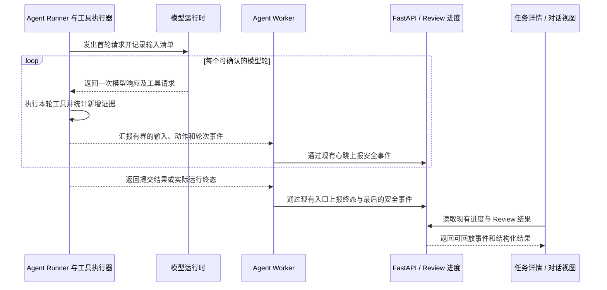

# Agent Review 聊天式回放多阶段推进方案

## 0. 状态与交付边界

- 更新于 2026-11-24。方案依据当前工作树与提交 `f3c0498`。P1 至 P4 和 P5 首批固定指令已通过分阶段本地验收。尚未核验运行环境数据库或实际 Provider 返回。
- 目标是在任务详情「模型 Review」抽屉中增加「执行过程」视图。Standard、Agent 和 Agent → Standard 降级共享「初始输入 → 执行过程 → 最终响应」布局，按已记录的事实展示并保留「阶段详情」。
- 常规任务先交付白名单回放。模型对外提供的决策摘要和初始 Prompt 原文分别设为独立阶段。AST、调用图、自动早停、扩大仓库访问范围和改变审查策略不在这次实施范围内。空转计数用于诊断。
- 用户已确认由子 Agent 推进、主 Agent 验收，已验收的阶段可继续推进。2026-11-24 确认所有能打开任务详情的用户都可读取初始 Prompt，沿用现有任务与 Review 的读取范围。

## 1. 现状与信息来源

| 想看到的内容 | 当前事实 | 设计取舍 |
| --- | --- | --- |
| 第一次发给模型的输入 | `agent_review/service.py` 组装 case、工作树、有效预算和记忆快照。各 Runner 再渲染指令和输入，大 diff 可能改用分页。终态按现有策略清理运行输入，符合降级条件的失败可暂留到降级使用 | 在 Runner 首次发送位置生成输入清单和实际计数。入队信息只表示准备完成，不能作「已发送」证明。 |
| 每轮模型与工具交互 | HTTP Runner 能识别模型响应及其 tool calls，并按 ID 回传工具结果。Claude CLI 目前从终态事件取总轮数，MCP 审计单独记录工具活动 | HTTP 先按真实轮次展示。CLI 有可靠关联后才按轮展示。单次工具调用不能代替一轮。 |
| 当前可见 Trace | Worker 通过心跳和完成接口上报脱敏 audit。后端以任务、`reviewKey`、Run 和领取尝试为作用域写进度，前端在阶段抽屉展示工具、计数、预算和提交状态 | 常规回放延用现有进度轮询和字段白名单。历史记录仅按当时已有的事件回放。 |
| 最终响应 | `submit_review` 校验 Review Card，Worker 回传，后端保存结构化结果。运行终态和提交事件已有各自的状态 | 从已有结果接口读取并引用卡片，失败或取消展示已保存的终态和安全错误码。 |

实现依据见 [Agent 入队](../backend-python/app/agent_review/service.py#L189)、[Responses Runner](../backend-python/app/agent_review_spike/responses_runner.py#L223)、[CLI 终态解析](../backend-python/app/agent_review_spike/runner.py#L665)、[安全 Trace 写入](../backend-python/app/agent_review/service.py#L868) 和 [进度接口](../backend-python/app/review_record/api.py#L80)。

## 2. 回放顺序与界面



- **平台 · 初始输入**展示指令来源、变更文件数、diff 模式、已注入材料与尚待工具获取的部分。按来源标明 Profile、平台审查指令、预检、项目策略和记忆。准备失败时只显示已知进度。
- **Agent · 第 N 轮**聚合一次模型响应及其全部工具结果。每项工具展示名称、执行状态、返回量和耗时。轮次耗时使用可核验的请求和执行时间，并标注口径。模型对外提供的摘要有独立标签。缺少轮次依据时，按已记录的工具顺序展示「工具活动」。
- **平台 · 收敛与提交**展示实际发生的预算收口、提交尝试、校验失败、安全错误码和终态。有效提交只说明卡片通过校验。证据是否充分看已保存的 finding 与缺失项，或有来源的模型说明。
- **Standard · 执行过程**按已有安全阶段查看上下文准备、关联检索、Provider 请求与响应，以及解析与保存。有证据的阶段才展示。Agent → Standard 降级保留安全 Agent 活动，显示有依据的转交，再接续后续 Standard 事件。
- **平台 · 最终响应**展示已保存 Review Card 的状态、风险分布和 finding 数量，并提供返回当前 Review 正式结果的入口。运行中、失败、取消和历史缺失按已有状态呈现。

同一作用域内，轮询以事件标识去重，保持抽屉、展开状态和滚动位置。切换任务、Review 或领取尝试时重新选择事件。同一任务重跑可能按现有逻辑清理进度，回放的可见历史以仍被保留的进度和结果为准。

## 3. 数据与接口

### 3.1 复用进度与结果

阶段一到四复用 `code_quality_review_progress_events` 与现有 Review 结果。既有进度接口 `GET /api/review-tasks/{taskId}/code-quality-progress` 和结果接口 `GET /api/review-tasks/{taskId}/code-quality-results` 保留响应结构。最终卡片沿用结果接口，进度只记录阶段事件。

阶段二起增量写入带版本的安全事件。建议使用两个新 phase，和原有工具、提交、终态 phase 并存。

| Phase | 来源 | 允许进入进度的内容 |
| --- | --- | --- |
| `AGENT_CONVERSATION_INPUT` | Runner 第一次将已渲染请求交给传输层 | 协议、固定来源标签、文件数、diff 模式、按来源计数、实际可计算的大小和已知截断项。收到模型响应由轮次事件证明 |
| `AGENT_CONVERSATION_TURN` | Runner 完成本轮可确认的模型响应与工具收集 | 轮号、对应工具事件序号、请求耗时、可用的用量、新证据数、同轮证据状态。阶段四可追加有来源且通过脱敏的摘要 |

示例为阶段二的单条轮次事件。`reviewKey` 沿用进度响应外层字段。

```json
{
  "phase": "AGENT_CONVERSATION_TURN",
  "detail": {
    "schemaVersion": 1,
    "runId": 831,
    "claimAttempt": 1,
    "turn": 2,
    "toolSequences": [3, 4],
    "modelRequestMs": 1840,
    "evidenceStatus": "MEASURED",
    "newEvidenceCount": 6,
    "consecutiveNoNewEvidenceTurns": 0
  }
}
```

Worker 沿用心跳、完成和失败路径，可选传 `runSummary.conversationEvents`。数组每项包含 `phase`、`schemaVersion` 和平铺的事件字段。DTO 按 `phase` 校验。输入要求 `protocol` 和 `diffMode`，可传 `changedFileCount`、`requestBytes`、`diffBytes` 和 `sourceSummaries`。来源仅接受固定枚举，单项可附 `count`、`bytes` 和 `truncated`。轮次要求 `turn`，支持安全工具序号、请求耗时和已有 Token 用量字段。只有 `evidenceStatus=MEASURED` 可附新增证据数与连续停滞轮数，停滞数不能超过当前轮。`UNAVAILABLE` 表示当前无法证明新增证据数。

现有进度 API 将 `detail` 作为 JSON 字符串返回，上例展开仅用于解释字段。后端只写白名单字段，拒绝未知版本和无效 DTO，丢弃未知字段。Worker 每次最多提交 20 条事件，正常批次最多包含一条输入清单、一条 P5 固定指令标记和 18 条轮次。输入来源及工具序号按上限截断并标记。单条存储 JSON 适配 `append_progress` 的 4,000 字符边界，超限时保留标识和必要字段。由服务端填入任务、Review、Run 和领取代次。

以 `taskId + reviewKey + runId + claimAttempt` 确定作用域。首轮输入固定一条，轮次事件按 `turn` 去重，原有工具事件继续按 `sequence` 去重。独立进度事务按 Scheduler Job、Agent Run 顺序锁定，重核 Worker 所有者、领取代次、运行状态和未过期租约；终态补传重核已保存终态和幂等键。同代次合法终态重试仍可补传。回放事件写入失败只记录安全错误类型，审查结果和通知沿现有业务路径完成。

### 3.2 初始 Prompt 的读取范围

阶段五沿用现有任务详情读取范围。应用内凡可查看该任务的用户都能展开初始 Prompt。首批展示实际发出或交给 Runner 的平台固定系统指令，按任务和 Review 关联，Agent 另外按 Run 与领取代次关联。记录随现有任务进度保留和清理，无新增数据库表或迁移。

进度新增 `REVIEW_PLATFORM_PROMPT`。数据库只保存模板版本、来源、协议和必要的运行参数。后端读取时从同一版平台模板生成 `detail.platformInstructions`。Worker 上报模板标识及当次提交轮次，服务端核对当前 Run 协议与领取代次后写入。Standard 记录区分独立执行和降级执行，降级按来源 Run 关联，避免排队事件与 Provider 实际启动的写入顺序影响展示。模板变更使用新版本，旧记录继续按原版本解释。 [接口字段](03-api-contract.md#73-查询代码质量-review-执行过程)

首批按来源取固定指令块。项目和 Profile 自定义指令、手动指令、diff、源码片段、项目记忆、凭据和请求头均不属于这次固定指令块。是否展示其中的自定义指令与代码材料，以及相应的捕获和保留策略，仍待确认。现有 `AgentReviewRun.input_json` 继续用于执行和降级。

## 4. 详细改动

### 4.1 Runner、工具与计量

- 在 `responses_runner.py`、`chat_completions_runner.py`、`anthropic_messages_runner.py` 首次渲染请求时生成清单，交给传输层时记录输入事件；收到响应后由轮次事件证明模型返回。请求在发送前失败只保留准备状态。分页 diff 标记 `TOOL_PAGED`，其内容计为待取。根据实际序列化方式计字节，Provider 用量按实际返回标记。首发重试沿用同一条输入事件。
- 一轮由一次可确认的模型响应及该响应发起的全部工具结果组成。网络重试、心跳、流式分片和 schema 修正不计入取证停滞轮。只在该轮包含取证活动且真实计量可用时计算空转。
- 按本次快照、源码或 diff 的坐标、文件路径、行号及内容摘要在执行内存中去重。与首轮已注入的内容、之前搜索命中和重叠读取窗口比较。空返回、拒绝和重复行计零。失败或权限拒绝单列原因。目录枚举、元数据和提交不计为新增代码证据。进度只落计数与状态。
- Claude CLI 使用 `stream-json`。先在固定版本验证 assistant 响应边界、同批多工具、CLI 与 MCP 的结果对应、取消和最终结果。仅对可证明绑定的轮次输出轮事件，有歧义时使用已有顺序事件。相关约束可复用 [CLI 回合设计](60-agent-review-memory-context-and-convergence-design.md#53-四种-runner-接入) 中的验证思路，避免引入早停。

### 4.2 Worker、进度和前端

- Worker 复用当前 heartbeat 与 complete/fail 路径，新增独立的有界安全事件快照。断开后可以在后续心跳和终态报告补传。后端在 `agent_review/service.py` 和现有进度写入附近完成字段校验、幂等和作用域检查。
- 前端在 `agentReviewTrace.js`、`reviewJourney.js` 与现有「模型 Review」抽屉旁建立回放派生。沿用作用域和结果读取规则。回放的工具与轮次数据继续使用原有白名单。
- 结构化事实用固定标签渲染。可选模型摘要须由 Provider 明示的对外摘要或可验证的公开说明字段提供，标明来源。摘要通过内容、长度和敏感字段检查后才入库，纯文本渲染。未返回摘要、风险过滤失败或运行时不支持时，依旧展示平台计算的工具事实。运行时内部推理及加密推理状态保持现有处理。
- 阶段五在「初始输入」下提供可展开的固定指令。Standard 和 Agent HTTP 标注 Provider 首轮来源。Claude CLI 标注平台传给 CLI 的附加系统指令。降级时按 Agent、Standard 顺序显示各自来源。历史任务没有相应事件时继续显示已有输入信息。

### 4.3 发布、兼容与回退

- 阶段一可单独发布。阶段二先发布能接受和清洗增量事件的后端，再逐步更新 Worker，最后由前端按真实事件逐轮显示。旧 Worker、旧 Run 和未知事件版本继续用已有工具活动展示。新增事件能力不足时允许退回工具事件。
- 现有 Run 输入、任务调度、只读工具、取证预算、提交期限、重试、降级与通知沿用当前行为。模型摘要或固定指令缺失只影响相关气泡。
- 部署出现异常时按前端、Worker、后端的依赖顺序回退。新旧组件并行期间，缺少固定指令的任务继续显示已有输入信息。

## 5. 多阶段推进与停止点

### P1 · Standard 与 Agent 共用「执行过程」视图

- **改动量等级：小。** 聚焦任务详情抽屉及其既有安全数据，沿用公开契约。
- **目标与范围**　在任务详情时间轴提供「执行过程」入口，进入同一个「模型 Review」抽屉。复用现有轮询、作用域与正式结果，串起初始输入安全摘要、执行过程和最终响应。Standard 展示已有阶段，Agent 展示安全工具活动，降级展示已证实的转交与接续事件。保留「阶段详情」。字段缺失时明确提示。
- **非目标**　真实模型轮次、额外数据落库、Prompt 原文及模型说明。
- **验收**　用本地 fixture 验收 Agent 成功、失败、取消、Standard、降级和历史任务。检查各引擎共用布局、正式结果跳转、回到现有阶段详情、重复轮询、切换 Review、抽屉和滚动保持，以及敏感字段隔离。核验桌面和窄屏，执行前端 build 和差异检查。
- **授权边界与停止点**　本阶段限前端和本地验收。页面能用现有数据完整解释已记录动作后，可独立交付。

**实施记录（2026-11-23）**　时间轴「执行过程」打开原有「模型 Review」抽屉，用户可在抽屉中切换「执行过程」和「阶段详情」。已准备的输入仅展示固定事件和计数，Standard 展示 Context Pack 与已记录执行阶段，Agent 沿用已有安全工具列表。转交事件缺失时明确降级已记录、转交时间未记录，并列出已记录的 Standard 阶段。最终气泡展示保存结果的状态与结构化统计，成功任务可跳转当前正式结果。运行态与终态共享时间轴实例，普通轮询保留打开的抽屉。

**验收记录（2026-11-23）**　前端构建、JavaScript 语法及差异检查通过。主 Agent 用本地合成响应在 Chrome 的 1440×900 和 390×844 视口验收 `/tasks/:taskId`，覆盖 Standard、Agent、降级、历史、失败、取消、阶段详情切换和正式结果定位。核对不同 Review 与领取尝试的隔离、敏感字段拒绝展示、缺失转交时间和轮询补传。首次验收发现运行中切换为完成时抽屉会被重新挂载，修复后复验同一次轮询保留原抽屉并显示最终结果。未运行单元测试或调用真实后端和模型。

### P2A · 后端安全接收与进度契约

- **改动量等级：大。** 现有 Worker 上报和公开进度接口增加可读事件契约，需覆盖领取代次、幂等和旧版本。
- **目标与范围**　固化输入和轮次事件 DTO、白名单、体积限制与服务端作用域校验。在既有心跳与终态路径接收事件，经当前进度接口供读取。此时旧 Worker 仍只提供原有工具事件。DTO 与接收须在同一阶段完成，接口验收必须有实际隔离和校验行为。
- **非目标**　开启生产轮次数据、前端逐轮展示、Prompt 原文与自动停止。
- **验收**　用本地协议夹具验证合法事件、未知版本、敏感字段、超限输入、心跳重复、终态补传、过期领取代次和旧 Worker。模拟 Trace 写入失败并确认结果与通知流程仍可完成。
- **授权边界与停止点**　限后端和本地契约验证。旧生产者可以继续运行，新增契约通过验证后可独立停留。失败时回退该阶段接收端，旧进度继续可读。部署需处于已授权环境。

**实施记录（2026-11-23）**　新增输入和轮次 DTO。现有心跳、成功、失败及取消处理可接收可选事件，独立事务重新核对领取代次并去重。历史 Worker 无需传新字段。采集与展示分别由 P2B、P2C 交付。

主 Agent 使用本地 SQLite 协议夹具核验旧 Worker 兼容、公开进度白名单、未知版本、重复心跳、接管隔离、终态补传，以及 Trace 写入失败后的正式结果保存。未运行单元测试、真实模型或生产数据库。

### P2B · HTTP Runner 发出逐轮数据

- **改动量等级：中。** 在已有安全契约内调整三种 Runner 与 Worker 的内部采集和上报。
- **目标与范围**　让 Responses、Chat Completions 和 Anthropic Messages 发出首轮清单、真实轮号、工具关联和新证据计数，继续使用同一安全 Tool Trace。
- **非目标**　Claude CLI 分轮、原文捕获、前端新布局、模型摘要以及自动停止。
- **验收**　以合成响应覆盖一轮多工具、分页 diff、网络重试、读窗口重叠、空结果、拒绝和有效提交。对照 Runner 事实和上报数据。确认截断后仍有安全事件，审查预算和保留结果保持原行为。
- **授权边界与停止点**　限 Runner、Worker 和本地协议验证。接口可在无新前端时单独验收。可回退到旧 Worker 让页面保留已有工具活动。

**实施记录（2026-11-23）**　三个 HTTP Runner 在首次调用传输层前上报请求与材料清单，按模型响应及本轮已完整执行的工具结果上报安全事实。输入清单确认平台指令、变更文件、实际注入的 diff 字节和合并后的已有上下文。Profile 与项目规则指令、预检与记忆在现有派发输入中已合并，保留可以确认的合并口径。源码与 diff 证据在执行内存中按坐标和摘要去重，计量连续没有新增证据的轮次。仅枚举文件或提交的轮次保留工具关联、耗时和可用模型用量。Worker 的心跳和终态请求携带累计快照，仅含回放事件的首发心跳保留已有审计和用量字段。

**验收记录（2026-11-23）**　主 Agent 通过本地替身传输核对三种协议的首发前取消、内联及分页 diff、网络重试、多工具响应、读取重叠、没有新增证据和合法提交。通过真 Worker 配合替身传输及后端确认终态同时携带原有安全审计和回放事件，并以隔离 SQLite 核对仅含回放事件的心跳保留已存计数。未运行单元测试或调用真实模型。

### P2C · 前端按真实轮次展示

- **改动量等级：小。** 聚焦既有对话视图与安全数据投影。
- **目标与范围**　按首轮输入、模型轮次、工具、收敛与最终结果分组显示。支持模型请求耗时、取证计数和已知空转状态，数据缺失时展示工具活动。
- **非目标**　补造历史轮次、变更结果层、展示原文和修改后端协议。
- **验收**　用包含轮次、工具、暂缺、补传和终态的混合 fixture 做桌面和窄屏验收，验证作用域切换、滚动保持和多轮关联。执行前端 build。
- **授权边界与停止点**　限前端和本地验收。前端可独立回退至 P1，旧工具事件可继续使用。

**实施记录（2026-11-23）**　模型 Review 抽屉保留「初始输入 → 执行过程 → 最终响应」。首轮展示已交给传输层的请求清单，轮次按真实轮号展开，工具按当前任务、Review、Run、领取代次及队列序号关联。涉及多条工具状态的提交序号保留各状态。已声明但尚未上报的工具显示为暂缺，轮询收到后补齐。Agent 降级时按 Agent 轮次、转交、Standard 接续顺序展示。缺少轮次的旧任务仍显示工具活动。

**验收记录（2026-11-23）**　通过前端 build、语法与 diff 检查。使用合成进度验证同名与多工具轮次、暂缺与补传、重复记录、接管、外部任务和 Review 隔离、旧活动兼容、终态降级与敏感字段过滤。主 Agent 使用 Chrome 对构建产物核对原有 Standard 和 Agent 展示、分页 Diff、真实轮次、重复进度、Run 和领取代次隔离、分批补传时保留展开状态、降级终态补传后的顺序及窄屏交互。未运行单元测试或调用真实模型。

### P3 · Claude CLI 轮次关联

- **改动量等级：中。** 复用 P2 的契约和 UI，工作集中在 CLI、MCP 事件关联和兼容验收。
- **目标与范围**　先验证固定 CLI 版本事件能力。能明确关联时产出真实轮次；仅有工具事实时保留工具活动并显示未分轮状态。
- **非目标**　替换 CLI、臆造轮边界、增加工具权限或改变收敛策略。
- **验收**　固定版本的本地事件样本覆盖连续同名调用、同批多工具、取消、关联缺失和终态补传。对照确认轮数和工具事件。缺少可靠关联时只显示工具活动，P2 的 HTTP 结果继续可用。
- **授权边界与停止点**　首轮验收使用本地脱敏样本。若结论是协议证据不足，保留工具活动并记录兼容边界即可独立验收。真实模型验证按环境授权执行。

**实施记录（2026-11-23）**　Claude CLI 回合在 Runner 取得终态输出后补传。Runner 以 `assistant.message.id` 合并同一模型响应的分片，经 `tool_use.id` 对应 `user` 事件中的工具结果，再用 MCP 返回的本地审计序号关联已有安全工具事件。仅当该轮所有工具调用都能唯一对应同名审计记录时，才保存轮号和工具序号。关联缺失、取消或超时时保留已有工具活动。CLI 回放目前只能确认工具关联，首轮请求清单和每轮新增证据计数仍缺少可靠来源。

**验收记录（2026-11-23）**　主 Agent 独立运行 Claude Code 2.1.112，使用受限回环 SSE 和合成项目确认四次 Provider 请求中三个工具轮分别关联审计序号 `[1, 2]`、`[3, 4]`、`[5]`。覆盖连续同名同参数调用、同批多工具、文件读取失败、缺失关联和取消。核对关联元数据留在 CLI 本地结果，回放经既有 DTO 保持安全字段。验证只连接本地替身，未调用真实模型或运行单元测试。两处改动的 Ruff 和 `git diff --check` 通过。

### P4 · 可选模型决策摘要

- **改动量等级：中。** 在安全事件契约内扩展摘要字段，涉及运行时字段映射、过滤和 UI 文案。
- **目标与范围**　为能可靠返回对外摘要的运行时展示简短的「模型说明」，并注明来源。工具事件与计数继续以平台事实为准。先接一个有明确输出契约的运行时。
- **非目标**　内部推理记录、自动改写 findings、为摘要另发模型请求，以及以摘要作为审查或早停条件。
- **验收**　使用本地样本验证安全摘要、空摘要、超长、含源码或凭证、错误标记和异构运行时。能显示通过过滤的摘要，未知或不合规摘要不进入进度。检查 tool loop 和最终响应保持可用。
- **授权边界与停止点**　限有契约支持的运行时适配。若没有可靠来源，保留 P2/P3 的事实时间线，记录能力缺口。新增向真实端点发请求或改变运行时开关前需确认环境授权。

**实施记录（2026-11-23）**　接入 OpenAI Responses 响应已有的结构化对外摘要。只有单个 `reasoning` 项中的单条 `summary_text` 全文精确匹配固定中英文句式时，才生成核对调用点、读取源码、查看变更或准备提交四类之一。轮次只保存成对的 `summarySource` 和 `summaryKind` 枚举，服务端按已登记的 Responses Runner 校验。页面使用固定文案并标明摘要来源，缺少匹配时继续显示工具和轮次事实。Provider 请求沿用已有配置，实际返回率仍待授权环境核验。

**验收记录（2026-11-23）**　主 Agent 通过替身 Responses 验证已知公开摘要映射、混合和空摘要拒绝、路径附加内容过滤及请求次数和参数。通过内存 SQLite 核对非 Responses Run 和未知类别的摘要字段被剔除，轮次和正式结果仍可读取。Chrome 验证支持的轮次展示固定「模型说明」与来源，未知字段与原文均未进入回放。前端构建、聚焦 Ruff、差异检查通过。

### P5 · 任务详情查看初始 Prompt

- **改动量等级：大。** 涉及 Standard 与 Agent 的后端采集、Worker 进度契约及前端回放，需按不同运行时和领取代次端到端验收。
- **目标与范围**　首批让所有任务详情查看者展开实际使用的平台固定审查指令。使用现有审查进度及其生命周期，按运行时注明来源。
- **非目标**　项目、Profile 与手动配置文本，diff、源码、项目记忆和其它任务上下文的采集，历史回填，原始工具响应及内部推理。
- **验收**　用本地合成数据逐项对照各运行时实际首轮指令与回放内容。验证降级顺序、跨任务及领取代次隔离、历史兼容、轮询补传，以及自定义规则和代码材料缺席。构建并检查桌面与窄屏。
- **授权边界与停止点**　固定平台指令可随任务详情读取，完成该范围后可独立交付。启用实际环境与扩大采集内容按对应范围确认。

**实施记录（2026-11-24）**　Standard 和三个 Agent HTTP Runner 在首轮交给传输层时记录平台固定系统指令的模板标记。Claude CLI 记录交给进程的平台附加系统指令。Agent 的公开文本根据本次已派发的提交截止轮次生成。抽屉「初始输入」显示可展开的纯文本。降级任务按 Agent、Standard 顺序显示，预检即降级的任务只显示 Standard。

**验收记录（2026-11-24）**　主 Agent 使用隔离 SQLite 和替身传输核对三种 Standard HTTP 实际请求的固定指令，以及三个 Agent HTTP 与 Claude CLI 标记的作用域、运行时、提交轮次、终态补传和去重。子 Agent 另核对 Agent HTTP 及 CLI 实际入参，并将抽取模板前后的请求正文逐字节比较。主 Agent 使用 Chrome 构建产物验证 1440×900 和 390×844 的指令展开、纯文本渲染、轮询后保留展开、跨任务及 Review 隔离、已有 Run 与无 Run 的降级、历史无记录。聚焦 Ruff、JavaScript 语法检查、前端生产构建和差异检查通过。未运行单元测试、真实 Provider、部署或生产数据库验证。

## 6. 整体验收口径

- 以同一组合成任务核对产生的首轮输入、模型轮次、工具调用、可用的证据计数和保存的 Review Card，确认显示与后端记录一一对应。
- 至少回放一个 Agent 成功任务、一个因预算收敛的任务、一个重复取证任务、一个降级任务和一条只有旧安全工具事件的历史任务。逐次核对轮询、终态和降级后的状态。
- 记录诊断指标是否足以解释首轮材料缺失、重复查找、检索耗时和提交失败。后续要启用早停时，单独用停滞样本回放验证漏报与节省，再制定启用条件。
- 单元测试仅按当前任务的明确授权执行。各阶段可通过聚焦静态检查、前端 build、本地协议夹具、浏览器验收和已授权的集成回放完成对应验证。

## 7. 重试后的审查终态

同一 Review 手动重试可以沿用原有 `reviewKey`。任务详情根据正式结果展示最新终态，Agent 阶段的失败事件按 Run 与领取代次归属。旧 Run 记录仍可用于排查。Standard 降级成功继续显示已降级。
