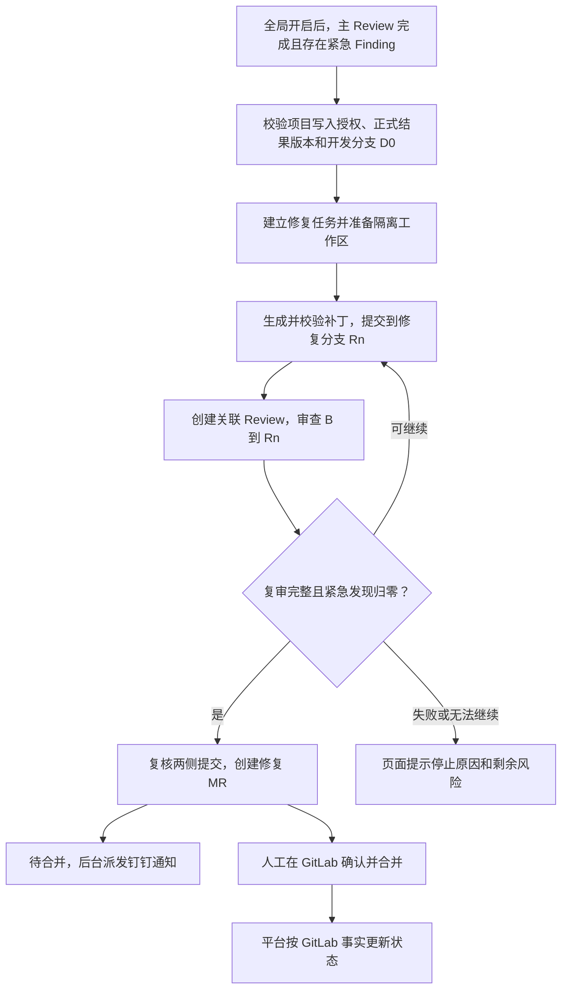

# Review 自动修复与复审闭环实施计划

## 1. 交付边界

P1、P2 和 P3 已完成本地实现及验收。P0 的真实隔离项目核验和 P3 的真实试点待执行，开关默认关闭。试点启用取决于第 7 节列出的访问范围、仓库规则及执行环境核验。

团队成员在「设置 → 全局设置」和试点项目的「Review 触发」中开启「自动修复紧急风险」。此后符合条件的 GitLab MR 正式 Review 完成并发现紧急 Finding，后端自动排队。平台从本次实际审查的开发分支提交创建修复分支，依次生成补丁、写入和复审，最多执行 3 轮。完整复审确认紧急 Finding 归零后，平台创建修复 MR，并通知项目钉钉群「自动修复已完成，等待合并」。人在 GitLab 查看差异、确认并合并，平台回写实际合并结果。三轮后仍有紧急 Finding 时，详情页提示剩余问题。

- 首版限同一 GitLab 项目的 MR，修复范围由各项目的自动修复开关决定。原 MR 为 `feat/order → develop` 时，修复 MR 为 `ai-fix/<runId> → feat/order`。
- 首版按原任务派发时确定的主 Review 正式结果判断，紧急仅指规范化的 `CRITICAL`。单一结果直接用该结果，多模型按派发顺序取第一项，无法证明主结果时在详情页显示未自动修复原因。页面选择其它 Review 标签页只切换查看范围。较低等级的问题仍在轮次结果中展示。
- 首版覆盖可定位到原 diff 内已修改文本文件的紧急 Finding。遇到跨文件且依赖不可编辑文件、文件路径缺失或无法确认修复范围的情况，停下来显示原因。本期范围之外包括 fork MR、Push、未绑定 Git 提交的手工 Review、挑选单条 Finding、平台内合并和自动修改 CI 或部署配置。

### 1.1 当前可复用的实现

| 环节 | 现状与改动依据 |
| --- | --- |
| 生成补丁 | `code_quality/service.py::_generate_fix_preview` 按 `reviewKey` 和 Finding 从原任务取单文件 diff。`providers.py::_looks_like_unified_diff` 仅检查文本结构。可复用 Provider 请求与 patch 输出，修复任务自行获取最新提交的文件、校验和应用补丁。现有预览接口继续提供逐 Finding 的预览。 |
| 绑定审查提交 | `project_integration/service.py::handle_merge_request_webhook` 保存原 MR 的分支及基线信息。`review_record/service.py::rerun_review_task_in_place` 会刷新原 MR，复审另建关联任务。`agent_review/service.py` 已支持按任务 head 获取只读源码。 |
| GitLab 集成 | `project_integration/gitlab_client.py` 提供 MR、compare 和文件读取。新增 MR 同仓库身份核验、ref 查询、修复分支提交及修复 MR 创建，读写均复用现有 GitLab Token。 |
| 任务运行 | `code_quality_scheduler_jobs` 提供领取、租约和取消相关字段。复用 Review 派发与可用的调度机制，修复步骤由 Backend 所有，现有只读 Review Worker 只做复审。 |
| 完成通知 | `notification/service.py::_send_markdown` 已按项目关联的启用机器人发送并遵循全局钉钉开关。新增修复完成消息，复用选路、发送和任务通知记录。 |
| 页面 | `frontend/src/App.jsx` 中的 `TaskDetail`、`CodeQualityReviewsPanel` 和 `ReviewResultSummary` 提供详情、当前结果作用域和摘要操作区。添加修复运行状态及 Drawer，沿用现有 Review 结果和 Finding 布局。 |

## 2. 提交口径与闭环

| 提交 | 含义 |
| --- | --- |
| `B` | 原 Review 执行时保存的实际 diff 基线。用于原 Review 和所有修复复审的范围对齐。 |
| `D0` | 原 Review 执行时实际读取的开发分支 head，也是修复分支起点和预期合并目标 head。 |
| `R1…Rn` | 修复分支各轮提交。第 1 轮输入为 `D0`，后续每轮以上一轮提交和复审结果为输入。 |

以 `B → Rn` 做正式复审，覆盖原改动和累计修复。用 `D0 → Rn` 展示最终补丁和修复 MR 的差异，用 `R(n-1) → Rn` 展示单轮变化。以上范围由服务端按完整 SHA 解析。必要时从受控 Git 镜像生成完整 diff，GitLab compare 的截断结果仅能作为诊断材料。



### 2.1 启动与继续条件

1. 全局自动修复默认关闭。仅处理本次开启后新完成、由 GitLab Webhook HTTP 入口派发的原 MR 主 Review。内网试点默认允许无 Token 的请求进入自动修复资格判断。设置 `AUTO_FIX_GITLAB_WEBHOOK_TOKEN` 后，只有匹配 Token 的请求可进入该判断。人工重跑和 Token 不匹配的请求仍按原机制审查。全局 AI Review 能力、全局与项目自动修复开关及 GitLab 集成配置均满足时，由系统自动排队。每次启动重新读取原 MR 的状态、源项目、目标项目、源分支和 head。须为开放的同仓库 MR，开发分支、原 MR 的 head 和已审查的 `D0` 一致，且 `B` 可解析并是 `D0` 的祖先。GitLab 读取暂时失败时按第 3.2 节退避。
2. 原结果须为 `SUCCESS` 且至少有一条 `CRITICAL`，能验证 `B`、`D0` 与主结果来自同一次执行。现有 `code_quality_review_results` 按 `task_id + review_key` 存储，重试可能覆盖行，因此在构建执行输入时捕获基线、head 和执行标识，正式结果落库时沿用该执行携带的快照。用执行标识及 Finding 摘要生成结果版本。启动后保存版本、输入的紧急 Finding 及允许改动路径，原任务重跑不改变本次输入。历史结果继续可查看。
3. 生成补丁时把本轮紧急 Finding、修复建议、输入提交的相关源码和 diff 交给已审批的修复 Provider，要求返回 unified diff。后端检查补丁路径、类型、体积和预期文件状态后应用并写入。允许范围以初始证据可验证的现存业务源码为限。禁止路径越界、符号链接、子模块、二进制文件、CI 与部署配置变更。源码及模型建议仅作为输入数据，执行器只运行平台固定的 Git 操作。复审沿用启动时锁定的引擎、模型和 Profile。Agent Review 使用既有只读工具，Standard 使用既有 Provider 请求。配置变化导致无法按原组合执行，或出现降级、跳过、取消、超时、无有效结构化结果时，转为人工处理。
4. 通过条件为复审正式结果成功、实际输入 SHA 与本轮一致、变更文件及主体 diff 无缺失或截断、无影响判定的范围或上下文缺口，并且 `CRITICAL` 计数为 0。空响应、未知严重等级和整体紧急但没有对应 Finding 的结果进入人工处理。页面用「本轮未发现紧急风险」表达模型结论。
5. 复审仍发现紧急问题且可以继续时自动开始下一轮。若上一份结果与本轮复审的紧急问题能全部一对一匹配，或补丁为空、应用失败、剩余问题越出允许范围、达到 3 轮，则停止。匹配按第 2.2 节进行，行号移动本身不算进展，匹配不确定时仍以本轮正式结果和轮次上限作决定。用户取消、关闭任一级自动修复或全局 AI Review 时，停止派发新步骤，并在下一次远端写入前再次检查。核对可能已经发出但结果未知的 GitLab 调用，保留已存在的提交和记录，等待合并的 MR 仍可跟踪。

### 2.2 逐条风险处理结果

第 1 轮比较原正式 Review 与第 1 轮复审；后续比较上一轮与本轮的正式复审。匹配范围包含两份结果的全部等级，避免同一问题升降级时被误记为新增或消失。页面默认展示任一侧为紧急的条目。数据源是绑定对应 SHA 的正式 Finding 与本轮提交差异，补丁 Provider 的说明不参与判定。

现有 `review_feedback/service.py::ai_finding_fingerprint` 包含 Review key、等级、行号分桶和标题，适合定位原反馈对象。跨轮采用以下规则，无需改动反馈指纹，也无需额外调用模型：

1. 先以规范化文件路径与类别收集候选。使用本轮 diff 将旧行范围映射到新提交，再结合归一后的标题或证据确认同一问题。匹配需要双向唯一。首版限制在已有文件内编辑。旧行明确被删除时记录删除差异作为对照证据。差异不足以还原位置，或多条 Finding 共享相同证据时，保留待核对项。
2. 使用结果快照内的 Finding 索引保存命中的双方引用。紧急等级发生变化时展示前后等级。每个 Finding 在同轮最多关联一次，保留无法明确对应的候选供人工核对。
3. 只有本轮复审完整且该问题所在文件具备有效审查证据时，未匹配的旧 Finding 才显示「复审未再发现」。本轮独有且没有合理前序候选的 Finding 显示「本轮新发现」，表示首次出现在本次对照结果。分类和匹配证据仅用于解释与识别无进展，紧急计数和进入等待合并仍以本轮正式复审为准。

| 页面状态 | 判定与证据 |
| --- | --- |
| 仍存在 | 确认是同一问题，展示前后 Finding、等级和本轮差异。`CRITICAL → MAJOR` 显示「仍存在 · 已降级」，与紧急计数分别呈现。 |
| 复审未再发现 | 上轮有该 Finding，本轮完整复审没有对应记录且无可疑候选。显示原 Finding 和本轮差异，供人工确认是否已修复。 |
| 本轮新发现 | 本轮有 Finding，前一份正式结果没有合理对应。显示本轮 Finding 与提交。 |
| 待核对 | 候选多义、证据不足或行范围无法可靠映射。展示候选或缺少的证据。 |
| 待复审／无法判定 | 排队中或执行中显示待复审。失败、取消或关键材料缺失时显示无法判定，沿用最近一次有效结果及轮次。 |

### 2.3 GitLab 写入与人工合并

- 修复执行器使用平台已有的 GitLab Token，写入前核对全局与项目开关。先持久化修复分支名、预期远端 head 和候选提交，再写远端。初次写入要求 ref 尚不存在，后续仅允许从上轮已知 head 快进。提交互相冲突时停止，禁止覆盖现有修复。远端写入前重新核对任务领取代次和取消状态，写入后的远端核对负责处理调用结果未知的情况。
- 复审期间保持修复分支，达到推荐条件后才创建修复 MR。创建前再次确认原 MR 仍开放、开发分支为 `D0`、修复分支为 `Rn`，修复 MR 内注明两个 SHA、原任务和本轮复审链接。以项目、固定修复分支、目标分支和任务标记核对创建结果。重复请求和超时恢复复用已存在的同一 MR。
- 平台二次检查和页面轮询只能提供状态提示。**GitLab 端的合并规则必须挡住未经复审的新内容**。建议试点验证仅允许快进合并、修复分支仅指定身份可写、禁止基于旧结论的自动 rebase 或 squash，并保留项目审批和 CI。目标分支并发新增独立提交时，快进应由 GitLab 拒绝。验收以实际合并所得提交等于已审查 `Rn` 为准。若实例无法保证这一点，停止在本地或隔离仓库验收，待明确约束后再开放合并交接。
- 达标后，后端不再向该修复分支写入。任一 head 变化时平台标为「分支已更新」，隐藏「前往 GitLab 确认」主操作，保留只读 MR 链接和重新审查原 MR 的路径。平台按 GitLab 的 MR 状态区分已合并、已关闭、仍开放。MR 已合并但合并提交偏离 `Rn` 时标记为异常并记录实际提交，单独展示核对结果。
- 人工合并依据是最后一轮完整复审。合并后平台核对实际合入的 SHA，原 MR 后续是否再跑正式 Review 依照其现有触发策略。

## 3. 后端改动与数据

### 3.1 持久化与并发

| 对象 | 字段与写入规则 |
| --- | --- |
| 新增 `code_quality_auto_fix_settings` | 单条开关记录默认关闭。通过平台设置修改，记录更新来源和时间。每次由关到开记录新的开启时间，作为新触发的生效边界和运行继续条件。 |
| `code_quality_review_results` 新增可空审查快照 | 记录执行标识及实际读取的 `baseSha/headSha`。随正式结果同事务写入。历史记录保持可读，缺可信快照的记录不可启动。 |
| 新增 `code_quality_fix_runs` | 主键 `id`，保存原任务、主 Review key 与结果版本、自动触发时间和开关开启时间、原 MR IID、`B/D0`、两条分支、锁定的复审配置、状态与原因、取消时间、修复 MR IID、合并事实和通知投递结果。原任务可重跑覆盖正式结果，因此保留原 Findings 用于修复、匹配和展示的最小字段快照。`(project_id, source_mr_iid, D0)` 唯一，`(project_id, developer_branch, active_slot)` 唯一。有效任务及等待合并的任务持有固定的 `active_slot`，其它终态为 NULL。按来源任务和 Review 查询历史。 |
| 新增 `code_quality_fix_rounds` | `(fix_run_id, round_number)` 唯一，保存输入和候选提交 SHA、远端写入确认、关联复审任务 ID 与 `reviewKey`、复审结果版本、紧急数、校验结果和起止时间。每轮保存逐条处理结果及前后 Finding 引用。子复审结果不可覆盖，页面从其正式结果按版本读取，diff 通过对应提交读取。 |

迁移采用仓库现有的加法方式并保留 MySQL 5.7 兼容。同一 MR 的同一开发分支 SHA 最多启动一次，重复完成事件、重跑相同 SHA 和后台重试复用已有修复记录。另一运行占用同一开发分支时，在原 Review 显示占用原因和关联运行。修复终止后，下一次自动触发须有新提交和对应的合格正式 Review。

### 3.2 调度、Review 与 webhook

- 从 Standard 正式结果保存和 Agent 正式结果回填两条路径创建排队中的修复运行。结果与修复运行同事务提交，原 Review 调用直接返回。消费时核对开关开启时间及当前授权，从运行快照读取已冻结的结果版本。恢复沿用运行 ID。子复审和修复分支事件采用各自的链路。
- 修复任务状态按 `QUEUED → RUNNING → AWAITING_APPROVAL → MERGED` 推进。`RUNNING` 下保存准备、生成补丁、提交、复审排队、复审执行、创建 MR 等步骤。停止状态包括 `STOPPED`、`CANCELLED`、`STALE` 和 `MR_CLOSED`。示例原因码包括 `ROUND_LIMIT_REACHED`、`NO_PROGRESS`、`REVIEW_INCOMPLETE`、`AUTO_FIX_DISABLED` 和 `BRANCH_CHANGED`。`STALE` 后仍按已登记的 MR 核对外部合并事实。
- Backend 每 5 秒从修复运行表领取到期步骤，使用独立租约和代次令牌。Review Worker 沿用原领取范围和只读权限。网络故障按 10 秒、30 秒有界退避，恢复写入前核对远端状态。模型修复轮次上限与网络重试独立。通过 GitLab API 每 60 秒检查等待人工合并的 MR，避免依赖 webhook 是否送达。
- 为每轮新建关联 Review，新增内部来源 `AUTO_FIX_REVIEW`，派发前保存任务 ID 与输入 SHA，恢复时沿用原任务。补丁生成和 Git 写入占用专用修复消费容量，复审占用对应的现有 Agent 或 Standard Review 队列，等待子复审期间释放修复执行槽。修复和复审共用同一模型账号时共享上游配额。子结果按只读链接打开，修复复审不派发自动预览、自动学习写回、普通钉钉审查通知或新的自动修复运行。
- 在 `project_integration/service.py` 进入普通任务创建前按项目、修复分支名和已登记的提交匹配修复分支 Push 与修复 MR 事件。假冒前缀或来自其它项目的事件采用原有普通链路。待合并的修复 MR 状态由定期读取 GitLab API 同步。
- 服务恢复时按持久化步骤与远端事实对账。候选提交已写入但本地未确认时，核对远端 SHA 后接续复审。远端返回其它 SHA 时标记分支已变更。任务进入终态后保留分支和 MR 记录，清理本地临时工作区。日志记录运行 ID、轮次、步骤、关联任务和停止原因，凭据和源码原文留在原有受控链路内。

### 3.3 新增页面契约草案

| 方法与路径 | 契约 |
| --- | --- |
| `GET /api/code-quality-reviews/settings` | 加法返回 `autoFixEnabled`。历史配置默认关闭。 |
| `PUT /api/code-quality-reviews/auto-fix-settings` | 通过平台设置写入 `{ enabled: true }` 或 `{ enabled: false }`，返回新状态。服务端记录更新来源。现有通用 settings 更新接口拒绝写入该开关字段。 |
| `GET /api/review-tasks/{taskId}/auto-fix?reviewKey=…` | 返回所选 Review 的自动修复状态、未启动原因、紧急数和最近运行摘要。用于从原页恢复进度。 |
| `GET /api/review-tasks/{taskId}/auto-fix/{runId}` | 返回状态、当前步骤、轮次数量、起点 SHA、两条分支、每轮提交与复审链接、停止原因、GitLab MR 和钉钉投递状态。每次核对 `taskId`、`runId` 属于同一可访问项目。 |
| `GET /api/review-tasks/{taskId}/auto-fix/{runId}/rounds/{roundNumber}/findings` | Drawer 展开时读取该轮对照。每条包含状态、前后结果版本及 Finding 索引、前后等级、最小展示字段和匹配或待核对原因。返回该轮 `inputSha`、`commitSha` 作为差异入口的定位依据。沿用修复详情的任务、项目和运行关联校验。 |
| `POST /api/review-tasks/{taskId}/auto-fix/{runId}/cancel` | 请求取消处于排队或执行中的任务，幂等返回最新状态。待人工确认后，用户在 GitLab 关闭修复 MR。 |

进度示例中第 1 轮已完成，正在审查第 2 轮。页面从已完成的轮次读取紧急数，尚无正式结果的轮次返回 `null`。

```json
{
  "runId": 123,
  "status": "RUNNING",
  "step": "REVIEWING",
  "developerBranch": "feat/order",
  "fixBranch": "ai-fix/123",
  "originalCriticalCount": 3,
  "currentRound": 2,
  "maxRounds": 3,
  "rounds": [
    { "number": 1, "reviewTaskId": 601, "criticalCount": 1 },
    { "number": 2, "reviewTaskId": 602, "criticalCount": null }
  ],
  "reasonCode": null,
  "mergeRequest": null,
  "notificationStatus": null
}
```

### 3.4 钉钉通知

- 最后一轮完整复审的紧急数归零，且修复 MR 创建成功、仍对应已审查提交时，将运行状态置为 `AWAITING_APPROVAL`，同事务持久化一条待发送的修复完成事件。普通 Review 通知继续走既有链路，修复子复审仅在页面展示。
- 后台按原任务所在项目选择已启用的机器人，复用现有钉钉发送边界、全局推送开关及通知记录。发送前确认 MR 仍待合并且两侧提交有效。一个运行对同一机器人只登记一次完成事件，已确认成功的目标不重发。对明确可重试的错误有界重试，响应超时且投递结果无法核实时记录「投递结果未知」，避免盲目重发。
- 卡片标题为「自动修复已完成，等待合并」。内容包括项目与原 MR、修复目标分支、实际轮数和紧急数变化。「最终复审」跳转平台最后一轮正式 Review，「修复 MR」直接跳转 GitLab。3 轮后仍有紧急问题或提前停止时，由任务详情提示结果。
- 全局钉钉关闭、项目缺少机器人、投递失败或 MR 已经关闭或合并时，记录原因供页面显示。通知结果与合并状态分别记录，待合并的修复 MR 可继续在详情页查看。

## 4. 页面布局

### 4.1 全局设置

在「设置 → 全局设置 → 平台全局能力」下新增「自动修复紧急风险」开关，位置在「Standard Review」与「钉钉推送」之间。开关说明「全局与项目开关均开启后，对符合条件的新 MR Review 自动修复紧急风险，最多 3 轮，完成后等待人工合并」。沿用设置的保存中、成功和失败反馈。开关状态以服务端读回为准。AI Review 全局能力关闭时显示当前暂停原因。

### 4.2 任务详情

自动排队后在**原主 Review 结果摘要下方、现有时间轴上方**展示修复状态条。右侧 Drawer 展示修复及复审进度，原 Finding 的「修复预览」继续服务单条问题。切换多模型 Review 标签时按 `reviewKey` 切换查看范围，已打开的修复 Drawer 始终绑定当前运行。用户关闭页面后任务继续执行，重新打开按最新运行恢复显示。

```text
任务详情页头  项目 / 原 MR / 开发分支
Review 选择器  [当前 Review] [其它 Review]

┌ 代码质量 Review 结果 ──────────────────────────────────┐
│ 已完成   紧急 3   高风险 2     摘要、引擎及耗时          │
└────────────────────────────────────────────────────────┘
  自动修复  第 2 / 3 轮 · 复审排队中 · ai-fix/123  [查看进度]
  原 Review 时间轴
  Finding / Diff / 单条修复预览

右侧 Drawer「自动修复」
  状态与分支    ai-fix/123 → feat/order
                起始 1a2b3c4 · 当前 7d8e9f0
  轮次         第 1 轮  紧急 3 → 1  [风险处理详情] [本轮差异] [查看复审]
               第 2 轮  待复审      [查看复审]
  底部操作     执行中 [取消修复] ／ 待确认 [前往 GitLab 确认]
```

| 位置或状态 | 设计与交互 |
| --- | --- |
| 未触发 | 无紧急 Finding 或全局开关关闭时，显示原 Review 结果。有紧急 Finding 但当前项目或结果不具备自动修复条件时，展示具体原因。 |
| 排队或执行中 | 状态条显示「已排队」或当前轮次及步骤，区分「生成补丁」「写入修复分支」「复审排队中」「复审中」。Drawer 默认展开当前轮，每轮显示紧急数变化、提交和本轮差异及正式复审链接。等待复审期间显示「待复审」，有正式结果后按该轮 Finding 展示仍存在或新出现的风险。取消请求期间显示「正在取消」。 |
| 等待合并 | 状态条显示「修复已完成，等待合并」。Drawer 展示紧急数变化、最终修复提交、累计差异、最后一轮正式 Review 和其它等级风险。主操作「前往 GitLab 确认」打开修复 MR。钉钉投递状态放在抽屉中。 |
| 已停止、分支已更新、已取消 | 状态条说明具体原因。第三轮仍有紧急风险时显示「已完成 3 轮，仍有 N 项紧急风险」，链接至第三轮 Finding。若最后一轮复审不可用，明确显示最近一次有效结果及对应轮次。Drawer 保留已有轮次和提交。分支已更新时提供刷新原 MR 审查的路径。 |
| 已合并或已关闭 | 展示 GitLab MR 状态、已知合并时间及提交。已关闭显示对应状态，保留轮次。 |

「风险处理详情」在每个实际执行的轮次内展开。列表显示风险标题、文件位置、前后等级和第 2.2 节的处理状态，提供「原风险」「本轮 Finding」「本轮差异」中当前可用的证据入口。优先显示仍紧急或待核对的问题。首轮的「原风险」从运行快照读取，后续轮回看上一轮结果。三轮用同一布局，最终停止后仍可展开任意轮。窄屏将前后信息纵向排列。

沿用 Ant Design 现有 Switch、Button、Alert、Tag、Drawer 和列表样式。桌面使用约 560 px 的右抽屉，宽度不足时 Drawer 占满视口。窄屏状态条在摘要下换行，分支名过长允许断行，抽屉底部主操作保持可见。状态用文字和图标表达，支持键盘打开、关闭和返回触发按钮。子复审可打开现有任务详情查看完整 Finding。

## 5. 实施阶段与停止点

### P0 · 核验试点前提

- **改动量等级：小。** 聚焦一个试点项目的只读核验及隔离仓库的行为验证。
- **目标与范围**　确认平台仅供内部团队访问、项目写入授权和通知机器人选路，核对 MR API 字段、分支写入规则、合并方式及可用 CI。准备可重复的同仓库 MR 和一组脱敏紧急 Finding 样例。
- **非目标**　发布产品入口、配置生产项目或给现有 Review 凭据增加写权限。
- **验收**　用隔离仓库验证正常快进、审批和 CI 阻断、开发分支并发推进时的拒绝、修复分支保护及跨项目拒绝。核对测试钉钉机器人的目标群和项目映射。记录实例版本、项目配置及可核对证据。
- **授权边界与停止点**　本地与只读核验可先做。隔离 GitLab 的写入和配置另按实际授权执行。合并和授权前提缺证据时可以继续 P1 本地实现，停在 P2 的真实写入及试点开关之前。

### P1 · 后端提交快照、补丁校验与只读复审

- **改动量等级：大。** 涉及正式结果快照迁移、Git 文件校验与 Review 执行输入，需兼容历史结果。
- **目标与范围**　在正式结果保存时记录可信提交。用本地 Git 仓库和受控 Provider 替身验证生成补丁、隔离应用、候选提交及提交绑定复审。补齐判定完整性、三轮上限和停机原因所需的输入。
- **非目标**　真实 GitLab 写入、由正式结果自动触发后台运行、用户侧设置入口。
- **验收**　用 `B → D0 → R1` fixture 验证复审确实读 `R1`，原缺陷、新增紧急问题和原提交的其它紧急问题都纳入判断。覆盖旧结果无快照、diff 截断、空或非法补丁、越界路径、引擎降级、零紧急但上下文不足。对照 MySQL 5.7 迁移语法和历史数据读取。
- **逐条对照验收**　覆盖同一问题随行号移动、同一问题升降级、复审未再发现、新发现、同文件同类多候选及无完整复审。验证仅一对一可信匹配可用于判定无进展，匹配结果不改变正式紧急数。
- **授权边界与停止点**　限本地代码、迁移文件、隔离实例与替身。候选提交和复审判定可独立核验后停在本地闭环。

### P2 · GitLab 修复运行及后端契约

- **改动量等级：大。** 跨数据库、异步任务、公开接口和 GitLab 写入主链路。授权、幂等、派发和 webhook 识别组成一个可安全启用的边界。
- **目标与范围**　落地全局开关、正式 Review 完成触发、修复运行及查询取消接口、项目开关和 GitLab 集成凭据、分支提交、多轮复审、创建修复 MR、合并状态回写和完成通知。默认关闭，先用后端接口和替身验证，再到隔离项目联调。
- **非目标**　提供前端设置界面、在平台内合并、接入 fork 或 Push 来源。
- **验收**　开关默认关闭，内网访问可配置开关，开启后只消费新主 Review 的完成事件。以 `3 → 1 → 0` 验证自动触发、恰好一个修复 MR、每个已配置目标一条成功通知，确认 MR 目标为原开发分支。覆盖重复完成、重跑同 SHA、多结果、子复审不回流、跨任务分支占用、开关关闭后停止写入、进程重启和远端写成功但响应丢失。验证第 3 轮仍有紧急时保留结果并停止，验证无机器人、通知失败和重复回调。人工合并后核对 GitLab 提交及平台状态。
- **逐条对照验收**　验证轮次处理结果幂等保存、跨项目读取被拒绝、原任务重跑后第 1 轮快照仍与启动时一致，以及三轮停止后每轮前后 Finding 和 SHA 都可查。
- **授权边界与停止点**　实现与本地验证可先用替身。外部写入只允许到已授权隔离项目，且 P0 的 GitLab 侧合并约束已验证。验收后保留开关关闭，后端可独立停留。

### P3 · 详情页与单项目试点

- **改动量等级：中。** 复用 P2 契约，在全局设置和详情页接入开关、状态条、Drawer 和跨系统人工交接，并做兼容和窄屏验收。
- **目标与范围**　团队成员可从全局设置开启自动修复，开发者从原 Review 跟踪后台任务和查看 GitLab 合并入口。首先用本地 fixture 做页面验证，再按授权启用一个项目。
- **非目标**　改变现有 Review 结果布局、添加独立修复管理页、扩大试点项目。
- **验收**　用 1440 × 900 和 390 × 844 视口验证开关保存反馈、关闭页面后任务继续、刷新恢复、复审排队与执行区分、多结果切换、风险超限提示和键盘操作。前端 build 通过后，在授权试点项目验证成功路径的钉钉卡片及人工合并，再演练分支变化与主动取消。核对原 Review 和单条修复预览可用。
- **逐条对照验收**　分别展开三轮，检查原风险、本轮 Finding 和差异定位，以及仍存在、未再发现、新发现、待核对和无可用复审的状态。检查钉钉两个链接分别打开平台复审和 GitLab 修复 MR。
- **授权边界与停止点**　页面与本地验收可独立交付。真实环境部署、项目启用和人工合并分别以授权为准。试点链路和回退演练通过后停止，扩大范围另立验收。

## 6. 发布、回退与复现

自动修复设置、进度和取消入口沿用平台现有的内部团队访问边界。能访问平台的团队成员可配置两级开关和查看修复结果。平台记录设置变更来源和时间。

迁移先应用 `V62__auto_fix_review_snapshot.sql` 和 `V63__code_quality_auto_fix_loop.sql`。V62 可识别运行期已创建的同类型可空列，V63 为当前首版的默认关闭设置、运行和轮次表。

| 环境配置 | 试点要求 |
| --- | --- |
| `AUTO_FIX_GITLAB_WEBHOOK_TOKEN` | 可选。示例环境文件中默认注释，空值也会跳过来源校验。启用时在 GitLab 项目 Webhook 的 Secret token 和后端部署环境填写同一值，重新创建 Backend 容器。Backend 比对单个 `X-Gitlab-Token` 请求头。 |
| `GITLAB_TOKEN` | 复用现有 GitLab 集成凭据。项目开启自动修复前，确认该凭据有权推送该项目的修复分支并创建 MR。项目开关决定修复范围。 |
| `AUTO_FIX_GITLAB_POLICY_VERIFIED` | 可选的人工确认标志，省略或留空按 `true` 处理。显式设置 `false` 可暂停修复。运行时仍读取并核对 GitLab 快进、禁止 squash 和 CI 设置。 |
| `AUTO_FIX_PROVIDER_CODE` | 可选。指定生成补丁的 Provider，留空使用平台当前默认 Provider。每次运行记录实际选中的 Provider，复审引擎继续沿用原 Review。 |
| `AUTO_FIX_WORKSPACE_ROOT` | 可选。Backend 专用且可写的 Git 工作目录，默认在 Backend 的 `.local/auto-fix-workspaces`。Compose 使用持久挂载。 |

Docker Compose 两种后端部署入口均透传试点配置，使用 `AUTO_FIX_WORKSPACE_HOST_DIR` 指定 Backend 独占的宿主目录。修复工作区与凭据只挂载或注入 Backend，Review Worker 继续使用原只读挂载。试点将 Backend 限制为一个修复执行实例，后续扩容需实测工作区跨实例接续。

内网试点沿用现有 Webhook 入口的访问边界。Token 留空时，能访问该入口的一方也可以提交事件，后端仍对项目授权及 MR、提交和差异逐项核验。验收时先确认无 Token 的新 MR 事件可进入自动修复资格判断。日后开启 Token 时，分别核对携带正确 Token、缺失和错误 Token 的普通 Review 均可接收，只有正确 Token 可进入自动修复资格判断。

发布顺序为加法迁移、默认关闭的后端、前端、配置单个授权项目并打开全局与该项目的自动修复开关。迁移缺失、写入凭据缺失或授权入口不可用时，修复功能拒绝接收新任务。先关全局开关以阻止新运行和新的远端写入，待运行在步骤边界退出并保留历史。对已创建的 MR 先核对两侧提交和 CI，由有权限的人在 GitLab 关闭或处理，再撤销写入凭据。旧版本回退时保留新增表与审计数据，普通 Review、原 MR 和开发分支继续按既有链路运行。

最小闭环验收使用隔离项目和测试钉钉群。开启两级开关后，创建 `feat/order → develop` 的 MR 并审查 `D0`，预设原结果含 3 条紧急 Finding，每轮复审依次剩 1 条和 0 条。确认任务自动启动并通知「自动修复已完成，等待合并」，点击通知中的链接核对修复 MR 为 `ai-fix/<runId> → feat/order`、`B → R2` 的复审证据与 `D0 → R2` 的累计补丁。人工合并后确认最终提交等于 `R2`。另外验证 3 轮仍有紧急时仅在页面提示，以及在等待合并时推进 `feat/order`，GitLab 拒绝旧结论提交的合并且页面显示过期。

## 7. 待确认事项

| 事项 | 需要确认的内容 | 缺少确认时的边界 |
| --- | --- | --- |
| 试点项目与访问范围 | 哪个隔离项目用于验证，哪个项目用于真实试点。核对内部团队访问范围、项目开关和 GitLab Token 的实际写入权限。 | 先做本地闭环与页面 fixture，外部写入开关保持关闭。 |
| GitLab 合并约束 | 试点能否使用仅快进合并、受保护修复分支、审批和 CI。验证目标分支并发更新和最终提交约束。 | 无法证明时暂停人工合并交接。若需额外 GitLab 门禁，补设计及验收。 |
| 隔离环境与模型 | 哪个修复 Provider 可读取试点源码，执行器工作区、资源上限及样例数据来源。 | 采用本地 Git 和脱敏替身，真实修复效果与容量暂不作承诺。 |
| 钉钉目标 | 核对测试机器人、试点项目关联的启用机器人和全局钉钉状态。 | 用本地消息替身验收，实际投递待对应环境授权。 |

设计按「全局开启后自动触发、最多 3 轮、只处理 `CRITICAL`、同仓库 MR、钉钉通知等待合并、GitLab 人工合并」推进。若需要平台内合并或调整范围，再单独明确授权与验收边界。

## 8. 本地实施与验收记录

- P1 使用本地 Git 仓库验证补丁应用、禁止越界与二进制编辑、提交绑定与完整差异，验证逐条 Finding 的仍存在、降级、新发现和待核对。Standard 和 Agent 各用隔离 SQLite 与替身验证按提交派发、子任务幂等及普通通知抑制。
- P2 用实际本地 Git 提交、隔离 SQLite 和 GitLab、模型、钉钉替身，核验 `3 → 1 → 0` 后仅创建一次修复 MR、产生完成通知并同步人工合并事实。另核验推送成功但响应丢失后接续、第三轮有剩余风险时停止、管理权限及跨项目读取隔离、钉钉未知回执避免重发。
- P3 前端构建和 Chrome 合成响应验收通过。1440 × 900 验证等待合并与两个链接去向，390 × 844 验证三轮停止提示与逐轮风险详情。变更范围 Ruff 和 Git 差异检查通过。未运行单元测试。
- Agent 分页 diff 的现有执行证据无法证明完整覆盖，首版将其标为复审不完整。涉及敏感路径排除、材料截断和配置变化的结果按相同门槛处理。真实 GitLab 防并发合并行为、MySQL 5.7 实际迁移、真实模型效果和钉钉发送待试点确认。

## 9. 项目级开关与版本说明

- **改动量等级：大。** 现有全局开关继续默认关闭，新增项目配置字段、MySQL 迁移和写入前校验，涉及后台写入主链路及设置页面。
- **目标与范围**　团队成员在「设置 → 全局设置」维护全局开关，在「设置 → 项目 / 端类型配置 → 项目配置 → Review 触发」维护项目开关。项目设置默认关闭，存于 `project_review_settings.auto_fix_enabled`。现有项目配置及 Review 设置 API 增量支持 `autoFixEnabled`，修改该字段沿用现有内部平台访问方式。项目开关决定修复范围，复用平台已有的 GitLab Token。开关旁提示先核对项目写入权限。任一级关闭会阻止新任务和运行中任务的后续步骤，已创建的修复 MR 继续跟踪。版本页说明两级开关、逐轮复审和人工合并。
- **非目标**　调整修复预览、触发来源、写入凭据、轮次上限或合并规则。
- **验收**　核对新旧项目默认关闭，旧客户端省略字段时可正常保存，内网请求无需身份头即可保存。用本地数据验证两级开关组合、运行中关闭项目开关、保存后读回和版本说明，执行前端构建。
- **授权边界与停止点**　限本地改动与验收。部署时应用 V65，随后打开全局与试点项目两个开关。回退时先关闭全局开关，保留新增列。
- **实施与验收记录（2026-11-24）**　项目开关已接入综合配置与 Review 设置，版本页新增 v1.4.0 说明。以隔离 SQLite 数据和本地 HTTP 请求核对默认值、管理员权限、旧客户端保存、迁移前读取、两级开关组合及运行中关闭项目开关。Ruff、差异检查和前端生产构建通过。未运行单元测试或应用真实数据库迁移。
